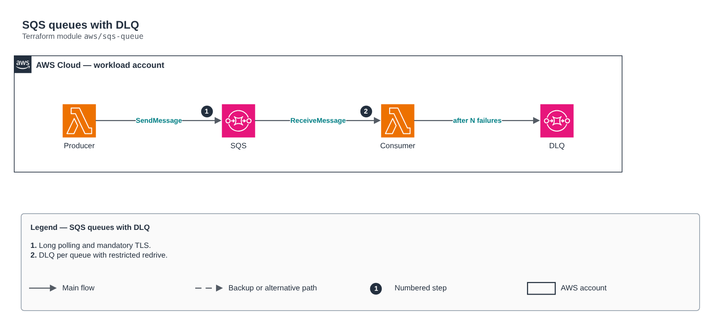

# SQS queues with DLQ

[Português](README.md) · **English**

> `aws/sqs-queue` · category **integracao** · origin: Health insurer on AWS (2024)

> Designed in May 2024. With no time to keep the repository up to date back then, it is being published and updated now.

Encrypted SQS queues (standard or FIFO), with an optional DLQ per queue, long polling and a redrive policy restricted to the source queue.

## Architecture



Editable source: [`diagram.drawio`](diagram.drawio) (open it in draw.io / diagrams.net), with Portuguese and English pages.

1. Long polling and mandatory TLS.
2. DLQ per queue with restricted redrive.

## Usage

```hcl
module "sqs_queue" {
  source = "git::https://github.com/raphaelfcs/automacao_terraform.git//aws/sqs-queue?ref=v1.0.0"

  name_prefix = "demo-dev-"
  queues      = ["pedidos", "notificacoes"]
  tags        = local.tags
}
```

## Examples

| Example | Files |
|---|---|
| [`standard`](examples/standard) | `main.tf`, `locals.tf`, `backend.tf` |
| [`fifo`](examples/fifo) | `main.tf`, `locals.tf`, `backend.tf` |

Each example has its own backend (state isolated per module and example). Different environments only use another `backend.tf`/`*.tfvars`, without duplicating code.

## Inputs

| Name | Type | Default | Required | Description |
|---|---|---|---|---|
| `name_prefix` | `string` | `""` | no | Queue name prefix. |
| `queues` | `list(string)` | - | **yes** | Queue names. |
| `fifo` | `bool` | `false` | no | Creates FIFO queues. |
| `enable_dead_letter` | `bool` | `true` | no | Creates one DLQ per queue. |
| `max_receive_count` | `number` | `5` | no | Deliveries before moving to the DLQ. |
| `kms_key_arn` | `string` | `null` | no | KMS key. null = SQS-managed SSE. |
| `visibility_timeout_seconds` | `number` | `30` | no | Visibility timeout (>= consumer Lambda timeout x 6 is the recommendation). |
| `message_retention_seconds` | `number` | `345600` | no | Message retention. |
| `max_message_size` | `number` | `262144` | no | Maximum message size in bytes. |
| `delay_seconds` | `number` | `0` | no | Delivery delay. |
| `receive_wait_time_seconds` | `number` | `20` | no | Long polling (20 reduces empty calls and cost). |
| `allowed_source_arns` | `list(string)` | `[]` | no | ARNs of SNS topics / EventBridge rules / buckets allowed to send. |
| `tags` | `map(string)` | `{}` | no | Tags applied. |

## Outputs

| Name | Description |
|---|---|
| `queue_urls` | Name -> URL map. |
| `queue_arns` | Name -> ARN map. |
| `dlq_arns` | Name -> DLQ ARN map. |

## Files

- `iam.tf`: policies, roles and permissions
- `main.tf`: main resources
- `outputs.tf`: outputs
- `variables.tf`: inputs and validations
- `versions.tf`: Terraform and provider versions
- `examples/`: ready-to-use compositions
- `tests/`: `terraform test` with mocked providers

## Well-Architected

- Reliability: dead-letter queues (DLQ), retries and event archiving.
- Security: resource policies restricted by source and message encryption.

## Tests

```bash
cd aws/sqs-queue
terraform init -backend=false
terraform test
```
