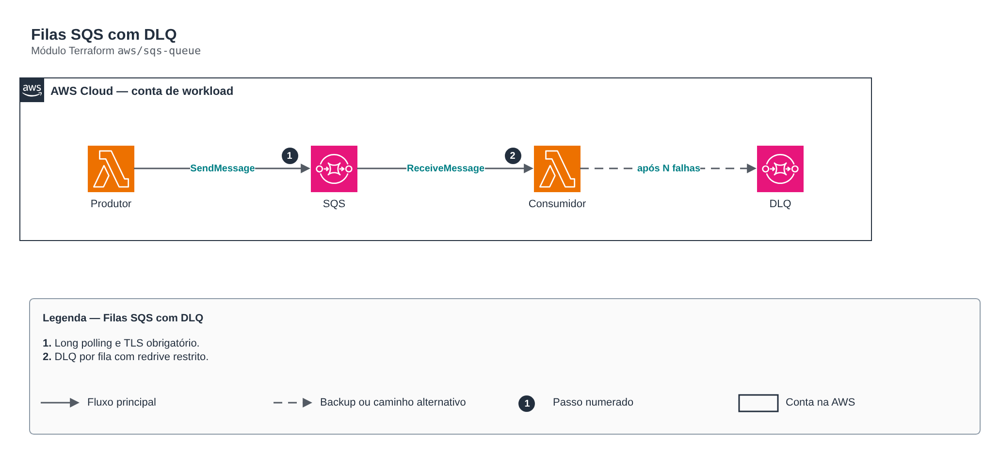

# Filas SQS com DLQ

> `aws/sqs-queue` · categoria **integracao** · origem: Operadora de saúde em AWS (2024)

> Idealizado em maio de 2024. Por falta de tempo para manter o repositório em dia na época, está sendo publicado e atualizado agora.

Filas SQS (standard ou FIFO) cifradas, com DLQ opcional por fila, long polling e política de redrive restrita à fila de origem.

## Arquitetura



Fonte editável: [`diagram.drawio`](diagram.drawio) (abra no draw.io / diagrams.net).

1. Long polling e TLS obrigatório.
2. DLQ por fila com redrive restrito.

## Uso

```hcl
module "sqs_queue" {
  source = "git::https://github.com/raphaelfcs/automacao_terraform.git//aws/sqs-queue?ref=v1.0.0"

  name_prefix = "demo-dev-"
  queues      = ["pedidos", "notificacoes"]
  tags        = local.tags
}
```

## Exemplos

| Exemplo | Arquivos |
|---|---|
| [`standard`](examples/standard) | `main.tf`, `locals.tf`, `backend.tf` |
| [`fifo`](examples/fifo) | `main.tf`, `locals.tf`, `backend.tf` |

Cada exemplo tem seu próprio backend (state isolado por módulo e exemplo). Ambientes diferentes usam apenas outro `backend.tf`/`*.tfvars`, sem duplicar código.

## Entradas

| Nome | Tipo | Padrão | Obrigatória | Descrição |
|---|---|---|---|---|
| `name_prefix` | `string` | `""` | não | Prefixo dos nomes das filas. |
| `queues` | `list(string)` | - | **sim** | Nomes das filas. |
| `fifo` | `bool` | `false` | não | Cria filas FIFO. |
| `enable_dead_letter` | `bool` | `true` | não | Cria uma DLQ por fila. |
| `max_receive_count` | `number` | `5` | não | Entregas antes de mover para a DLQ. |
| `kms_key_arn` | `string` | `null` | não | Chave KMS. null = SSE gerenciada pelo SQS. |
| `visibility_timeout_seconds` | `number` | `30` | não | Timeout de visibilidade (>= timeout do consumidor Lambda x 6 é a recomendação). |
| `message_retention_seconds` | `number` | `345600` | não | Retenção das mensagens. |
| `max_message_size` | `number` | `262144` | não | Tamanho máximo da mensagem em bytes. |
| `delay_seconds` | `number` | `0` | não | Atraso de entrega. |
| `receive_wait_time_seconds` | `number` | `20` | não | Long polling (20 reduz chamadas vazias e custo). |
| `allowed_source_arns` | `list(string)` | `[]` | não | ARNs de tópicos SNS / regras EventBridge / buckets autorizados a enviar. |
| `tags` | `map(string)` | `{}` | não | Tags aplicadas. |

## Saídas

| Nome | Descrição |
|---|---|
| `queue_urls` | Mapa nome -> URL. |
| `queue_arns` | Mapa nome -> ARN. |
| `dlq_arns` | Mapa nome -> ARN da DLQ. |

## Arquivos

- `iam.tf`: políticas, papéis e permissões
- `main.tf`: recursos principais
- `outputs.tf`: saídas
- `variables.tf`: entradas e validações
- `versions.tf`: versões do Terraform e providers
- `examples/`: composições prontas para uso
- `tests/`: `terraform test` com providers simulados

## Well-Architected

- Confiabilidade: filas de mensagens mortas (DLQ), retentativas e arquivamento de eventos.
- Segurança: políticas de recurso restritas por origem e cifragem das mensagens.

## Testes

```bash
cd aws/sqs-queue
terraform init -backend=false
terraform test
```
