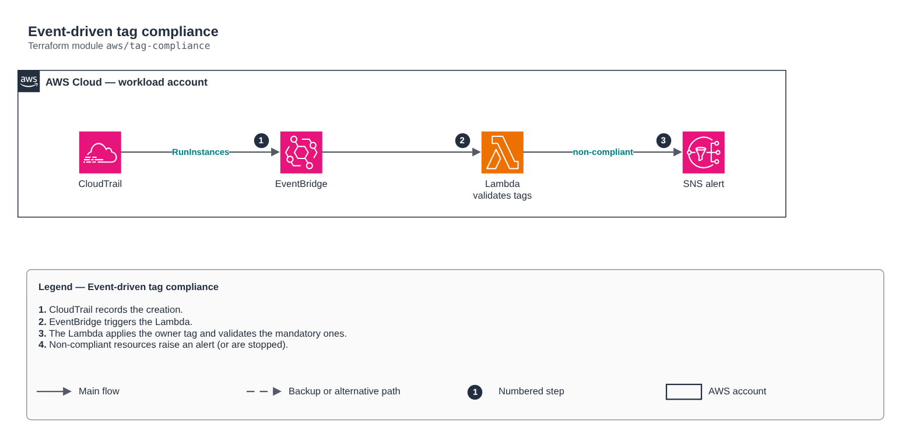

# Event-driven tag compliance

[Português](README.md) · **English**

> `aws/tag-compliance` · category **automacao** · origin: Retail, migration to AWS (2017-2018)

> Designed in March 2019. With no time to keep the repository up to date back then, it is being published and updated now.

Event-driven tag compliance: CloudTrail -> EventBridge -> Lambda. Terraform redesign of the old boto3 automations (EC2 autotag, tag validation, stopping untagged RDS) with least privilege, logs with retention and SNS alerts.

## Architecture



Editable source: [`diagram.drawio`](diagram.drawio) (open it in draw.io / diagrams.net), with Portuguese and English pages.

1. CloudTrail records the creation.
2. EventBridge triggers the Lambda.
3. The Lambda applies the owner tag and validates the mandatory ones.
4. Non-compliant resources raise an alert (or are stopped).

## Usage

```hcl
module "tag_compliance" {
  source = "git::https://github.com/raphaelfcs/automacao_terraform.git//aws/tag-compliance?ref=v1.0.0"

  name_prefix     = local.name_prefix
  required_tags   = ["CentroCusto", "Ambiente", "Dono"]
  alert_topic_arn = "arn:aws:sns:sa-east-1:123456789012:demo-dev-alertas"
  tags            = local.tags
}
```

## Examples

| Example | Files |
|---|---|
| [`basico`](examples/basico) | `main.tf`, `locals.tf`, `backend.tf` |

Each example has its own backend (state isolated per module and example). Different environments only use another `backend.tf`/`*.tfvars`, without duplicating code.

## Inputs

| Name | Type | Default | Required | Description |
|---|---|---|---|---|
| `name_prefix` | `string` | - | **yes** | Resource prefix. |
| `required_tags` | `list(string)` | `["CentroCusto", "Ambiente", "Dono"]` | no | Mandatory tags. |
| `owner_tag` | `string` | `"CriadoPor"` | no | Tag automatically filled with who created the resource. |
| `enforce` | `bool` | `false` | no | true = stops non-compliant EC2 instances; false = only notifies. |
| `alert_topic_arn` | `string` | - | **yes** | Alert SNS topic (sns-topic module). |
| `kms_key_arn` | `string` | `null` | no | KMS key for the log group and function variables. |
| `tags` | `map(string)` | `{}` | no | Tags applied. |

## Outputs

| Name | Description |
|---|---|
| `function_arn` | Compliance function ARN. |

## Files

- `iam.tf`: policies, roles and permissions
- `main.tf`: main resources
- `outputs.tf`: outputs
- `variables.tf`: inputs and validations
- `versions.tf`: Terraform and provider versions
- `src/`: supporting files (code, templates or policies)
- `examples/`: ready-to-use compositions
- `tests/`: `terraform test` with mocked providers

## Well-Architected

- Operational excellence: manual routine replaced by a managed service or a least-privilege function.
- Cost optimization: on-demand/scheduled execution, no servers running.

## Tests

```bash
cd aws/tag-compliance
terraform init -backend=false
terraform test
```
