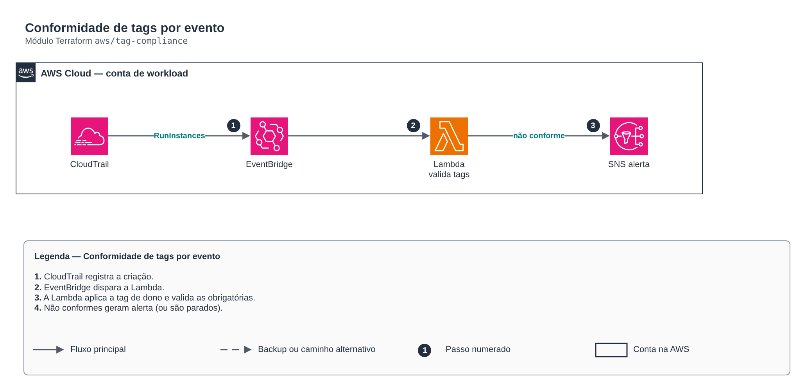

# Conformidade de tags por evento

> `aws/tag-compliance` · categoria **automacao** · origem: Varejo, migração para AWS (2017-2018)

> Idealizado em março de 2019. Por falta de tempo para manter o repositório em dia na época, está sendo publicado e atualizado agora.

Conformidade de tags orientada a eventos: CloudTrail -> EventBridge -> Lambda. Redesenho em Terraform das antigas automações boto3 (autotag de EC2, validação de tags, parada de RDS sem tag) com permissões mínimas, logs com retenção e alerta por SNS.

## Arquitetura



Fonte editável: [`diagram.drawio`](diagram.drawio) (abra no draw.io / diagrams.net).

1. CloudTrail registra a criação.
2. EventBridge dispara a Lambda.
3. A Lambda aplica a tag de dono e valida as obrigatórias.
4. Não conformes geram alerta (ou são parados).

## Uso

```hcl
module "tag_compliance" {
  source = "git::https://github.com/raphaelfcs/automacao_terraform.git//aws/tag-compliance?ref=v1.0.0"

  name_prefix     = local.name_prefix
  required_tags   = ["CentroCusto", "Ambiente", "Dono"]
  alert_topic_arn = "arn:aws:sns:sa-east-1:123456789012:demo-dev-alertas"
  tags            = local.tags
}
```

## Exemplos

| Exemplo | Arquivos |
|---|---|
| [`basico`](examples/basico) | `main.tf`, `locals.tf`, `backend.tf` |

Cada exemplo tem seu próprio backend (state isolado por módulo e exemplo). Ambientes diferentes usam apenas outro `backend.tf`/`*.tfvars`, sem duplicar código.

## Entradas

| Nome | Tipo | Padrão | Obrigatória | Descrição |
|---|---|---|---|---|
| `name_prefix` | `string` | - | **sim** | Prefixo dos recursos. |
| `required_tags` | `list(string)` | `["CentroCusto", "Ambiente", "Dono"]` | não | Tags obrigatórias. |
| `owner_tag` | `string` | `"CriadoPor"` | não | Tag preenchida automaticamente com quem criou o recurso. |
| `enforce` | `bool` | `false` | não | true = para instâncias EC2 não conformes; false = só notifica. |
| `alert_topic_arn` | `string` | - | **sim** | Tópico SNS dos alertas (módulo sns-topic). |
| `kms_key_arn` | `string` | `null` | não | Chave KMS do log group e das variáveis da função. |
| `tags` | `map(string)` | `{}` | não | Tags aplicadas. |

## Saídas

| Nome | Descrição |
|---|---|
| `function_arn` | ARN da função de conformidade. |

## Arquivos

- `iam.tf`: políticas, papéis e permissões
- `main.tf`: recursos principais
- `outputs.tf`: saídas
- `variables.tf`: entradas e validações
- `versions.tf`: versões do Terraform e providers
- `src/`: arquivos auxiliares (código, templates ou políticas)
- `examples/`: composições prontas para uso
- `tests/`: `terraform test` com providers simulados

## Well-Architected

- Excelência operacional: rotina manual substituída por serviço gerenciado ou função com permissões mínimas.
- Otimização de custos: execução sob demanda/agendada, sem servidores ligados.

## Testes

```bash
cd aws/tag-compliance
terraform init -backend=false
terraform test
```
