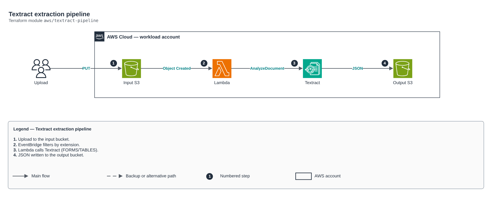

# Textract extraction pipeline

[Português](README.md) · **English**

> `aws/textract-pipeline` · category **automacao** · origin: Health insurer on AWS (2024)

> Designed in July 2024. With no time to keep the repository up to date back then, it is being published and updated now.

Document extraction pipeline (intelligent OCR): upload to the input bucket -> EventBridge (S3 notification) -> Lambda -> Textract (FORMS/TABLES) -> JSON in the output bucket. Redesign of an old Lambda with encrypted buckets and least privilege.

## Architecture



Editable source: [`diagram.drawio`](diagram.drawio) (open it in draw.io / diagrams.net), with Portuguese and English pages.

1. Upload to the input bucket.
2. EventBridge filters by extension.
3. Lambda calls Textract (FORMS/TABLES).
4. JSON written to the output bucket.

## Usage

```hcl
module "textract_pipeline" {
  source = "git::https://github.com/raphaelfcs/automacao_terraform.git//aws/textract-pipeline?ref=v1.0.0"

  name_prefix = "demo-dev-ocr"
  kms_key_arn = "arn:aws:kms:sa-east-1:123456789012:key/11111111-2222-3333-4444-555555555555"
  tags        = local.tags
}
```

## Examples

| Example | Files |
|---|---|
| [`basico`](examples/basico) | `main.tf`, `locals.tf`, `backend.tf` |

Each example has its own backend (state isolated per module and example). Different environments only use another `backend.tf`/`*.tfvars`, without duplicating code.

## Inputs

| Name | Type | Default | Required | Description |
|---|---|---|---|---|
| `name_prefix` | `string` | - | **yes** | Resource prefix (builds bucket names; must be globally unique). |
| `features` | `list(string)` | `["FORMS", "TABLES"]` | no | Textract features: FORMS, TABLES, SIGNATURES, LAYOUT. |
| `accepted_suffixes` | `list(string)` | `[".pdf", ".png", ".jpg", ".jpeg", ".t...` | no | Processed extensions. |
| `input_retention_days` | `number` | `30` | no | Days until input documents are deleted (personal data: minimum retention). |
| `kms_key_arn` | `string` | `null` | no | KMS key for the buckets and the function. |
| `tags` | `map(string)` | `{}` | no | Tags applied. |

## Outputs

| Name | Description |
|---|---|
| `input_bucket` | Input bucket. |
| `output_bucket` | Bucket with the extracted JSONs. |
| `function_arn` | Function ARN. |

## Files

- `iam.tf`: policies, roles and permissions
- `main.tf`: main resources
- `outputs.tf`: outputs
- `variables.tf`: inputs and validations
- `versions.tf`: Terraform and provider versions
- `src/`: supporting files (code, templates or policies)
- `examples/`: ready-to-use compositions
- `tests/`: `terraform test` with mocked providers

## Well-Architected

- Operational excellence: manual routine replaced by a managed service or a least-privilege function.
- Cost optimization: on-demand/scheduled execution, no servers running.

## Tests

```bash
cd aws/textract-pipeline
terraform init -backend=false
terraform test
```
