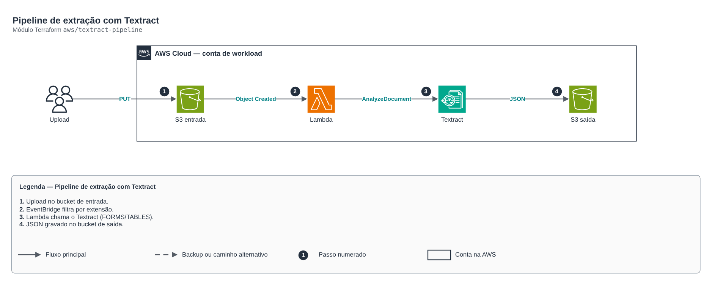

# Pipeline de extração com Textract

**Português** · [English](README.en.md)

> `aws/textract-pipeline` · categoria **automacao** · origem: Operadora de saúde em AWS (2024)

> Idealizado em julho de 2024. Por falta de tempo para manter o repositório em dia na época, está sendo publicado e atualizado agora.

Pipeline de extração de documentos (OCR inteligente): upload no bucket de entrada -> EventBridge (notificação S3) -> Lambda -> Textract (FORMS/TABLES) -> JSON no bucket de saída. Redesenho da Lambda lambda_textract_s3 com buckets cifrados e permissões mínimas.

## Arquitetura



Fonte editável: [`diagram.drawio`](diagram.drawio) (abra no draw.io / diagrams.net), com páginas em português e inglês.

1. Upload no bucket de entrada.
2. EventBridge filtra por extensão.
3. Lambda chama o Textract (FORMS/TABLES).
4. JSON gravado no bucket de saída.

## Uso

```hcl
module "textract_pipeline" {
  source = "git::https://github.com/raphaelfcs/automacao_terraform.git//aws/textract-pipeline?ref=v1.0.0"

  name_prefix = "demo-dev-ocr"
  kms_key_arn = "arn:aws:kms:sa-east-1:123456789012:key/11111111-2222-3333-4444-555555555555"
  tags        = local.tags
}
```

## Exemplos

| Exemplo | Arquivos |
|---|---|
| [`basico`](examples/basico) | `main.tf`, `locals.tf`, `backend.tf` |

Cada exemplo tem seu próprio backend (state isolado por módulo e exemplo). Ambientes diferentes usam apenas outro `backend.tf`/`*.tfvars`, sem duplicar código.

## Entradas

| Nome | Tipo | Padrão | Obrigatória | Descrição |
|---|---|---|---|---|
| `name_prefix` | `string` | - | **sim** | Prefixo dos recursos (compõe os nomes dos buckets; precisa ser globalmente único). |
| `features` | `list(string)` | `["FORMS", "TABLES"]` | não | Recursos do Textract: FORMS, TABLES, SIGNATURES, LAYOUT. |
| `accepted_suffixes` | `list(string)` | `[".pdf", ".png", ".jpg", ".jpeg", ".t...` | não | Extensões processadas. |
| `input_retention_days` | `number` | `30` | não | Dias até apagar os documentos de entrada (dados pessoais: retenção mínima). |
| `kms_key_arn` | `string` | `null` | não | Chave KMS dos buckets e da função. |
| `tags` | `map(string)` | `{}` | não | Tags aplicadas. |

## Saídas

| Nome | Descrição |
|---|---|
| `input_bucket` | Bucket de entrada. |
| `output_bucket` | Bucket com os JSONs extraídos. |
| `function_arn` | ARN da função. |

## Arquivos

- `iam.tf`: políticas, papéis e permissões
- `main.tf`: recursos principais
- `outputs.tf`: saídas
- `variables.tf`: entradas e validações
- `versions.tf`: versões do Terraform e providers
- `src/`: arquivos auxiliares (código, templates ou políticas)
- `examples/`: composições prontas para uso
- `tests/`: `terraform test` com providers simulados

## Well-Architected

- Excelência operacional: rotina manual substituída por serviço gerenciado ou função com permissões mínimas.
- Otimização de custos: execução sob demanda/agendada, sem servidores ligados.

## Testes

```bash
cd aws/textract-pipeline
terraform init -backend=false
terraform test
```
