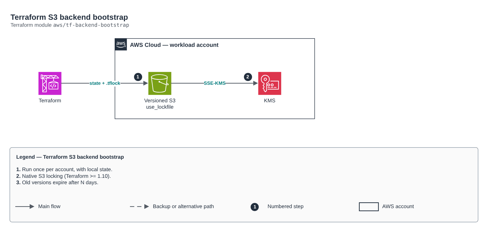

# Terraform S3 backend bootstrap

[Português](README.md) · **English**

> `aws/tf-backend-bootstrap` · category **devops** · origin: Telecom microservices platform (2026)

> Designed in October 2026 and published now.

Terraform remote backend bootstrap: versioned, KMS-encrypted, private S3 bucket with mandatory TLS and destroy protection. Locking uses the native S3 lockfile (Terraform >= 1.10, use_lockfile = true); the DynamoDB table is optional (legacy). This is the only stack with LOCAL state: run it once per account.

## Architecture



Editable source: [`diagram.drawio`](diagram.drawio) (open it in draw.io / diagrams.net), with Portuguese and English pages.

1. Run once per account, with local state.
2. Native S3 locking (Terraform >= 1.10).
3. Old versions expire after N days.

## Usage

```hcl
module "tf_backend_bootstrap" {
  source = "git::https://github.com/raphaelfcs/automacao_terraform.git//aws/tf-backend-bootstrap?ref=v1.0.0"

  bucket_name = "demo-tfstate-123456789012"
  tags        = local.tags
}
```

## Examples

| Example | Files |
|---|---|
| [`basico`](examples/basico) | `main.tf`, `locals.tf`, `backend.tf` |

Each example has its own backend (state isolated per module and example). Different environments only use another `backend.tf`/`*.tfvars`, without duplicating code.

## Inputs

| Name | Type | Default | Required | Description |
|---|---|---|---|---|
| `bucket_name` | `string` | - | **yes** | State bucket name (e.g. <org>-tfstate-<account>). |
| `kms_key_arn` | `string` | `null` | no | Bucket KMS key. null = managed aws/s3 key. |
| `noncurrent_version_days` | `number` | `90` | no | Retention days for old state versions. |
| `create_dynamodb_lock_table` | `bool` | `false` | no | Creates a DynamoDB lock table (only for Terraform < 1.10). |
| `tags` | `map(string)` | `{}` | no | Tags applied. |

## Outputs

| Name | Description |
|---|---|
| `state_bucket_name` | State bucket (use it in the stacks backend.tf). |
| `state_bucket_arn` | Bucket ARN (for CI role policies). |
| `lock_table_name` | Lock table (null when disabled). |
| `backend_snippet` | Ready-to-use backend.tf snippet for the stacks. |

## Files

- `iam.tf`: policies, roles and permissions
- `main.tf`: main resources
- `outputs.tf`: outputs
- `variables.tf`: inputs and validations
- `versions.tf`: Terraform and provider versions
- `examples/`: ready-to-use compositions
- `tests/`: `terraform test` with mocked providers

## Well-Architected

- Operational excellence: GitOps, the desired state lives in Git and is reconciled continuously.
- Security: repository credentials kept out of the code.

## Tests

```bash
cd aws/tf-backend-bootstrap
terraform init -backend=false
terraform test
```
