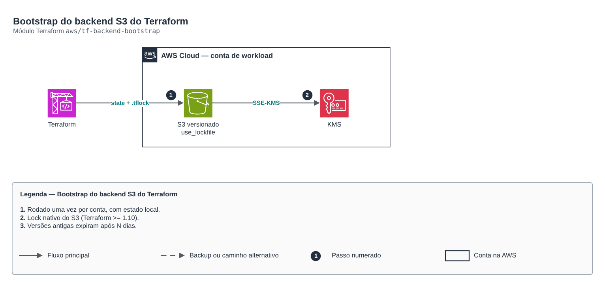

# Bootstrap do backend S3 do Terraform

**Português** · [English](README.en.md)

> `aws/tf-backend-bootstrap` · categoria **devops** · origem: Plataforma de microsserviços em telecom (2026)

> Idealizado em outubro de 2026 e publicado agora.

Bootstrap do backend remoto do Terraform: bucket S3 versionado, cifrado (KMS), privado, com TLS obrigatório e proteção contra destruição. O lock usa o lockfile nativo do S3 (Terraform >= 1.10, use_lockfile = true); a tabela DynamoDB é opcional (legado). Este é o único stack com estado LOCAL: rode uma vez por conta e versione o output.

## Arquitetura



Fonte editável: [`diagram.drawio`](diagram.drawio) (abra no draw.io / diagrams.net), com páginas em português e inglês.

1. Rodado uma vez por conta, com estado local.
2. Lock nativo do S3 (Terraform >= 1.10).
3. Versões antigas expiram após N dias.

## Uso

```hcl
module "tf_backend_bootstrap" {
  source = "git::https://github.com/raphaelfcs/automacao_terraform.git//aws/tf-backend-bootstrap?ref=v1.0.0"

  bucket_name = "demo-tfstate-123456789012"
  tags        = local.tags
}
```

## Exemplos

| Exemplo | Arquivos |
|---|---|
| [`basico`](examples/basico) | `main.tf`, `locals.tf`, `backend.tf` |

Cada exemplo tem seu próprio backend (state isolado por módulo e exemplo). Ambientes diferentes usam apenas outro `backend.tf`/`*.tfvars`, sem duplicar código.

## Entradas

| Nome | Tipo | Padrão | Obrigatória | Descrição |
|---|---|---|---|---|
| `bucket_name` | `string` | - | **sim** | Nome do bucket de estado (ex.: <org>-tfstate-<conta>). |
| `kms_key_arn` | `string` | `null` | não | Chave KMS do bucket. null = chave gerenciada aws/s3. |
| `noncurrent_version_days` | `number` | `90` | não | Dias de retenção das versões antigas do state. |
| `create_dynamodb_lock_table` | `bool` | `false` | não | Cria tabela DynamoDB de lock (só para Terraform < 1.10). |
| `tags` | `map(string)` | `{}` | não | Tags aplicadas. |

## Saídas

| Nome | Descrição |
|---|---|
| `state_bucket_name` | Bucket de estado (use no backend.tf dos stacks). |
| `state_bucket_arn` | ARN do bucket (para políticas das roles de CI). |
| `lock_table_name` | Tabela de lock (null quando desligada). |
| `backend_snippet` | Trecho de backend.tf pronto para os stacks. |

## Arquivos

- `iam.tf`: políticas, papéis e permissões
- `main.tf`: recursos principais
- `outputs.tf`: saídas
- `variables.tf`: entradas e validações
- `versions.tf`: versões do Terraform e providers
- `examples/`: composições prontas para uso
- `tests/`: `terraform test` com providers simulados

## Well-Architected

- Excelência operacional: GitOps, o estado desejado vive no Git e é reconciliado continuamente.
- Segurança: credenciais do repositório fora do código.

## Testes

```bash
cd aws/tf-backend-bootstrap
terraform init -backend=false
terraform test
```
