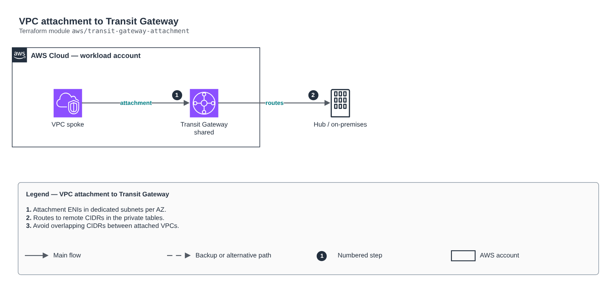

# VPC attachment to Transit Gateway

[Português](README.md) · **English**

> `aws/transit-gateway-attachment` · category **rede** · origin: Telecom microservices platform (2026)

> Designed in October 2026 and published now.

Attaches a VPC to an existing Transit Gateway (own or shared through RAM) and creates, in the VPC private route tables, routes to the remote CIDRs through the TGW. Operational care: if another VPC attached to the same TGW advertises the SAME CIDR, traffic becomes non-deterministic. Plan IPAM first.

## Architecture



Editable source: [`diagram.drawio`](diagram.drawio) (open it in draw.io / diagrams.net), with Portuguese and English pages.

1. Attachment ENIs in dedicated subnets per AZ.
2. Routes to remote CIDRs in the private tables.
3. Avoid overlapping CIDRs between attached VPCs.

## Usage

```hcl
module "transit_gateway_attachment" {
  source = "git::https://github.com/raphaelfcs/automacao_terraform.git//aws/transit-gateway-attachment?ref=v1.0.0"

  name_prefix        = local.name_prefix
  transit_gateway_id = "tgw-0123456789abcdef0"
  vpc_id             = "vpc-0123456789abcdef0"
  subnet_ids         = ["subnet-0aaa1111bbbb2222c", "subnet-0ddd3333eeee4444f"]
  route_table_ids    = ["rtb-0aaa1111bbbb2222c"]
  remote_cidrs       = ["10.0.0.0/8", "172.16.0.0/12"]
  tags               = local.tags
}
```

## Examples

| Example | Files |
|---|---|
| [`spoke`](examples/spoke) | `main.tf`, `locals.tf`, `backend.tf` |

Each example has its own backend (state isolated per module and example). Different environments only use another `backend.tf`/`*.tfvars`, without duplicating code.

## Inputs

| Name | Type | Default | Required | Description |
|---|---|---|---|---|
| `name_prefix` | `string` | - | **yes** | Attachment name prefix. |
| `enabled` | `bool` | `true` | no | Turns on the attachment and routes (lets you turn it off without removing the module). |
| `transit_gateway_id` | `string` | - | **yes** | Transit Gateway ID (created outside this module). |
| `vpc_id` | `string` | - | **yes** | VPC to attach. |
| `subnet_ids` | `list(string)` | - | **yes** | One private subnet per AZ for the attachment ENIs (ideally dedicated /28s). |
| `route_table_ids` | `list(string)` | `[]` | no | VPC route tables that get routes to the remote CIDRs. |
| `remote_cidrs` | `list(string)` | `[]` | no | CIDRs reached through the TGW (other VPCs, on-premises). |
| `appliance_mode` | `bool` | `false` | no | Turns on appliance mode (flow symmetry for inspection firewalls). |
| `default_route_table_association` | `bool` | `true` | no | Associates with the TGW default route table (false when tables are segmented). |
| `default_route_table_propagation` | `bool` | `true` | no | Propagates to the TGW default route table. |
| `tags` | `map(string)` | `{}` | no | Tags applied. |

## Outputs

| Name | Description |
|---|---|
| `attachment_id` | Attachment ID (null when disabled). |
| `route_ids` | Routes created by table-cidr key. |

## Files

- `locals.tf`: derived values
- `main.tf`: main resources
- `outputs.tf`: outputs
- `variables.tf`: inputs and validations
- `versions.tf`: Terraform and provider versions
- `examples/`: ready-to-use compositions
- `tests/`: `terraform test` with mocked providers

## Well-Architected

- Reliability: resources spread across availability zones and no single point of failure for egress.
- Security: isolated subnet tiers, source-based rules and flow logs enabled.

## Tests

```bash
cd aws/transit-gateway-attachment
terraform init -backend=false
terraform test
```
