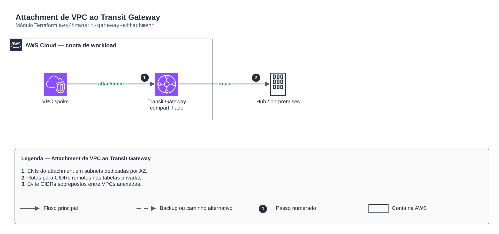

# Attachment de VPC ao Transit Gateway

> `aws/transit-gateway-attachment` · categoria **rede** · origem: Plataforma de microsserviços em telecom (2026)

> Idealizado em outubro de 2026 e publicado agora.

Anexa uma VPC a um Transit Gateway existente (próprio ou compartilhado via RAM) e cria, nas tabelas de rota privadas da VPC, as rotas para os CIDRs remotos via TGW. Cuidado operacional: se outra VPC anexada ao mesmo TGW anunciar o MESMO CIDR, o destino do tráfego fica não determinístico. Planeje o IPAM antes de ligar o attachment.

## Arquitetura



Fonte editável: [`diagram.drawio`](diagram.drawio) (abra no draw.io / diagrams.net).

1. ENIs do attachment em subnets dedicadas por AZ.
2. Rotas para CIDRs remotos nas tabelas privadas.
3. Evite CIDRs sobrepostos entre VPCs anexadas.

## Uso

```hcl
module "transit_gateway_attachment" {
  source = "git::https://github.com/raphaelfcs/automacao_terraform.git//aws/transit-gateway-attachment?ref=v1.0.0"

  name_prefix        = local.name_prefix
  transit_gateway_id = "tgw-0123456789abcdef0"
  vpc_id             = "vpc-0123456789abcdef0"
  subnet_ids         = ["subnet-0aaa1111bbbb2222c", "subnet-0ddd3333eeee4444f"]
  route_table_ids    = ["rtb-0aaa1111bbbb2222c"]
  remote_cidrs       = ["10.0.0.0/8", "172.16.0.0/12"]
  tags               = local.tags
}
```

## Exemplos

| Exemplo | Arquivos |
|---|---|
| [`spoke`](examples/spoke) | `main.tf`, `locals.tf`, `backend.tf` |

Cada exemplo tem seu próprio backend (state isolado por módulo e exemplo). Ambientes diferentes usam apenas outro `backend.tf`/`*.tfvars`, sem duplicar código.

## Entradas

| Nome | Tipo | Padrão | Obrigatória | Descrição |
|---|---|---|---|---|
| `name_prefix` | `string` | - | **sim** | Prefixo do nome do attachment. |
| `enabled` | `bool` | `true` | não | Liga o attachment e as rotas (permite desligar sem remover o módulo). |
| `transit_gateway_id` | `string` | - | **sim** | ID do Transit Gateway (criado fora deste módulo). |
| `vpc_id` | `string` | - | **sim** | VPC a anexar. |
| `subnet_ids` | `list(string)` | - | **sim** | Uma subnet privada por AZ para as ENIs do attachment (de preferência /28 dedicadas). |
| `route_table_ids` | `list(string)` | `[]` | não | Tabelas de rota da VPC que recebem as rotas para os CIDRs remotos. |
| `remote_cidrs` | `list(string)` | `[]` | não | CIDRs alcançados via TGW (outras VPCs, on-premises). |
| `appliance_mode` | `bool` | `false` | não | Liga appliance mode (simetria de fluxo para firewalls de inspeção). |
| `default_route_table_association` | `bool` | `true` | não | Associa à route table padrão do TGW (false quando há tabelas segmentadas). |
| `default_route_table_propagation` | `bool` | `true` | não | Propaga para a route table padrão do TGW. |
| `tags` | `map(string)` | `{}` | não | Tags aplicadas. |

## Saídas

| Nome | Descrição |
|---|---|
| `attachment_id` | ID do attachment (null quando desligado). |
| `route_ids` | Rotas criadas por chave tabela-cidr. |

## Arquivos

- `locals.tf`: valores derivados
- `main.tf`: recursos principais
- `outputs.tf`: saídas
- `variables.tf`: entradas e validações
- `versions.tf`: versões do Terraform e providers
- `examples/`: composições prontas para uso
- `tests/`: `terraform test` com providers simulados

## Well-Architected

- Confiabilidade: recursos distribuídos por zonas de disponibilidade e sem ponto único de falha na saída.
- Segurança: camadas de sub-rede isoladas, regras por origem e logs de fluxo habilitados.

## Testes

```bash
cd aws/transit-gateway-attachment
terraform init -backend=false
terraform test
```
