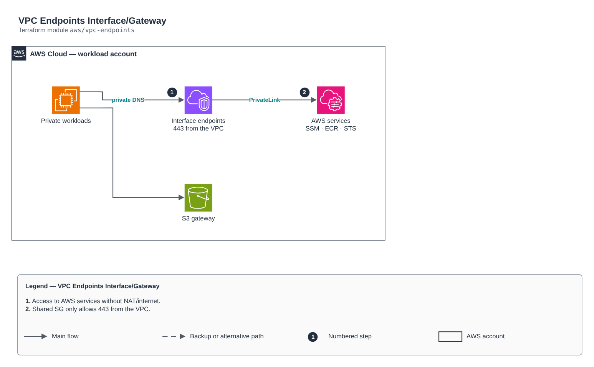

# VPC Endpoints Interface/Gateway

[Português](README.md) · **English**

> `aws/vpc-endpoints` · category **rede** · origin: Health insurer on AWS (2024)

> Designed in September 2024. With no time to keep the repository up to date back then, it is being published and updated now.

VPC Endpoints (Interface and Gateway) for private access to AWS services without NAT/internet (e.g. ssm, ssmmessages, ec2messages, ecr.api, ecr.dkr, logs, sts, secretsmanager, s3). Interface endpoints share an SG that only allows 443 from the VPC.

## Architecture



Editable source: [`diagram.drawio`](diagram.drawio) (open it in draw.io / diagrams.net), with Portuguese and English pages.

1. Access to AWS services without NAT/internet.
2. Shared SG only allows 443 from the VPC.

## Usage

```hcl
module "vpc_endpoints" {
  source = "git::https://github.com/raphaelfcs/automacao_terraform.git//aws/vpc-endpoints?ref=v1.0.0"

  name_prefix        = local.name_prefix
  vpc_id             = "vpc-0123456789abcdef0"
  subnet_ids         = ["subnet-0aaa1111bbbb2222c", "subnet-0ddd3333eeee4444f"]
  route_table_ids    = ["rtb-0aaa1111bbbb2222c"]
  interface_services = ["ssm", "ssmmessages", "ec2messages", "ecr.api", "ecr.dkr", "logs", "sts"]
  tags               = local.tags
}
```

## Examples

| Example | Files |
|---|---|
| [`ssm-ecr`](examples/ssm-ecr) | `main.tf`, `locals.tf`, `backend.tf` |

Each example has its own backend (state isolated per module and example). Different environments only use another `backend.tf`/`*.tfvars`, without duplicating code.

## Inputs

| Name | Type | Default | Required | Description |
|---|---|---|---|---|
| `name_prefix` | `string` | - | **yes** | Name prefix. |
| `vpc_id` | `string` | - | **yes** | Endpoint VPC. |
| `subnet_ids` | `list(string)` | `[]` | no | Private subnets for the Interface endpoints (one per AZ). |
| `route_table_ids` | `list(string)` | `[]` | no | Gateway endpoint route tables (s3, dynamodb). |
| `interface_services` | `list(string)` | `["ssm", "ssmmessages", "ec2messages"]` | no | Interface services (each one costs per hour per AZ — enable only what you need). |
| `gateway_services` | `list(string)` | `["s3"]` | no | Gateway services (free): s3, dynamodb. |
| `allowed_cidrs` | `list(string)` | `[]` | no | Additional allowed CIDRs (e.g. peered/TGW VPCs). |
| `tags` | `map(string)` | `{}` | no | Tags applied. |

## Outputs

| Name | Description |
|---|---|
| `interface_endpoint_ids` | Service -> Interface endpoint ID map. |
| `gateway_endpoint_ids` | Service -> Gateway endpoint ID map. |
| `security_group_id` | Shared SG of the Interface endpoints. |

## Files

- `main.tf`: main resources
- `outputs.tf`: outputs
- `variables.tf`: inputs and validations
- `versions.tf`: Terraform and provider versions
- `examples/`: ready-to-use compositions
- `tests/`: `terraform test` with mocked providers

## Well-Architected

- Reliability: resources spread across availability zones and no single point of failure for egress.
- Security: isolated subnet tiers, source-based rules and flow logs enabled.

## Tests

```bash
cd aws/vpc-endpoints
terraform init -backend=false
terraform test
```
