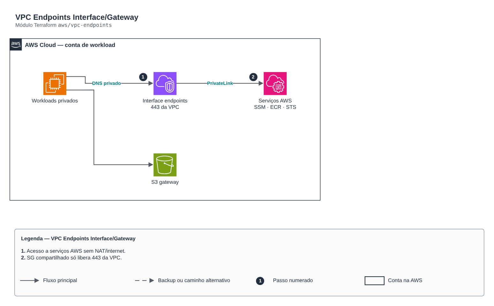

# VPC Endpoints Interface/Gateway

> `aws/vpc-endpoints` · categoria **rede** · origem: Operadora de saúde em AWS (2024)

> Idealizado em setembro de 2024. Por falta de tempo para manter o repositório em dia na época, está sendo publicado e atualizado agora.

VPC Endpoints (Interface e Gateway) para acesso privado a serviços AWS sem NAT/internet (ex.: ssm, ssmmessages, ec2messages, ecr.api, ecr.dkr, logs, sts, secretsmanager, s3). Os Interface endpoints compartilham um SG que libera 443 apenas a partir da VPC.

## Arquitetura



Fonte editável: [`diagram.drawio`](diagram.drawio) (abra no draw.io / diagrams.net).

1. Acesso a serviços AWS sem NAT/internet.
2. SG compartilhado só libera 443 da VPC.

## Uso

```hcl
module "vpc_endpoints" {
  source = "git::https://github.com/raphaelfcs/automacao_terraform.git//aws/vpc-endpoints?ref=v1.0.0"

  name_prefix        = local.name_prefix
  vpc_id             = "vpc-0123456789abcdef0"
  subnet_ids         = ["subnet-0aaa1111bbbb2222c", "subnet-0ddd3333eeee4444f"]
  route_table_ids    = ["rtb-0aaa1111bbbb2222c"]
  interface_services = ["ssm", "ssmmessages", "ec2messages", "ecr.api", "ecr.dkr", "logs", "sts"]
  tags               = local.tags
}
```

## Exemplos

| Exemplo | Arquivos |
|---|---|
| [`ssm-ecr`](examples/ssm-ecr) | `main.tf`, `locals.tf`, `backend.tf` |

Cada exemplo tem seu próprio backend (state isolado por módulo e exemplo). Ambientes diferentes usam apenas outro `backend.tf`/`*.tfvars`, sem duplicar código.

## Entradas

| Nome | Tipo | Padrão | Obrigatória | Descrição |
|---|---|---|---|---|
| `name_prefix` | `string` | - | **sim** | Prefixo dos nomes. |
| `vpc_id` | `string` | - | **sim** | VPC dos endpoints. |
| `subnet_ids` | `list(string)` | `[]` | não | Subnets privadas dos Interface endpoints (uma por AZ). |
| `route_table_ids` | `list(string)` | `[]` | não | Tabelas de rota dos Gateway endpoints (s3, dynamodb). |
| `interface_services` | `list(string)` | `["ssm", "ssmmessages", "ec2messages"]` | não | Serviços Interface (cada um custa por hora por AZ — habilite só o necessário). |
| `gateway_services` | `list(string)` | `["s3"]` | não | Serviços Gateway (gratuitos): s3, dynamodb. |
| `allowed_cidrs` | `list(string)` | `[]` | não | CIDRs adicionais autorizados (ex.: VPCs peered/TGW). |
| `tags` | `map(string)` | `{}` | não | Tags aplicadas. |

## Saídas

| Nome | Descrição |
|---|---|
| `interface_endpoint_ids` | Mapa serviço -> ID do Interface endpoint. |
| `gateway_endpoint_ids` | Mapa serviço -> ID do Gateway endpoint. |
| `security_group_id` | SG compartilhado dos Interface endpoints. |

## Arquivos

- `main.tf`: recursos principais
- `outputs.tf`: saídas
- `variables.tf`: entradas e validações
- `versions.tf`: versões do Terraform e providers
- `examples/`: composições prontas para uso
- `tests/`: `terraform test` com providers simulados

## Well-Architected

- Confiabilidade: recursos distribuídos por zonas de disponibilidade e sem ponto único de falha na saída.
- Segurança: camadas de sub-rede isoladas, regras por origem e logs de fluxo habilitados.

## Testes

```bash
cd aws/vpc-endpoints
terraform init -backend=false
terraform test
```
