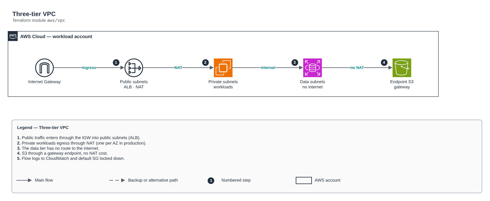

# Three-tier VPC

[Português](README.md) · **English**

> `aws/vpc` · category **rede** · origin: Telecom microservices platform (2026)

> Designed in October 2026 and published now.

Three-tier VPC per AZ: public (ALB/NAT), private (workloads, egress through NAT) and data (databases/caches, no route to the internet). Flow logs and an S3 gateway endpoint included.

## Architecture



Editable source: [`diagram.drawio`](diagram.drawio) (open it in draw.io / diagrams.net), with Portuguese and English pages.

1. Public traffic enters through the IGW into public subnets (ALB).
2. Private workloads egress through NAT (one per AZ in production).
3. The data tier has no route to the internet.
4. S3 through a gateway endpoint, no NAT cost.
5. Flow logs to CloudWatch and default SG locked down.

## Usage

```hcl
module "vpc" {
  source = "git::https://github.com/raphaelfcs/automacao_terraform.git//aws/vpc?ref=v1.0.0"

  name_prefix        = local.name_prefix
  cidr_block         = "10.20.0.0/16"
  azs                = ["sa-east-1a", "sa-east-1b"]
  single_nat_gateway = true
  eks_cluster_name   = "demo-dev"
  tags               = local.tags
}
```

## Examples

| Example | Files |
|---|---|
| [`dev-nat-unico`](examples/dev-nat-unico) | `main.tf`, `locals.tf`, `backend.tf` |
| [`producao-3-az`](examples/producao-3-az) | `main.tf`, `locals.tf`, `backend.tf` |

Each example has its own backend (state isolated per module and example). Different environments only use another `backend.tf`/`*.tfvars`, without duplicating code.

## Inputs

| Name | Type | Default | Required | Description |
|---|---|---|---|---|
| `name_prefix` | `string` | - | **yes** | Prefix applied to the name of every network resource. |
| `cidr_block` | `string` | - | **yes** | VPC CIDR (e.g. 10.20.0.0/16). Plan it without overlap with other VPCs and on-premises. |
| `azs` | `list(string)` | - | **yes** | Availability zones. Production: 3 AZs; dev may use 2 to contain NAT cost. |
| `subnet_newbits` | `number` | `4` | no | Additional bits to slice the CIDR (/16 + 4 = /20 subnets). |
| `enable_nat_gateway` | `bool` | `true` | no | Creates NAT Gateway(s) for private subnet egress. |
| `single_nat_gateway` | `bool` | `false` | no | A single NAT for all AZs (dev). false = one NAT per AZ (production, no single point of failure). |
| `create_data_subnets` | `bool` | `true` | no | Creates the isolated data tier (no route to the internet). |
| `eks_cluster_name` | `string` | `null` | no | EKS cluster that will use the subnets (adds ELB discovery tags). null = no EKS tags. |
| `flow_logs_retention_days` | `number` | `30` | no | Flow log retention in days. 0 disables. |
| `kms_key_arn` | `string` | `null` | no | Flow log group KMS key. null = default CloudWatch encryption. |
| `tags` | `map(string)` | `{}` | no | Tags applied to all resources. |

## Outputs

| Name | Description |
|---|---|
| `vpc_id` | VPC ID. |
| `vpc_cidr_block` | VPC CIDR. |
| `public_subnet_ids` | Public subnet IDs, in var.azs order. |
| `private_subnet_ids` | Private subnet IDs, in var.azs order. |
| `data_subnet_ids` | Data subnet IDs (empty if create_data_subnets = false). |
| `private_route_table_ids` | Private route tables (for TGW/VPN routes added by other modules). |
| `data_route_table_ids` | Data tier route tables. |
| `nat_public_ips` | NAT Gateway public IPs (for partner allowlists). |

## Files

- `flow-logs.tf`: module-specific resources
- `iam.tf`: policies, roles and permissions
- `locals.tf`: derived values
- `main.tf`: main resources
- `outputs.tf`: outputs
- `routes.tf`: module-specific resources
- `variables.tf`: inputs and validations
- `versions.tf`: Terraform and provider versions
- `examples/`: ready-to-use compositions
- `tests/`: `terraform test` with mocked providers

## Well-Architected

- Reliability: resources spread across availability zones and no single point of failure for egress.
- Security: isolated subnet tiers, source-based rules and flow logs enabled.

## Tests

```bash
cd aws/vpc
terraform init -backend=false
terraform test
```
