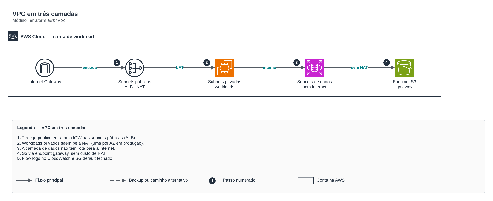

# VPC em três camadas

> `aws/vpc` · categoria **rede** · origem: Plataforma de microsserviços em telecom (2026)

> Idealizado em outubro de 2026 e publicado agora.

VPC em três camadas por AZ: pública (ALB/NAT), privada (workloads, saída via NAT) e dados (bancos/caches, sem rota para a internet). Flow logs e endpoint S3 gateway inclusos.

## Arquitetura



Fonte editável: [`diagram.drawio`](diagram.drawio) (abra no draw.io / diagrams.net).

1. Tráfego público entra pelo IGW nas subnets públicas (ALB).
2. Workloads privados saem pela NAT (uma por AZ em produção).
3. A camada de dados não tem rota para a internet.
4. S3 via endpoint gateway, sem custo de NAT.
5. Flow logs no CloudWatch e SG default fechado.

## Uso

```hcl
module "vpc" {
  source = "git::https://github.com/raphaelfcs/automacao_terraform.git//aws/vpc?ref=v1.0.0"

  name_prefix        = local.name_prefix
  cidr_block         = "10.20.0.0/16"
  azs                = ["sa-east-1a", "sa-east-1b"]
  single_nat_gateway = true
  eks_cluster_name   = "demo-dev"
  tags               = local.tags
}
```

## Exemplos

| Exemplo | Arquivos |
|---|---|
| [`dev-nat-unico`](examples/dev-nat-unico) | `main.tf`, `locals.tf`, `backend.tf` |
| [`producao-3-az`](examples/producao-3-az) | `main.tf`, `locals.tf`, `backend.tf` |

Cada exemplo tem seu próprio backend (state isolado por módulo e exemplo). Ambientes diferentes usam apenas outro `backend.tf`/`*.tfvars`, sem duplicar código.

## Entradas

| Nome | Tipo | Padrão | Obrigatória | Descrição |
|---|---|---|---|---|
| `name_prefix` | `string` | - | **sim** | Prefixo aplicado ao nome de todos os recursos de rede. |
| `cidr_block` | `string` | - | **sim** | CIDR da VPC (ex.: 10.20.0.0/16). Planeje sem sobreposição com outras VPCs e on-premises. |
| `azs` | `list(string)` | - | **sim** | Availability zones. Produção: 3 AZs; dev pode usar 2 para conter custo de NAT. |
| `subnet_newbits` | `number` | `4` | não | Bits adicionais para fatiar o CIDR (/16 + 4 = subnets /20). |
| `enable_nat_gateway` | `bool` | `true` | não | Cria NAT Gateway(s) para saída das subnets privadas. |
| `single_nat_gateway` | `bool` | `false` | não | Um único NAT para todas as AZs (dev). false = um NAT por AZ (produção, sem ponto único de falha). |
| `create_data_subnets` | `bool` | `true` | não | Cria a camada de dados isolada (sem rota para a internet). |
| `eks_cluster_name` | `string` | `null` | não | Cluster EKS que consumirá as subnets (adiciona tags de descoberta de ELB). null = sem tags EKS. |
| `flow_logs_retention_days` | `number` | `30` | não | Retenção dos flow logs em dias. 0 desliga. |
| `kms_key_arn` | `string` | `null` | não | Chave KMS do log group dos flow logs. null = cifra padrão do CloudWatch. |
| `tags` | `map(string)` | `{}` | não | Tags aplicadas a todos os recursos. |

## Saídas

| Nome | Descrição |
|---|---|
| `vpc_id` | ID da VPC. |
| `vpc_cidr_block` | CIDR da VPC. |
| `public_subnet_ids` | IDs das subnets públicas, na ordem de var.azs. |
| `private_subnet_ids` | IDs das subnets privadas, na ordem de var.azs. |
| `data_subnet_ids` | IDs das subnets de dados (vazio se create_data_subnets = false). |
| `private_route_table_ids` | Tabelas de rota privadas (para rotas de TGW/VPN adicionadas por outros módulos). |
| `data_route_table_ids` | Tabelas de rota da camada de dados. |
| `nat_public_ips` | IPs públicos dos NAT Gateways (para allowlist em parceiros). |

## Arquivos

- `flow-logs.tf`: recursos específicos do módulo
- `iam.tf`: políticas, papéis e permissões
- `locals.tf`: valores derivados
- `main.tf`: recursos principais
- `outputs.tf`: saídas
- `routes.tf`: recursos específicos do módulo
- `variables.tf`: entradas e validações
- `versions.tf`: versões do Terraform e providers
- `examples/`: composições prontas para uso
- `tests/`: `terraform test` com providers simulados

## Well-Architected

- Confiabilidade: recursos distribuídos por zonas de disponibilidade e sem ponto único de falha na saída.
- Segurança: camadas de sub-rede isoladas, regras por origem e logs de fluxo habilitados.

## Testes

```bash
cd aws/vpc
terraform init -backend=false
terraform test
```
