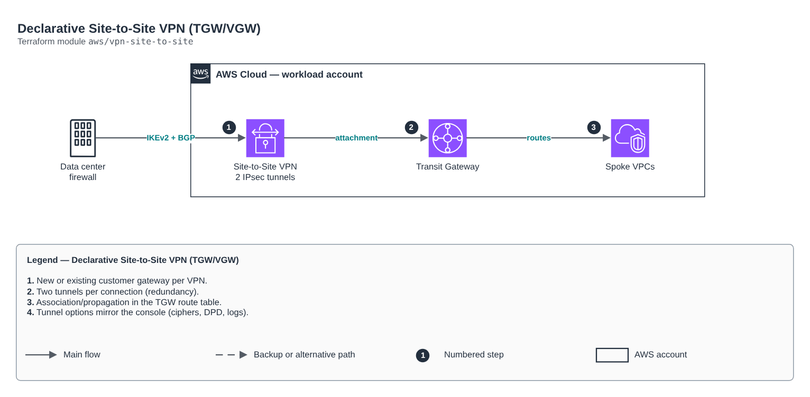

# Declarative Site-to-Site VPN (TGW/VGW)

[Português](README.md) · **English**

> `aws/vpn-site-to-site` · category **rede** · origin: Telecom CCoE and landing zone (2025)

> Designed in November 2025. With no time to keep the repository up to date back then, it is being published and updated now.

Declarative Site-to-Site VPN (Transit Gateway or VGW): new or existing customer gateway, two IPsec tunnels per connection, tunnel options that mirror the console and optional association/propagation in the TGW route table.

## Architecture



Editable source: [`diagram.drawio`](diagram.drawio) (open it in draw.io / diagrams.net), with Portuguese and English pages.

1. New or existing customer gateway per VPN.
2. Two tunnels per connection (redundancy).
3. Association/propagation in the TGW route table.
4. Tunnel options mirror the console (ciphers, DPD, logs).

## Usage

```hcl
module "vpn_site_to_site" {
  source = "git::https://github.com/raphaelfcs/automacao_terraform.git//aws/vpn-site-to-site?ref=v1.0.0"

  transit_gateway_route_table_id = "tgw-rtb-0123456789abcdef0"
  vpn_connections = {
    matriz = {
      target_gateway_type = "transit_gateway"
      transit_gateway_id  = "tgw-0123456789abcdef0"
      routing_option      = "dynamic"
      customer_gateway    = { mode = "new", bgp_asn = 65010, ip_address = "203.0.113.10" }
    }
  }
  tags = local.tags
}
```

## Examples

| Example | Files |
|---|---|
| [`tgw-bgp`](examples/tgw-bgp) | `main.tf`, `locals.tf`, `backend.tf` |

Each example has its own backend (state isolated per module and example). Different environments only use another `backend.tf`/`*.tfvars`, without duplicating code.

## Inputs

| Name | Type | Default | Required | Description |
|---|---|---|---|---|
| `transit_gateway_route_table_id` | `string` | `null` | no | ID of an EXISTING Transit Gateway Route Table (e.g. tgw-rtb-0123456789abcdef0) where the attachment(s) of VPNs with target_gateway_type = "transit_gateway" are associated and propagated. IMPORTANT (non-destructive): additive, it only affects the NEW attachments created here. It does not recreate, replace or delete the route table, nor affect associations/propagations/routes of other existing attachments (VPCs, other VPNs, Direct Connect, etc.). Leave it null if you do not want the module to manage association/propagation (e.g. when the TGW already has "default route table association/propagation = true"). |
| `tags` | `map(string)` | `{}` | no | Common tags applied to all resources created by the module (cgw, vpn connection, etc.). |
| `vpn_connections` | `map(...)` | - | **yes** | Map of Site-to-Site VPNs to create. See the comments on the type above for the meaning of each field — they mirror 1:1 the options of the "Create VPN Connection" wizard in the AWS console. |

## Outputs

| Name | Description |
|---|---|
| `customer_gateway_ids` | Map { vpn_key => effective Customer Gateway id (created by this module or an existing one reused)}. |
| `vpn_connection_ids` | Map { vpn_key => VPN Connection id }. |
| `transit_gateway_attachment_ids` | Map { vpn_key => Transit Gateway Attachment id }, only for VPNs with target_gateway_type = "transit_gateway". |
| `preshared_key_arns` | Map { vpn_key => PSK ARN in Secrets Manager }, only for VPNs with preshared_key_storage = "SecretsManager". |
| `vpn_connections` | Full map { vpn_key => VPN details }, including each tunnel public AWS address and the pre-shared keys (generated by AWS when not given in var.vpn_connections, or empty when preshared_key_storage = "SecretsManager" — then use the preshared_key_arns output). Use this data to configure the device on the other side (firewall, router, etc.). |
| `customer_gateway_configuration` | Map { vpn_key => full configuration XML generated by AWS for that VPN (contains PSKs). |

## Files

- `locals.tf`: derived values
- `main.tf`: main resources
- `outputs.tf`: outputs
- `variables.tf`: inputs and validations
- `versions.tf`: Terraform and provider versions
- `examples/`: ready-to-use compositions
- `tests/`: `terraform test` with mocked providers

## Well-Architected

- Reliability: resources spread across availability zones and no single point of failure for egress.
- Security: isolated subnet tiers, source-based rules and flow logs enabled.

## Tests

```bash
cd aws/vpn-site-to-site
terraform init -backend=false
terraform test
```
