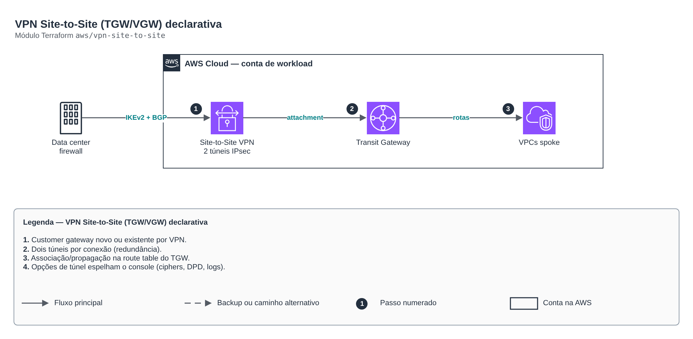

# VPN Site-to-Site (TGW/VGW) declarativa

> `aws/vpn-site-to-site` · categoria **rede** · origem: CCoE e landing zone de telecom (2025)

> Idealizado em novembro de 2025. Por falta de tempo para manter o repositório em dia na época, está sendo publicado e atualizado agora.

Customer Gateway — criado apenas para VPNs com customer_gateway.mode = "new". Para mode = "existing", nenhum recurso é criado aqui — reaproveitamos o ID informado (ver local.customer_gateway_ids em locals.tf).

## Arquitetura



Fonte editável: [`diagram.drawio`](diagram.drawio) (abra no draw.io / diagrams.net).

1. Customer gateway novo ou existente por VPN.
2. Dois túneis por conexão (redundância).
3. Associação/propagação na route table do TGW.
4. Opções de túnel espelham o console (ciphers, DPD, logs).

## Uso

```hcl
module "vpn_site_to_site" {
  source = "git::https://github.com/raphaelfcs/automacao_terraform.git//aws/vpn-site-to-site?ref=v1.0.0"

  transit_gateway_route_table_id = "tgw-rtb-0123456789abcdef0"
  vpn_connections = {
    matriz = {
      target_gateway_type = "transit_gateway"
      transit_gateway_id  = "tgw-0123456789abcdef0"
      routing_option      = "dynamic"
      customer_gateway    = { mode = "new", bgp_asn = 65010, ip_address = "203.0.113.10" }
    }
  }
  tags = local.tags
}
```

## Exemplos

| Exemplo | Arquivos |
|---|---|
| [`tgw-bgp`](examples/tgw-bgp) | `main.tf`, `locals.tf`, `backend.tf` |

Cada exemplo tem seu próprio backend (state isolado por módulo e exemplo). Ambientes diferentes usam apenas outro `backend.tf`/`*.tfvars`, sem duplicar código.

## Entradas

| Nome | Tipo | Padrão | Obrigatória | Descrição |
|---|---|---|---|---|
| `transit_gateway_route_table_id` | `string` | `null` | não | <<-EOT
    ID de uma Transit Gateway Route Table JÁ EXISTENTE (ex: tgw-rtb-0123456789abcdef0)
    onde o(s) attachment(s) das VPNs com target_gateway_type = "transit_gateway" devem
    ser associados e ter suas rotas propagadas.

    IMPORTANTE (não destrutivo): aditivo, só afeta os NOVOS attachments criados aqui.
    Não recria, substitui nem apaga a route table, nem afeta associações/propagações/
    rotas de outros attachments já existentes (VPCs, outras VPNs, Direct Connect etc.).

    Deixe como null se não quiser que o módulo gerencie associação/propagação (ex:
    quando o TGW já tem "default route table association/propagation = true").
  EOT |
| `tags` | `map(string)` | `{}` | não | Tags comuns aplicadas a todos os recursos criados pelo módulo (cgw, vpn connection, etc.). |
| `vpn_connections` | `map(...)` | - | **sim** | <<-EOT
    Mapa de VPNs Site-to-Site a serem criadas. Veja os comentários no type acima
    para o significado de cada campo — eles espelham 1:1 as opções do wizard
    "Create VPN Connection" do console AWS.
  EOT |

## Saídas

| Nome | Descrição |
|---|---|
| `customer_gateway_ids` | Mapa { chave_da_vpn => id do Customer Gateway efetivo (criado por este módulo ou existente reaproveitado)}. |
| `vpn_connection_ids` | Mapa { chave_da_vpn => id da VPN Connection }. |
| `transit_gateway_attachment_ids` | Mapa { chave_da_vpn => id do Transit Gateway Attachment }, apenas para VPNs com target_gateway_type = "transit_gateway". |
| `preshared_key_arns` | Mapa { chave_da_vpn => ARN da PSK no Secrets Manager }, apenas para VPNs com preshared_key_storage = "SecretsManager". |
| `vpn_connections` | <<-EOT
    Mapa completo { chave_da_vpn => detalhes da VPN }, incluindo os endereços
    públicos AWS de cada túnel e as pre-shared keys (geradas pela AWS quando
    não informadas em var.vpn_connections, ou vazias quando preshared_key_storage
    = "SecretsManager" — nesse caso use o output preshared_key_arns). Use estes
    dados para configurar o equipamento do outro lado (firewall, roteador etc.).
  EOT |
| `customer_gateway_configuration` | Mapa { chave_da_vpn => XML de configuração completo gerado pela AWS para essa VPN (contém PSKs). |

## Arquivos

- `locals.tf`: valores derivados
- `main.tf`: recursos principais
- `outputs.tf`: saídas
- `variables.tf`: entradas e validações
- `versions.tf`: versões do Terraform e providers
- `examples/`: composições prontas para uso
- `tests/`: `terraform test` com providers simulados

## Well-Architected

- Confiabilidade: recursos distribuídos por zonas de disponibilidade e sem ponto único de falha na saída.
- Segurança: camadas de sub-rede isoladas, regras por origem e logs de fluxo habilitados.

## Testes

```bash
cd aws/vpn-site-to-site
terraform init -backend=false
terraform test
```
