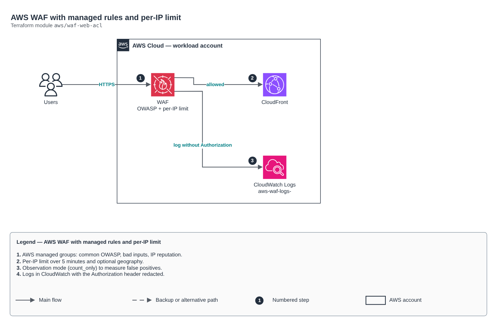

# AWS WAF with managed rules and per-IP limit

[Português](README.md) · **English**

> `aws/waf-web-acl` · category **borda** · origin: Health records platform (2026)

> Designed in November 2026 and published now.

AWS WAF web ACL for CloudFront (create it with a us-east-1 provider) or regional resources: AWS managed groups (common OWASP, known bad inputs, IP reputation), per-IP rate limit, optional geo blocking and logs with defined retention.

## Architecture



Editable source: [`diagram.drawio`](diagram.drawio) (open it in draw.io / diagrams.net), with Portuguese and English pages.

1. AWS managed groups: common OWASP, bad inputs, IP reputation.
2. Per-IP limit over 5 minutes and optional geography.
3. Observation mode (count_only) to measure false positives.
4. Logs in CloudWatch with the Authorization header redacted.

## Usage

```hcl
module "waf_web_acl" {
  source = "git::https://github.com/raphaelfcs/automacao_terraform.git//aws/waf-web-acl?ref=v1.0.0"

  name                = "${local.name_prefix}-borda"
  allowed_countries   = ["BR"]
  rate_limit_per_5min = 1000
  tags                = local.tags
}
```

## Examples

| Example | Files |
|---|---|
| [`cloudfront`](examples/cloudfront) | `main.tf`, `locals.tf`, `backend.tf` |

Each example has its own backend (state isolated per module and example). Different environments only use another `backend.tf`/`*.tfvars`, without duplicating code.

## Inputs

| Name | Type | Default | Required | Description |
|---|---|---|---|---|
| `name` | `string` | - | **yes** | Web ACL name. |
| `scope` | `string` | `"CLOUDFRONT"` | no | CLOUDFRONT (provider in us-east-1) or REGIONAL (ALB, API Gateway REST, AppSync). |
| `managed_rule_groups` | `list(string)` | `["AWSManagedRulesCommonRuleSet", "AWS...` | no | AWS managed rule groups, in evaluation order. Each one is billed as a rule. |
| `managed_rule_overrides` | `map(list(string))` | `{}` | no | Rules of a managed group that only count instead of blocking (e.g. SizeRestrictions_BODY for uploads). |
| `count_only` | `bool` | `false` | no | Observation mode: managed groups only count. Use it in the first week to measure false positives. |
| `rate_limit_per_5min` | `number` | `1000` | no | Requests per IP in 5 minutes before blocking. |
| `allowed_countries` | `list(string)` | `[]` | no | ISO codes of allowed countries (e.g. ["BR"]). Empty = no geographic restriction. |
| `log_retention_days` | `number` | `90` | no | WAF log retention in CloudWatch. null = no logs. |
| `kms_key_arn` | `string` | `null` | no | KMS key for the logs (in the same region as the Web ACL). |
| `tags` | `map(string)` | `{}` | no | Tags applied. |
| `geo_exempt_paths` | `list(string)` | `[]` | no | Exact paths exempted from the geographic rule and the per-IP limit (e.g. ["/api/health"] for the Route 53 health check, which comes from outside the country). Managed rules evaluate first and still apply. Use only for paths with no data. |

## Outputs

| Name | Description |
|---|---|
| `arn` | Web ACL ARN (CloudFront web_acl_id). |
| `id` | Web ACL ID. |

## Files

- `locals.tf`: derived values
- `main.tf`: main resources
- `outputs.tf`: outputs
- `variables.tf`: inputs and validations
- `versions.tf`: Terraform and provider versions
- `examples/`: ready-to-use compositions
- `tests/`: `terraform test` with mocked providers

## Well-Architected

- Security: private origin, WAF and modern TLS at the edge.
- Performance: edge caching and compression.

## Tests

```bash
cd aws/waf-web-acl
terraform init -backend=false
terraform test
```
