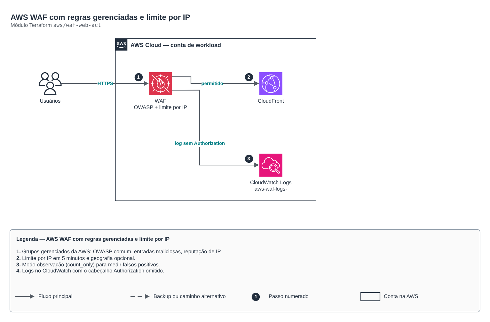

# AWS WAF com regras gerenciadas e limite por IP

**Português** · [English](README.en.md)

> `aws/waf-web-acl` · categoria **borda** · origem: Plataforma de documentos de saúde (2026)

> Idealizado em novembro de 2026 e publicado agora.

Web ACL do AWS WAF para CloudFront (crie com provider em us-east-1) ou recursos regionais: grupos gerenciados da AWS (OWASP comum, entradas maliciosas conhecidas, reputação de IP), limite de requisições por IP, bloqueio geográfico opcional e logs com retenção definida.

## Arquitetura



Fonte editável: [`diagram.drawio`](diagram.drawio) (abra no draw.io / diagrams.net), com páginas em português e inglês.

1. Grupos gerenciados da AWS: OWASP comum, entradas maliciosas, reputação de IP.
2. Limite por IP em 5 minutos e geografia opcional.
3. Modo observação (count_only) para medir falsos positivos.
4. Logs no CloudWatch com o cabeçalho Authorization omitido.

## Uso

```hcl
module "waf_web_acl" {
  source = "git::https://github.com/raphaelfcs/automacao_terraform.git//aws/waf-web-acl?ref=v1.0.0"

  name                = "${local.name_prefix}-borda"
  allowed_countries   = ["BR"]
  rate_limit_per_5min = 1000
  tags                = local.tags
}
```

## Exemplos

| Exemplo | Arquivos |
|---|---|
| [`cloudfront`](examples/cloudfront) | `main.tf`, `locals.tf`, `backend.tf` |

Cada exemplo tem seu próprio backend (state isolado por módulo e exemplo). Ambientes diferentes usam apenas outro `backend.tf`/`*.tfvars`, sem duplicar código.

## Entradas

| Nome | Tipo | Padrão | Obrigatória | Descrição |
|---|---|---|---|---|
| `name` | `string` | - | **sim** | Nome da Web ACL. |
| `scope` | `string` | `"CLOUDFRONT"` | não | CLOUDFRONT (provider em us-east-1) ou REGIONAL (ALB, API Gateway REST, AppSync). |
| `managed_rule_groups` | `list(string)` | `["AWSManagedRulesCommonRuleSet", "AWS...` | não | Grupos gerenciados da AWS, em ordem de avaliação. Cada um custa como uma regra. |
| `managed_rule_overrides` | `map(list(string))` | `{}` | não | Regras de um grupo gerenciado que só contam em vez de bloquear (ex.: SizeRestrictions_BODY para uploads). |
| `count_only` | `bool` | `false` | não | Modo observação: grupos gerenciados só contam. Use na primeira semana para medir falsos positivos. |
| `rate_limit_per_5min` | `number` | `1000` | não | Requisições por IP em 5 minutos antes do bloqueio. |
| `allowed_countries` | `list(string)` | `[]` | não | Códigos ISO de países permitidos (ex.: ["BR"]). Vazio = sem restrição geográfica. |
| `log_retention_days` | `number` | `90` | não | Retenção dos logs do WAF no CloudWatch. null = sem logs. |
| `kms_key_arn` | `string` | `null` | não | Chave KMS dos logs (na mesma região da Web ACL). |
| `tags` | `map(string)` | `{}` | não | Tags aplicadas. |

## Saídas

| Nome | Descrição |
|---|---|
| `arn` | ARN da Web ACL (web_acl_id da CloudFront). |
| `id` | ID da Web ACL. |

## Arquivos

- `locals.tf`: valores derivados
- `main.tf`: recursos principais
- `outputs.tf`: saídas
- `variables.tf`: entradas e validações
- `versions.tf`: versões do Terraform e providers
- `examples/`: composições prontas para uso
- `tests/`: `terraform test` com providers simulados

## Well-Architected

- Segurança: origem privada, WAF e TLS moderno na borda.
- Performance: cache na borda e compressão.

## Testes

```bash
cd aws/waf-web-acl
terraform init -backend=false
terraform test
```
