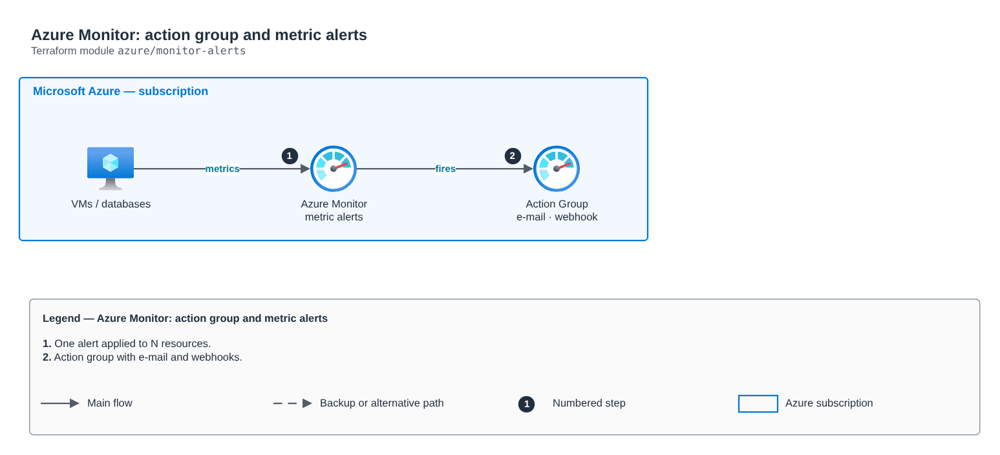

# Azure Monitor: action group and metric alerts

[Português](README.md) · **English**

> `azure/monitor-alerts` · category **observabilidade** · origin: Digital bank on Azure (2020-2021)

> Designed in January 2021. With no time to keep the repository up to date back then, it is being published and updated now.

Azure Monitor alerts: Action Group (e-mail, webhook, SMS) and metric alerts applied to N target resources (VMs, databases, Key Vault, storage), with severity, window and frequency per alert.

## Architecture



Editable source: [`diagram.drawio`](diagram.drawio) (open it in draw.io / diagrams.net), with Portuguese and English pages.

1. One alert applied to N resources.
2. Action group with e-mail and webhooks.

## Usage

```hcl
module "monitor_alerts" {
  source = "git::https://github.com/raphaelfcs/automacao_terraform.git//azure/monitor-alerts?ref=v1.0.0"

  resource_group_name     = "rg-monitoria"
  action_group_name       = "ag-plataforma"
  action_group_short_name = "plataforma"
  emails                  = ["plataforma@example.com"]
  metric_alerts = {
    cpu-alta = { target_ids = ["/subscriptions/00000000-0000-0000-0000-000000000000/resourceGroups/rg-app/providers/Microsoft.Compute/virtualMachines/vm-app-01"], metric_namespace = "Microsoft.Compute/virtualMachines", metric_name = "Percentage CPU", threshold = 85 }
    dtu-alta = { target_ids = ["/subscriptions/00000000-0000-0000-0000-000000000000/resourceGroups/rg-dados/providers/Microsoft.Sql/servers/sql-demo/databases/app"], metric_namespace = "Microsoft.Sql/servers/databases", metric_name = "cpu_percent", threshold = 80, severity = 1 }
  }
  tags = local.tags
}
```

## Examples

| Example | Files |
|---|---|
| [`vm-e-banco`](examples/vm-e-banco) | `main.tf`, `locals.tf`, `backend.tf` |

Each example has its own backend (state isolated per module and example). Different environments only use another `backend.tf`/`*.tfvars`, without duplicating code.

## Inputs

| Name | Type | Default | Required | Description |
|---|---|---|---|---|
| `resource_group_name` | `string` | - | **yes** | Alert resource group. |
| `action_group_name` | `string` | - | **yes** | Action Group name. |
| `action_group_short_name` | `string` | - | **yes** | Short name (up to 12 characters, shown in SMS/e-mail). |
| `emails` | `list(string)` | `[]` | no | Notified e-mails. |
| `webhooks` | `map(string)` | `{}` | no | Webhooks (e.g. Teams/Slack/ITSM): name -> URL. |
| `metric_alerts` | `map(...)` | `{}` | no | Metric alerts by name, each applied to all target_ids. |
| `tags` | `map(string)` | `{}` | no | Tags applied. |

## Outputs

| Name | Description |
|---|---|
| `action_group_id` | Action Group ID. |
| `alert_ids` | Alert|target -> ID map. |

## Files

- `locals.tf`: derived values
- `main.tf`: main resources
- `outputs.tf`: outputs
- `variables.tf`: inputs and validations
- `versions.tf`: Terraform and provider versions
- `examples/`: ready-to-use compositions
- `tests/`: `terraform test` with mocked providers

## Well-Architected

- Operational excellence: centralized logs and metrics with defined retention and actionable alerts.
- Cost optimization: retention per log class so you do not pay for unused data.

## Tests

```bash
cd azure/monitor-alerts
terraform init -backend=false
terraform test
```
