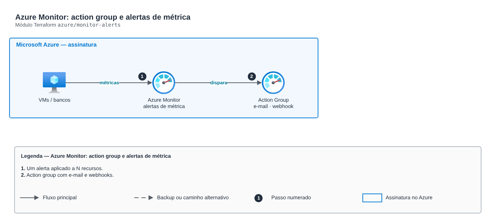

# Azure Monitor: action group e alertas de métrica

**Português** · [English](README.en.md)

> `azure/monitor-alerts` · categoria **observabilidade** · origem: Banco digital em Azure (2020-2021)

> Idealizado em janeiro de 2021. Por falta de tempo para manter o repositório em dia na época, está sendo publicado e atualizado agora.

Alertas do Azure Monitor: Action Group (e-mail, webhook, SMS) e alertas de métrica aplicados a N recursos-alvo (VMs, bancos, Key Vault, storage), com severidade, janela e frequência por alerta. Consolida os antigos módulos "monitor-action-group", "vm cpu avg", "keyvault monitor" e "database monitor".

## Arquitetura



Fonte editável: [`diagram.drawio`](diagram.drawio) (abra no draw.io / diagrams.net), com páginas em português e inglês.

1. Um alerta aplicado a N recursos.
2. Action group com e-mail e webhooks.

## Uso

```hcl
module "monitor_alerts" {
  source = "git::https://github.com/raphaelfcs/automacao_terraform.git//azure/monitor-alerts?ref=v1.0.0"

  resource_group_name     = "rg-monitoria"
  action_group_name       = "ag-plataforma"
  action_group_short_name = "plataforma"
  emails                  = ["plataforma@example.com"]
  metric_alerts = {
    cpu-alta = { target_ids = ["/subscriptions/00000000-0000-0000-0000-000000000000/resourceGroups/rg-app/providers/Microsoft.Compute/virtualMachines/vm-app-01"], metric_namespace = "Microsoft.Compute/virtualMachines", metric_name = "Percentage CPU", threshold = 85 }
    dtu-alta = { target_ids = ["/subscriptions/00000000-0000-0000-0000-000000000000/resourceGroups/rg-dados/providers/Microsoft.Sql/servers/sql-demo/databases/app"], metric_namespace = "Microsoft.Sql/servers/databases", metric_name = "cpu_percent", threshold = 80, severity = 1 }
  }
  tags = local.tags
}
```

## Exemplos

| Exemplo | Arquivos |
|---|---|
| [`vm-e-banco`](examples/vm-e-banco) | `main.tf`, `locals.tf`, `backend.tf` |

Cada exemplo tem seu próprio backend (state isolado por módulo e exemplo). Ambientes diferentes usam apenas outro `backend.tf`/`*.tfvars`, sem duplicar código.

## Entradas

| Nome | Tipo | Padrão | Obrigatória | Descrição |
|---|---|---|---|---|
| `resource_group_name` | `string` | - | **sim** | Resource group dos alertas. |
| `action_group_name` | `string` | - | **sim** | Nome do Action Group. |
| `action_group_short_name` | `string` | - | **sim** | Nome curto (até 12 caracteres, aparece em SMS/e-mail). |
| `emails` | `list(string)` | `[]` | não | E-mails notificados. |
| `webhooks` | `map(string)` | `{}` | não | Webhooks (ex.: Teams/Slack/ITSM): nome -> URL. |
| `metric_alerts` | `map(...)` | `{}` | não | Alertas de métrica por nome, cada um aplicado a todos os target_ids. |
| `tags` | `map(string)` | `{}` | não | Tags aplicadas. |

## Saídas

| Nome | Descrição |
|---|---|
| `action_group_id` | ID do Action Group. |
| `alert_ids` | Mapa alerta|alvo -> ID. |

## Arquivos

- `locals.tf`: valores derivados
- `main.tf`: recursos principais
- `outputs.tf`: saídas
- `variables.tf`: entradas e validações
- `versions.tf`: versões do Terraform e providers
- `examples/`: composições prontas para uso
- `tests/`: `terraform test` com providers simulados

## Well-Architected

- Excelência operacional: logs e métricas centralizados com retenção definida e alertas acionáveis.
- Otimização de custos: retenção por classe de log para não pagar por dado sem uso.

## Testes

```bash
cd azure/monitor-alerts
terraform init -backend=false
terraform test
```
