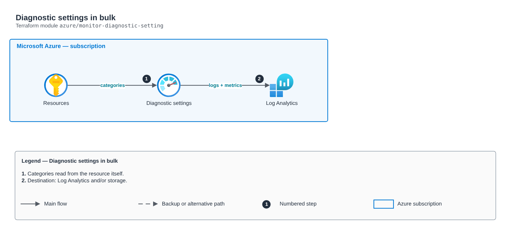

# Diagnostic settings in bulk

[Português](README.md) · **English**

> `azure/monitor-diagnostic-setting` · category **observabilidade** · origin: Digital bank on Azure (2020-2021)

> Designed in April 2021. With no time to keep the repository up to date back then, it is being published and updated now.

Diagnostic settings in bulk: sends logs and metrics from N resources to a Log Analytics workspace (and/or an archive storage account). Available categories are read from the resource itself, avoiding fixed lists that break across types.

## Architecture



Editable source: [`diagram.drawio`](diagram.drawio) (open it in draw.io / diagrams.net), with Portuguese and English pages.

1. Categories read from the resource itself.
2. Destination: Log Analytics and/or storage.

## Usage

```hcl
module "monitor_diagnostic_setting" {
  source = "git::https://github.com/raphaelfcs/automacao_terraform.git//azure/monitor-diagnostic-setting?ref=v1.0.0"

  target_resource_ids        = ["/subscriptions/00000000-0000-0000-0000-000000000000/resourceGroups/rg-app/providers/Microsoft.KeyVault/vaults/kv-demo"]
  log_analytics_workspace_id = "/subscriptions/00000000-0000-0000-0000-000000000000/resourceGroups/rg-monitoria/providers/Microsoft.OperationalInsights/workspaces/law-plataforma"
}
```

## Examples

| Example | Files |
|---|---|
| [`log-analytics`](examples/log-analytics) | `main.tf`, `locals.tf`, `backend.tf` |

Each example has its own backend (state isolated per module and example). Different environments only use another `backend.tf`/`*.tfvars`, without duplicating code.

## Inputs

| Name | Type | Default | Required | Description |
|---|---|---|---|---|
| `name` | `string` | `"envio-log-analytics"` | no | Diagnostic setting name. |
| `target_resource_ids` | `list(string)` | - | **yes** | Monitored resource IDs. |
| `log_analytics_workspace_id` | `string` | - | **yes** | Target workspace. |
| `archive_storage_account_id` | `string` | `null` | no | Archive storage account (optional). |
| `log_categories` | `list(string)` | `[]` | no | Log categories. Empty = all supported by the resource. |
| `enable_metrics` | `bool` | `true` | no | Also sends metrics (AllMetrics). |

## Outputs

| Name | Description |
|---|---|
| `diagnostic_setting_ids` | Resource -> diagnostic setting ID map. |

## Files

- `main.tf`: main resources
- `outputs.tf`: outputs
- `variables.tf`: inputs and validations
- `versions.tf`: Terraform and provider versions
- `examples/`: ready-to-use compositions
- `tests/`: `terraform test` with mocked providers

## Well-Architected

- Operational excellence: centralized logs and metrics with defined retention and actionable alerts.
- Cost optimization: retention per log class so you do not pay for unused data.

## Tests

```bash
cd azure/monitor-diagnostic-setting
terraform init -backend=false
terraform test
```
