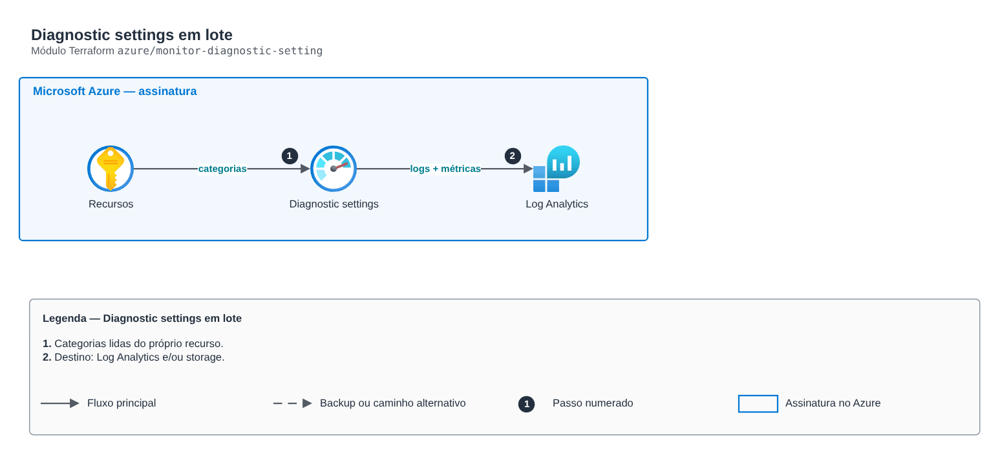

# Diagnostic settings em lote

> `azure/monitor-diagnostic-setting` · categoria **observabilidade** · origem: Banco digital em Azure (2020-2021)

> Idealizado em abril de 2021. Por falta de tempo para manter o repositório em dia na época, está sendo publicado e atualizado agora.

Diagnostic settings em lote: envia logs e métricas de N recursos para um Log Analytics workspace (e/ou storage account de arquivamento). As categorias disponíveis são lidas do próprio recurso (data source), evitando listas fixas que quebram entre tipos.

## Arquitetura



Fonte editável: [`diagram.drawio`](diagram.drawio) (abra no draw.io / diagrams.net).

1. Categorias lidas do próprio recurso.
2. Destino: Log Analytics e/ou storage.

## Uso

```hcl
module "monitor_diagnostic_setting" {
  source = "git::https://github.com/raphaelfcs/automacao_terraform.git//azure/monitor-diagnostic-setting?ref=v1.0.0"

  target_resource_ids        = ["/subscriptions/00000000-0000-0000-0000-000000000000/resourceGroups/rg-app/providers/Microsoft.KeyVault/vaults/kv-demo"]
  log_analytics_workspace_id = "/subscriptions/00000000-0000-0000-0000-000000000000/resourceGroups/rg-monitoria/providers/Microsoft.OperationalInsights/workspaces/law-plataforma"
}
```

## Exemplos

| Exemplo | Arquivos |
|---|---|
| [`log-analytics`](examples/log-analytics) | `main.tf`, `locals.tf`, `backend.tf` |

Cada exemplo tem seu próprio backend (state isolado por módulo e exemplo). Ambientes diferentes usam apenas outro `backend.tf`/`*.tfvars`, sem duplicar código.

## Entradas

| Nome | Tipo | Padrão | Obrigatória | Descrição |
|---|---|---|---|---|
| `name` | `string` | `"envio-log-analytics"` | não | Nome do diagnostic setting. |
| `target_resource_ids` | `list(string)` | - | **sim** | IDs dos recursos monitorados. |
| `log_analytics_workspace_id` | `string` | - | **sim** | Workspace de destino. |
| `archive_storage_account_id` | `string` | `null` | não | Storage account de arquivamento (opcional). |
| `log_categories` | `list(string)` | `[]` | não | Categorias de log. Vazio = todas as suportadas pelo recurso. |
| `enable_metrics` | `bool` | `true` | não | Envia também as métricas (AllMetrics). |

## Saídas

| Nome | Descrição |
|---|---|
| `diagnostic_setting_ids` | Mapa recurso -> ID do diagnostic setting. |

## Arquivos

- `main.tf`: recursos principais
- `outputs.tf`: saídas
- `variables.tf`: entradas e validações
- `versions.tf`: versões do Terraform e providers
- `examples/`: composições prontas para uso
- `tests/`: `terraform test` com providers simulados

## Well-Architected

- Excelência operacional: logs e métricas centralizados com retenção definida e alertas acionáveis.
- Otimização de custos: retenção por classe de log para não pagar por dado sem uso.

## Testes

```bash
cd azure/monitor-diagnostic-setting
terraform init -backend=false
terraform test
```
