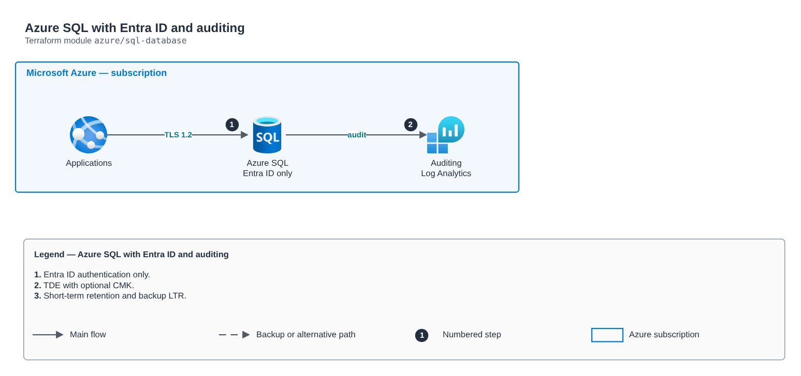

# Azure SQL with Entra ID and auditing

[Português](README.md) · **English**

> `azure/sql-database` · category **dados** · origin: Digital bank on Azure (2020-2021)

> Designed in July 2021. With no time to keep the repository up to date back then, it is being published and updated now.

Azure SQL: logical server with an Entra ID administrator (no SQL auth), optional customer-managed TDE key, auditing to Log Analytics, public access off and databases declared as a map (SKU, size, zone redundancy, backup retention).

## Architecture



Editable source: [`diagram.drawio`](diagram.drawio) (open it in draw.io / diagrams.net), with Portuguese and English pages.

1. Entra ID authentication only.
2. TDE with optional CMK.
3. Short-term retention and backup LTR.

## Usage

```hcl
module "sql_database" {
  source = "git::https://github.com/raphaelfcs/automacao_terraform.git//azure/sql-database?ref=v1.0.0"

  server_name                = "sql-demo-dev"
  resource_group_name        = "rg-dados"
  location                   = "brazilsouth"
  entra_admin_login          = "grp-dba"
  entra_admin_object_id      = "00000000-0000-0000-0000-000000000001"
  log_analytics_workspace_id = "/subscriptions/00000000-0000-0000-0000-000000000000/resourceGroups/rg-monitoria/providers/Microsoft.OperationalInsights/workspaces/law-plataforma"
  databases                  = { cartoes = {}, conciliacao = { sku_name = "GP_Gen5_4", zone_redundant = true } }
  tags                       = local.tags
}
```

## Examples

| Example | Files |
|---|---|
| [`basico`](examples/basico) | `main.tf`, `locals.tf`, `backend.tf` |

Each example has its own backend (state isolated per module and example). Different environments only use another `backend.tf`/`*.tfvars`, without duplicating code.

## Inputs

| Name | Type | Default | Required | Description |
|---|---|---|---|---|
| `server_name` | `string` | - | **yes** | Logical server name (global). |
| `resource_group_name` | `string` | - | **yes** | Resource group. |
| `location` | `string` | - | **yes** | Region. |
| `entra_admin_login` | `string` | - | **yes** | Administrator group/user name in Entra ID. |
| `entra_admin_object_id` | `string` | - | **yes** | Entra ID administrator object ID. |
| `public_network_access` | `bool` | `false` | no | Public access (false = Private Endpoint). |
| `tde_key_vault_id` | `string` | `null` | no | TDE key Key Vault (null = service-managed key). |
| `tde_key_vault_key_id` | `string` | `null` | no | TDE key ID. |
| `log_analytics_workspace_id` | `string` | `null` | no | Audit workspace (null = no auditing). |
| `databases` | `map(...)` | `{}` | no | Databases by name. |
| `tags` | `map(string)` | `{}` | no | Tags applied. |

## Outputs

| Name | Description |
|---|---|
| `server_id` | Server ID. |
| `server_fqdn` | Server FQDN. |
| `database_ids` | Name -> database ID map. |

## Files

- `iam.tf`: policies, roles and permissions
- `main.tf`: main resources
- `outputs.tf`: outputs
- `variables.tf`: inputs and validations
- `versions.tf`: Terraform and provider versions
- `examples/`: ready-to-use compositions
- `tests/`: `terraform test` with mocked providers

## Well-Architected

- Reliability: automatic backups, configurable Multi-AZ/high availability and deletion protection.
- Security: private-only access, mandatory TLS and data encrypted at rest with KMS/CMK.

## Tests

```bash
cd azure/sql-database
terraform init -backend=false
terraform test
```
