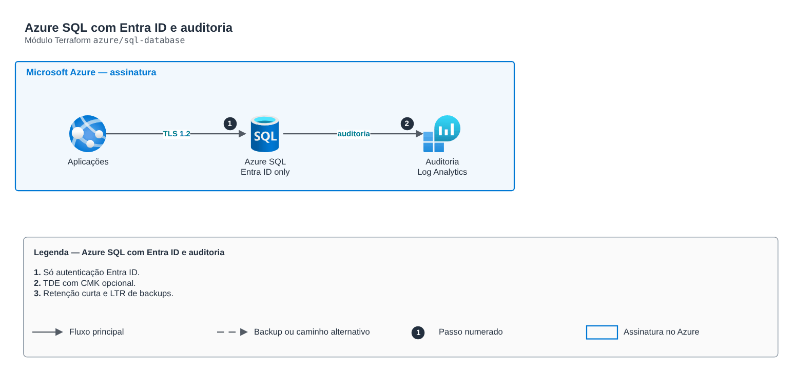

# Azure SQL com Entra ID e auditoria

**Português** · [English](README.en.md)

> `azure/sql-database` · categoria **dados** · origem: Banco digital em Azure (2020-2021)

> Idealizado em julho de 2021. Por falta de tempo para manter o repositório em dia na época, está sendo publicado e atualizado agora.

Azure SQL: servidor lógico com administrador Entra ID (sem SQL auth), TDE com chave do cliente opcional, auditoria para Log Analytics, acesso público desligado e bancos declarados por mapa (SKU, tamanho, redundância de zona, retenção de backup).

## Arquitetura



Fonte editável: [`diagram.drawio`](diagram.drawio) (abra no draw.io / diagrams.net), com páginas em português e inglês.

1. Só autenticação Entra ID.
2. TDE com CMK opcional.
3. Retenção curta e LTR de backups.

## Uso

```hcl
module "sql_database" {
  source = "git::https://github.com/raphaelfcs/automacao_terraform.git//azure/sql-database?ref=v1.0.0"

  server_name                = "sql-demo-dev"
  resource_group_name        = "rg-dados"
  location                   = "brazilsouth"
  entra_admin_login          = "grp-dba"
  entra_admin_object_id      = "00000000-0000-0000-0000-000000000001"
  log_analytics_workspace_id = "/subscriptions/00000000-0000-0000-0000-000000000000/resourceGroups/rg-monitoria/providers/Microsoft.OperationalInsights/workspaces/law-plataforma"
  databases                  = { cartoes = {}, conciliacao = { sku_name = "GP_Gen5_4", zone_redundant = true } }
  tags                       = local.tags
}
```

## Exemplos

| Exemplo | Arquivos |
|---|---|
| [`basico`](examples/basico) | `main.tf`, `locals.tf`, `backend.tf` |

Cada exemplo tem seu próprio backend (state isolado por módulo e exemplo). Ambientes diferentes usam apenas outro `backend.tf`/`*.tfvars`, sem duplicar código.

## Entradas

| Nome | Tipo | Padrão | Obrigatória | Descrição |
|---|---|---|---|---|
| `server_name` | `string` | - | **sim** | Nome do servidor lógico (global). |
| `resource_group_name` | `string` | - | **sim** | Resource group. |
| `location` | `string` | - | **sim** | Região. |
| `entra_admin_login` | `string` | - | **sim** | Nome do grupo/usuário administrador no Entra ID. |
| `entra_admin_object_id` | `string` | - | **sim** | Object ID do administrador Entra ID. |
| `public_network_access` | `bool` | `false` | não | Acesso público (false = Private Endpoint). |
| `tde_key_vault_id` | `string` | `null` | não | Key Vault da chave TDE (null = chave gerenciada pelo serviço). |
| `tde_key_vault_key_id` | `string` | `null` | não | ID da chave TDE. |
| `log_analytics_workspace_id` | `string` | `null` | não | Workspace da auditoria (null = sem auditoria). |
| `databases` | `map(...)` | `{}` | não | Bancos por nome. |
| `tags` | `map(string)` | `{}` | não | Tags aplicadas. |

## Saídas

| Nome | Descrição |
|---|---|
| `server_id` | ID do servidor. |
| `server_fqdn` | FQDN do servidor. |
| `database_ids` | Mapa nome -> ID do banco. |

## Arquivos

- `iam.tf`: políticas, papéis e permissões
- `main.tf`: recursos principais
- `outputs.tf`: saídas
- `variables.tf`: entradas e validações
- `versions.tf`: versões do Terraform e providers
- `examples/`: composições prontas para uso
- `tests/`: `terraform test` com providers simulados

## Well-Architected

- Confiabilidade: backups automáticos, Multi-AZ/alta disponibilidade configuráveis e proteção contra exclusão.
- Segurança: acesso somente privado, TLS obrigatório e dados cifrados em repouso com KMS/CMK.

## Testes

```bash
cd azure/sql-database
terraform init -backend=false
terraform test
```
