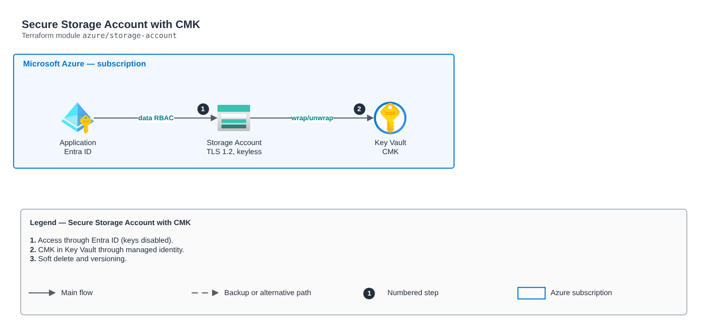

# Secure Storage Account with CMK

[Português](README.md) · **English**

> `azure/storage-account` · category **armazenamento** · origin: Digital bank on Azure (2020-2021)

> Designed in October 2021. With no time to keep the repository up to date back then, it is being published and updated now.

Secure Storage Account: TLS 1.2, no public blob access, no shared key (Entra ID), customer-managed key (CMK) encryption in Key Vault through a managed identity, blob/container soft delete, versioning and private containers.

## Architecture



Editable source: [`diagram.drawio`](diagram.drawio) (open it in draw.io / diagrams.net), with Portuguese and English pages.

1. Access through Entra ID (keys disabled).
2. CMK in Key Vault through managed identity.
3. Soft delete and versioning.

## Usage

```hcl
module "storage_account" {
  source = "git::https://github.com/raphaelfcs/automacao_terraform.git//azure/storage-account?ref=v1.0.0"

  name                 = "stdemodev001"
  resource_group_name  = "rg-demo-dev"
  location             = "brazilsouth"
  cmk_key_vault_id     = "/subscriptions/00000000-0000-0000-0000-000000000000/resourceGroups/rg-demo-dev/providers/Microsoft.KeyVault/vaults/kv-demo-dev"
  cmk_key_vault_key_id = "https://kv-demo-dev.vault.azure.net/keys/storage"
  containers           = ["dados", "backup"]
  tags                 = local.tags
}
```

## Examples

| Example | Files |
|---|---|
| [`cmk`](examples/cmk) | `main.tf`, `locals.tf`, `backend.tf` |

Each example has its own backend (state isolated per module and example). Different environments only use another `backend.tf`/`*.tfvars`, without duplicating code.

## Inputs

| Name | Type | Default | Required | Description |
|---|---|---|---|---|
| `name` | `string` | - | **yes** | Storage account name (3-24, lowercase letters and numbers, global). |
| `resource_group_name` | `string` | - | **yes** | Resource group. |
| `location` | `string` | - | **yes** | Region (e.g. brazilsouth). |
| `account_tier` | `string` | `"Standard"` | no | Standard or Premium. |
| `replication_type` | `string` | `"ZRS"` | no | LRS, ZRS, GRS, RAGRS, GZRS or RAGZRS. |
| `hierarchical_namespace` | `bool` | `false` | no | Data Lake Gen2 (HNS). |
| `shared_access_key_enabled` | `bool` | `false` | no | Allows account keys/key-based SAS. Prefer false (Entra ID). |
| `public_network_access` | `bool` | `false` | no | Public network access (false = only Private Endpoint/allowed subnets). |
| `allowed_ip_ranges` | `list(string)` | `[]` | no | Allowed public IPs/CIDRs. |
| `allowed_subnet_ids` | `list(string)` | `[]` | no | Allowed subnets with a service endpoint. |
| `cmk_key_vault_id` | `string` | `null` | no | CMK Key Vault (for the crypto role). null = Microsoft-managed key. |
| `cmk_key_vault_key_id` | `string` | `null` | no | Versionless key ID in Key Vault. |
| `versioning` | `bool` | `true` | no | Blob versioning. |
| `soft_delete_days` | `number` | `14` | no | Blob and container soft delete retention. |
| `containers` | `list(string)` | `[]` | no | Private containers created. |
| `data_contributors` | `map(string)` | `{}` | no | principal_id -> data role (e.g. Storage Blob Data Contributor). |
| `tags` | `map(string)` | `{}` | no | Tags applied. |

## Outputs

| Name | Description |
|---|---|
| `storage_account_id` | Storage account ID. |
| `primary_blob_endpoint` | Blob endpoint. |
| `identity_principal_id` | Managed identity principal. |

## Files

- `iam.tf`: policies, roles and permissions
- `main.tf`: main resources
- `outputs.tf`: outputs
- `variables.tf`: inputs and validations
- `versions.tf`: Terraform and provider versions
- `examples/`: ready-to-use compositions
- `tests/`: `terraform test` with mocked providers

## Well-Architected

- Security: public access blocked, encryption and identity-based authentication.
- Reliability: versioning and reversible deletion.

## Tests

```bash
cd azure/storage-account
terraform init -backend=false
terraform test
```
