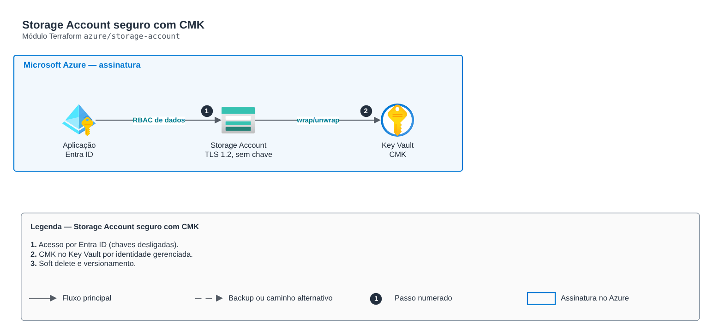

# Storage Account seguro com CMK

**Português** · [English](README.en.md)

> `azure/storage-account` · categoria **armazenamento** · origem: Banco digital em Azure (2020-2021)

> Idealizado em outubro de 2021. Por falta de tempo para manter o repositório em dia na época, está sendo publicado e atualizado agora.

Storage Account seguro: TLS 1.2, sem acesso público a blobs, sem chave compartilhada (Entra ID), cifra com chave do cliente (CMK) no Key Vault via identidade gerenciada, soft delete de blobs/containers, versionamento e containers privados. Substitui o antigo "local-exec az storage account update" por recursos nativos.

## Arquitetura



Fonte editável: [`diagram.drawio`](diagram.drawio) (abra no draw.io / diagrams.net), com páginas em português e inglês.

1. Acesso por Entra ID (chaves desligadas).
2. CMK no Key Vault por identidade gerenciada.
3. Soft delete e versionamento.

## Uso

```hcl
module "storage_account" {
  source = "git::https://github.com/raphaelfcs/automacao_terraform.git//azure/storage-account?ref=v1.0.0"

  name                 = "stdemodev001"
  resource_group_name  = "rg-demo-dev"
  location             = "brazilsouth"
  cmk_key_vault_id     = "/subscriptions/00000000-0000-0000-0000-000000000000/resourceGroups/rg-demo-dev/providers/Microsoft.KeyVault/vaults/kv-demo-dev"
  cmk_key_vault_key_id = "https://kv-demo-dev.vault.azure.net/keys/storage"
  containers           = ["dados", "backup"]
  tags                 = local.tags
}
```

## Exemplos

| Exemplo | Arquivos |
|---|---|
| [`cmk`](examples/cmk) | `main.tf`, `locals.tf`, `backend.tf` |

Cada exemplo tem seu próprio backend (state isolado por módulo e exemplo). Ambientes diferentes usam apenas outro `backend.tf`/`*.tfvars`, sem duplicar código.

## Entradas

| Nome | Tipo | Padrão | Obrigatória | Descrição |
|---|---|---|---|---|
| `name` | `string` | - | **sim** | Nome da storage account (3-24, minúsculas e números, global). |
| `resource_group_name` | `string` | - | **sim** | Resource group. |
| `location` | `string` | - | **sim** | Região (ex.: brazilsouth). |
| `account_tier` | `string` | `"Standard"` | não | Standard ou Premium. |
| `replication_type` | `string` | `"ZRS"` | não | LRS, ZRS, GRS, RAGRS, GZRS ou RAGZRS. |
| `hierarchical_namespace` | `bool` | `false` | não | Data Lake Gen2 (HNS). |
| `shared_access_key_enabled` | `bool` | `false` | não | Permite chaves de conta/SAS por chave. Prefira false (Entra ID). |
| `public_network_access` | `bool` | `false` | não | Acesso por rede pública (false = só Private Endpoint/subnets permitidas). |
| `allowed_ip_ranges` | `list(string)` | `[]` | não | IPs/CIDRs públicos permitidos. |
| `allowed_subnet_ids` | `list(string)` | `[]` | não | Subnets com service endpoint permitidas. |
| `cmk_key_vault_id` | `string` | `null` | não | Key Vault da CMK (para a role de criptografia). null = chave da Microsoft. |
| `cmk_key_vault_key_id` | `string` | `null` | não | ID versionless da chave no Key Vault. |
| `versioning` | `bool` | `true` | não | Versionamento de blobs. |
| `soft_delete_days` | `number` | `14` | não | Retenção do soft delete de blobs e containers. |
| `containers` | `list(string)` | `[]` | não | Containers privados criados. |
| `data_contributors` | `map(string)` | `{}` | não | principal_id -> role de dados (ex.: Storage Blob Data Contributor). |
| `tags` | `map(string)` | `{}` | não | Tags aplicadas. |

## Saídas

| Nome | Descrição |
|---|---|
| `storage_account_id` | ID da storage account. |
| `primary_blob_endpoint` | Endpoint de blob. |
| `identity_principal_id` | Principal da identidade gerenciada. |

## Arquivos

- `iam.tf`: políticas, papéis e permissões
- `main.tf`: recursos principais
- `outputs.tf`: saídas
- `variables.tf`: entradas e validações
- `versions.tf`: versões do Terraform e providers
- `examples/`: composições prontas para uso
- `tests/`: `terraform test` com providers simulados

## Well-Architected

- Segurança: acesso público bloqueado, criptografia e autenticação por identidade.
- Confiabilidade: versionamento e exclusão reversível.

## Testes

```bash
cd azure/storage-account
terraform init -backend=false
terraform test
```
