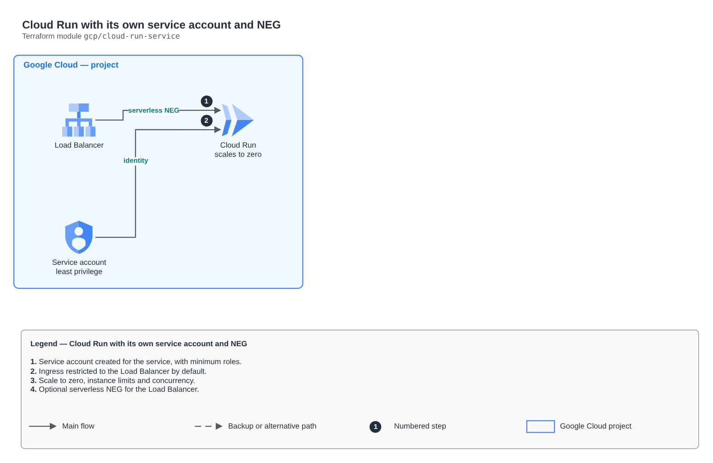

# Cloud Run with its own service account and NEG

[Português](README.md) · **English**

> `gcp/cloud-run-service` · category **computacao** · origin: Health records platform (2026)

> Designed in November 2026 and published now.

Cloud Run (v2) service with its own service account, scale to zero, instance limits and restricted ingress. To sit behind a global Load Balancer (with Cloud Armor), create the serverless NEG (create_serverless_neg) and use ingress "INGRESS_TRAFFIC_INTERNAL_LOAD_BALANCER".

## Architecture



Editable source: [`diagram.drawio`](diagram.drawio) (open it in draw.io / diagrams.net), with Portuguese and English pages.

1. Service account created for the service, with minimum roles.
2. Ingress restricted to the Load Balancer by default.
3. Scale to zero, instance limits and concurrency.
4. Optional serverless NEG for the Load Balancer.

## Usage

```hcl
module "cloud_run_service" {
  source = "git::https://github.com/raphaelfcs/automacao_terraform.git//gcp/cloud-run-service?ref=v1.0.0"

  project_id            = local.project_id
  name                  = "demo-dev-api"
  image                 = "southamerica-east1-docker.pkg.dev/demo-plataforma-dev/docs/api:1.0.0"
  service_account_id    = "demo-dev-api"
  invoker_members       = ["allUsers"]
  create_serverless_neg = true
  env                   = { NUVEM = "gcp" }
  labels                = local.labels
}
```

## Examples

| Example | Files |
|---|---|
| [`api`](examples/api) | `main.tf`, `locals.tf`, `backend.tf` |

Each example has its own backend (state isolated per module and example). Different environments only use another `backend.tf`/`*.tfvars`, without duplicating code.

## Inputs

| Name | Type | Default | Required | Description |
|---|---|---|---|---|
| `project_id` | `string` | - | **yes** | GCP project. |
| `name` | `string` | - | **yes** | Service name. |
| `region` | `string` | `"southamerica-east1"` | no | Service region. |
| `image` | `string` | - | **yes** | Container image (Artifact Registry), preferably with a digest or immutable tag. |
| `service_account_id` | `string` | `null` | no | ID of the service account created for the service (6 to 30 characters). Ignored if service_account_email is set. |
| `service_account_email` | `string` | `null` | no | Existing service account. null = create one with service_account_id. |
| `ingress` | `string` | `"INGRESS_TRAFFIC_INTERNAL_LOAD_BALANCER"` | no | INGRESS_TRAFFIC_ALL, INGRESS_TRAFFIC_INTERNAL_ONLY or INGRESS_TRAFFIC_INTERNAL_LOAD_BALANCER. |
| `env` | `map(string)` | `{}` | no | Environment variables (no secrets: use Secret Manager or federated identity). |
| `min_instances` | `number` | `0` | no | Minimum instances (0 = scales to zero and costs nothing idle). |
| `max_instances` | `number` | `20` | no | Maximum instances (ceiling on cost and on database load). |
| `concurrency` | `number` | `40` | no | Concurrent requests per instance. |
| `cpu` | `string` | `"1"` | no | vCPU per instance. |
| `memory` | `string` | `"512Mi"` | no | Memory per instance. |
| `timeout_seconds` | `number` | `60` | no | Maximum time per request. |
| `invoker_members` | `list(string)` | `[]` | no | Who may invoke (e.g. allUsers behind the LB; the Eventarc serviceAccount on an internal service). |
| `project_roles` | `list(string)` | `[]` | no | Project roles of the service account (minimum required). |
| `create_serverless_neg` | `bool` | `false` | no | Creates the serverless NEG to use the service as a Load Balancer backend. |
| `deletion_protection` | `bool` | `true` | no | Prevents Terraform from destroying the service. |
| `labels` | `map(string)` | `{}` | no | Labels applied. |

## Outputs

| Name | Description |
|---|---|
| `name` | Service name. |
| `uri` | Service URL (answers only as the ingress allows). |
| `service_account_email` | Service account email. |
| `service_account_unique_id` | Unique ID of the service account created here (used in an AWS trust policy); null if the account came from outside. |
| `neg_id` | Serverless NEG ID (null if not created). |

## Files

- `locals.tf`: derived values
- `main.tf`: main resources
- `outputs.tf`: outputs
- `variables.tf`: inputs and validations
- `versions.tf`: Terraform and provider versions
- `examples/`: ready-to-use compositions
- `tests/`: `terraform test` with mocked providers

## Well-Architected

- Operational excellence: packaging and logs with retention created by IaC.
- Security: least-privilege execution role.

## Tests

```bash
cd gcp/cloud-run-service
terraform init -backend=false
terraform test
```
