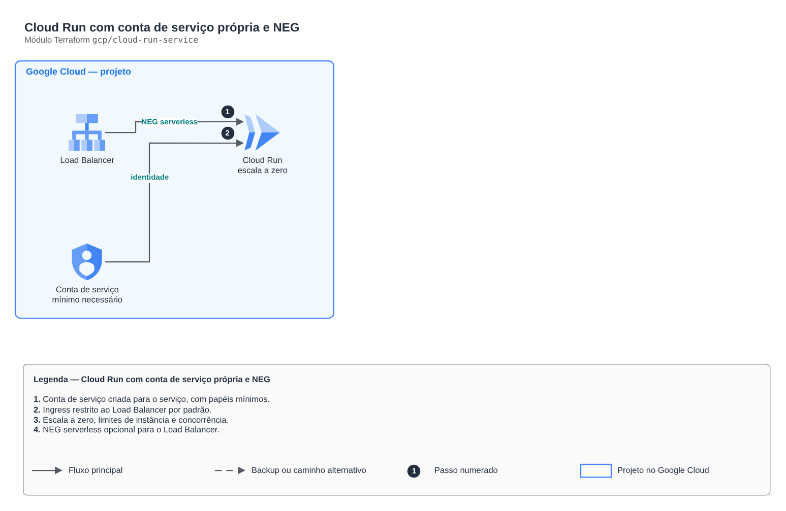

# Cloud Run com conta de serviço própria e NEG

**Português** · [English](README.en.md)

> `gcp/cloud-run-service` · categoria **computacao** · origem: Plataforma de documentos de saúde (2026)

> Idealizado em novembro de 2026 e publicado agora.

Serviço Cloud Run (v2) com conta de serviço própria, escala a zero, limites de instância e ingress restrito. Para ficar atrás de um Load Balancer global (com Cloud Armor), crie o NEG serverless (create_serverless_neg) e use ingress "INGRESS_TRAFFIC_INTERNAL_LOAD_BALANCER".

## Arquitetura



Fonte editável: [`diagram.drawio`](diagram.drawio) (abra no draw.io / diagrams.net), com páginas em português e inglês.

1. Conta de serviço criada para o serviço, com papéis mínimos.
2. Ingress restrito ao Load Balancer por padrão.
3. Escala a zero, limites de instância e concorrência.
4. NEG serverless opcional para o Load Balancer.

## Uso

```hcl
module "cloud_run_service" {
  source = "git::https://github.com/raphaelfcs/automacao_terraform.git//gcp/cloud-run-service?ref=v1.0.0"

  project_id            = local.project_id
  name                  = "demo-dev-api"
  image                 = "southamerica-east1-docker.pkg.dev/demo-plataforma-dev/docs/api:1.0.0"
  service_account_id    = "demo-dev-api"
  invoker_members       = ["allUsers"]
  create_serverless_neg = true
  env                   = { NUVEM = "gcp" }
  labels                = local.labels
}
```

## Exemplos

| Exemplo | Arquivos |
|---|---|
| [`api`](examples/api) | `main.tf`, `locals.tf`, `backend.tf` |

Cada exemplo tem seu próprio backend (state isolado por módulo e exemplo). Ambientes diferentes usam apenas outro `backend.tf`/`*.tfvars`, sem duplicar código.

## Entradas

| Nome | Tipo | Padrão | Obrigatória | Descrição |
|---|---|---|---|---|
| `project_id` | `string` | - | **sim** | Projeto do GCP. |
| `name` | `string` | - | **sim** | Nome do serviço. |
| `region` | `string` | `"southamerica-east1"` | não | Região do serviço. |
| `image` | `string` | - | **sim** | Imagem do container (Artifact Registry), de preferência com digest ou tag imutável. |
| `service_account_id` | `string` | `null` | não | ID da conta de serviço criada para o serviço (6 a 30 caracteres). Ignorado se service_account_email for informado. |
| `service_account_email` | `string` | `null` | não | Conta de serviço já existente. null = cria uma com service_account_id. |
| `ingress` | `string` | `"INGRESS_TRAFFIC_INTERNAL_LOAD_BALANCER"` | não | INGRESS_TRAFFIC_ALL, INGRESS_TRAFFIC_INTERNAL_ONLY ou INGRESS_TRAFFIC_INTERNAL_LOAD_BALANCER. |
| `env` | `map(string)` | `{}` | não | Variáveis de ambiente (sem segredos: use Secret Manager ou identidade federada). |
| `min_instances` | `number` | `0` | não | Instâncias mínimas (0 = escala a zero e não cobra parado). |
| `max_instances` | `number` | `20` | não | Instâncias máximas (teto de custo e de carga no banco). |
| `concurrency` | `number` | `40` | não | Requisições simultâneas por instância. |
| `cpu` | `string` | `"1"` | não | vCPU por instância. |
| `memory` | `string` | `"512Mi"` | não | Memória por instância. |
| `timeout_seconds` | `number` | `60` | não | Tempo máximo por requisição. |
| `invoker_members` | `list(string)` | `[]` | não | Quem pode invocar (ex.: allUsers atrás do LB; serviceAccount do Eventarc em serviço interno). |
| `project_roles` | `list(string)` | `[]` | não | Papéis de projeto da conta de serviço (mínimo necessário). |
| `create_serverless_neg` | `bool` | `false` | não | Cria o NEG serverless para usar o serviço como backend de um Load Balancer. |
| `deletion_protection` | `bool` | `true` | não | Impede destruir o serviço pelo Terraform. |
| `labels` | `map(string)` | `{}` | não | Labels aplicados. |

## Saídas

| Nome | Descrição |
|---|---|
| `name` | Nome do serviço. |
| `uri` | URL do serviço (só responde conforme o ingress). |
| `service_account_email` | E-mail da conta de serviço. |
| `service_account_unique_id` | ID único da conta de serviço criada aqui (usado em trust policy da AWS); null se a conta veio de fora. |
| `neg_id` | ID do NEG serverless (null se não criado). |

## Arquivos

- `locals.tf`: valores derivados
- `main.tf`: recursos principais
- `outputs.tf`: saídas
- `variables.tf`: entradas e validações
- `versions.tf`: versões do Terraform e providers
- `examples/`: composições prontas para uso
- `tests/`: `terraform test` com providers simulados

## Well-Architected

- Excelência operacional: empacotamento e logs com retenção criados pela IaC.
- Segurança: papel de execução com permissões mínimas.

## Testes

```bash
cd gcp/cloud-run-service
terraform init -backend=false
terraform test
```
