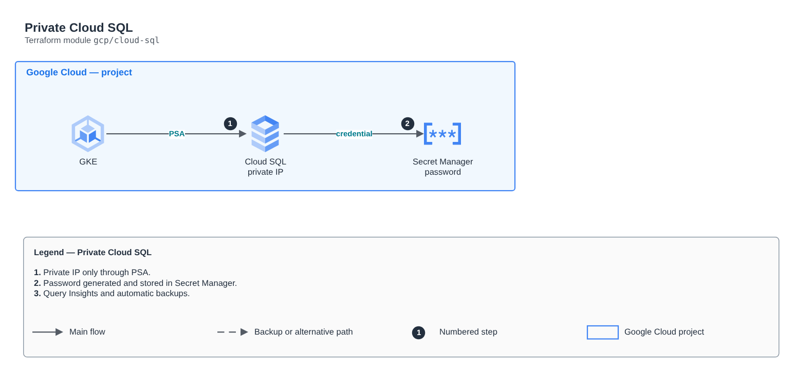

# Private Cloud SQL

[Português](README.md) · **English**

> `gcp/cloud-sql` · category **dados** · origin: Architecture case studies (2026)

> Designed in October 2026 and published now.

Cloud SQL (PostgreSQL) with private IP only through Private Service Access, password generated and stored in Secret Manager, automatic backups and Query Insights.

## Architecture



Editable source: [`diagram.drawio`](diagram.drawio) (open it in draw.io / diagrams.net), with Portuguese and English pages.

1. Private IP only through PSA.
2. Password generated and stored in Secret Manager.
3. Query Insights and automatic backups.

## Usage

```hcl
module "cloud_sql" {
  source = "git::https://github.com/raphaelfcs/automacao_terraform.git//gcp/cloud-sql?ref=v1.0.0"

  project_id = "demo-plataforma-dev"
  region     = local.region
  network_id = "projects/demo-plataforma-dev/global/networks/vpc-demo"
  labels     = local.labels
}
```

## Examples

| Example | Files |
|---|---|
| [`basico`](examples/basico) | `main.tf`, `locals.tf`, `backend.tf` |

Each example has its own backend (state isolated per module and example). Different environments only use another `backend.tf`/`*.tfvars`, without duplicating code.

## Inputs

| Name | Type | Default | Required | Description |
|---|---|---|---|---|
| `project_id` | `string` | - | **yes** |  |
| `region` | `string` | - | **yes** |  |
| `network_id` | `string` | - | **yes** |  |
| `instance_name` | `string` | `"sql-lab"` | no |  |
| `tier` | `string` | `"db-f1-micro"` | no | db-f1-micro for labs; use db-custom-* in production. |
| `availability_type` | `string` | `"ZONAL"` | no | ZONAL (lab) or REGIONAL (high availability). |
| `database` | `string` | `"orders"` | no |  |
| `db_user` | `string` | `"app"` | no |  |
| `deletion_protection` | `bool` | `false` | no |  |
| `labels` | `map(string)` | `{}` | no |  |

## Outputs

| Name | Description |
|---|---|
| `db_private_ip` |  |
| `db_secret_id` |  |
| `connection_name` |  |

## Files

- `locals.tf`: derived values
- `main.tf`: main resources
- `outputs.tf`: outputs
- `variables.tf`: inputs and validations
- `versions.tf`: Terraform and provider versions
- `examples/`: ready-to-use compositions
- `tests/`: `terraform test` with mocked providers

## Well-Architected

- Reliability: automatic backups, configurable Multi-AZ/high availability and deletion protection.
- Security: private-only access, mandatory TLS and data encrypted at rest with KMS/CMK.

## Tests

```bash
cd gcp/cloud-sql
terraform init -backend=false
terraform test
```
