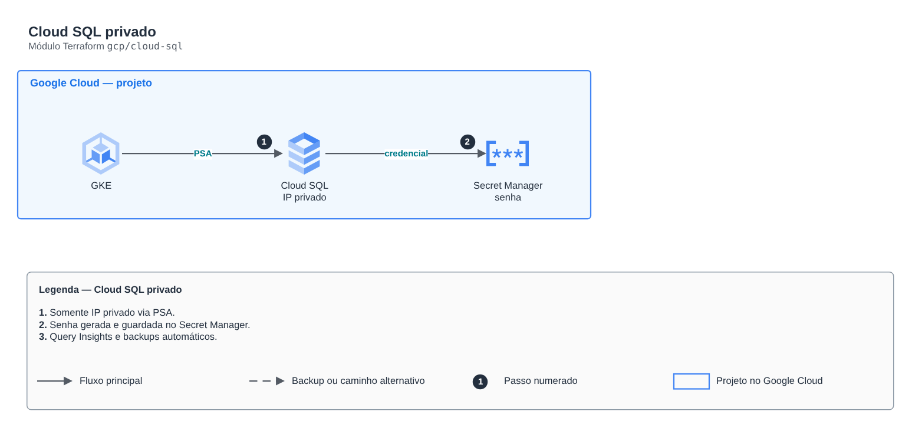

# Cloud SQL privado

**Português** · [English](README.en.md)

> `gcp/cloud-sql` · categoria **dados** · origem: Estudos de caso de arquitetura (2026)

> Idealizado em outubro de 2026 e publicado agora.

Cloud SQL (PostgreSQL) só com IP privado via Private Service Access, senha gerada e guardada no Secret Manager, backups automáticos e Query Insights.

## Arquitetura



Fonte editável: [`diagram.drawio`](diagram.drawio) (abra no draw.io / diagrams.net), com páginas em português e inglês.

1. Somente IP privado via PSA.
2. Senha gerada e guardada no Secret Manager.
3. Query Insights e backups automáticos.

## Uso

```hcl
module "cloud_sql" {
  source = "git::https://github.com/raphaelfcs/automacao_terraform.git//gcp/cloud-sql?ref=v1.0.0"

  project_id = "demo-plataforma-dev"
  region     = local.region
  network_id = "projects/demo-plataforma-dev/global/networks/vpc-demo"
  labels     = local.labels
}
```

## Exemplos

| Exemplo | Arquivos |
|---|---|
| [`basico`](examples/basico) | `main.tf`, `locals.tf`, `backend.tf` |

Cada exemplo tem seu próprio backend (state isolado por módulo e exemplo). Ambientes diferentes usam apenas outro `backend.tf`/`*.tfvars`, sem duplicar código.

## Entradas

| Nome | Tipo | Padrão | Obrigatória | Descrição |
|---|---|---|---|---|
| `project_id` | `string` | - | **sim** |  |
| `region` | `string` | - | **sim** |  |
| `network_id` | `string` | - | **sim** |  |
| `instance_name` | `string` | `"sql-lab"` | não |  |
| `tier` | `string` | `"db-f1-micro"` | não | db-f1-micro para laboratório; use db-custom-* em produção. |
| `availability_type` | `string` | `"ZONAL"` | não | ZONAL (laboratório) ou REGIONAL (alta disponibilidade). |
| `database` | `string` | `"orders"` | não |  |
| `db_user` | `string` | `"app"` | não |  |
| `deletion_protection` | `bool` | `false` | não |  |
| `labels` | `map(string)` | `{}` | não |  |

## Saídas

| Nome | Descrição |
|---|---|
| `db_private_ip` |  |
| `db_secret_id` |  |
| `connection_name` |  |

## Arquivos

- `locals.tf`: valores derivados
- `main.tf`: recursos principais
- `outputs.tf`: saídas
- `variables.tf`: entradas e validações
- `versions.tf`: versões do Terraform e providers
- `examples/`: composições prontas para uso
- `tests/`: `terraform test` com providers simulados

## Well-Architected

- Confiabilidade: backups automáticos, Multi-AZ/alta disponibilidade configuráveis e proteção contra exclusão.
- Segurança: acesso somente privado, TLS obrigatório e dados cifrados em repouso com KMS/CMK.

## Testes

```bash
cd gcp/cloud-sql
terraform init -backend=false
terraform test
```
