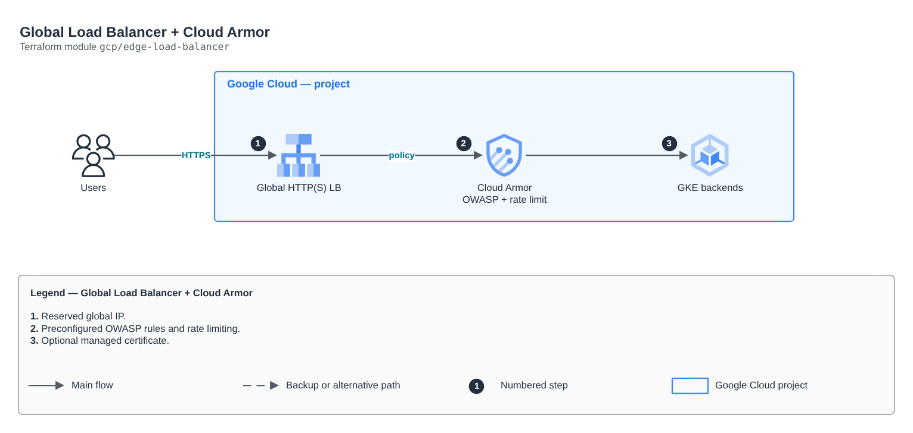

# Global Load Balancer + Cloud Armor

[Português](README.md) · **English**

> `gcp/edge-load-balancer` · category **borda** · origin: Architecture case studies (2026)

> Designed in October 2026 and published now.

Global edge on Google Cloud: reserved global IP and a Cloud Armor policy with preconfigured OWASP rules, per-IP rate limiting and an optional geo rule.

## Architecture



Editable source: [`diagram.drawio`](diagram.drawio) (open it in draw.io / diagrams.net), with Portuguese and English pages.

1. Reserved global IP.
2. Preconfigured OWASP rules and rate limiting.
3. Optional managed certificate.

## Usage

```hcl
module "edge_load_balancer" {
  source = "git::https://github.com/raphaelfcs/automacao_terraform.git//gcp/edge-load-balancer?ref=v1.0.0"

  project_id = "demo-plataforma-dev"
  waf_rules  = { "sqli-v33-stable" = 1000, "xss-v33-stable" = 1001 }
  rate_limit = 60
}
```

## Examples

| Example | Files |
|---|---|
| [`basico`](examples/basico) | `main.tf`, `locals.tf`, `backend.tf` |

Each example has its own backend (state isolated per module and example). Different environments only use another `backend.tf`/`*.tfvars`, without duplicating code.

## Inputs

| Name | Type | Default | Required | Description |
|---|---|---|---|---|
| `project_id` | `string` | - | **yes** |  |
| `policy_name` | `string` | `"armor-lab"` | no | Cloud Armor policy name (referenced in GCPBackendPolicy). |
| `ip_name` | `string` | `"ip-lab"` | no | Global IP name (referenced in the Gateway). |
| `waf_rules` | `map(number)` | - | **yes** | Preconfigured WAF rules (OWASP) with the priority of each. |
| `waf_preview` | `bool` | `false` | no | true = log only, no blocking (good for tuning). |
| `rate_limit` | `number` | `60` | no | Requests per minute per IP before a temporary ban. |
| `allowed_country` | `string` | `""` | no | Allowed country code (e.g. BR). Empty = no geo rule. |
| `enable_https` | `bool` | `false` | no | Creates a managed certificate for <IP>.nip.io. |

## Outputs

| Name | Description |
|---|---|
| `ip_address` |  |
| `policy_name` |  |
| `https_domain` |  |

## Files

- `locals.tf`: derived values
- `main.tf`: main resources
- `outputs.tf`: outputs
- `variables.tf`: inputs and validations
- `versions.tf`: Terraform and provider versions
- `examples/`: ready-to-use compositions
- `tests/`: `terraform test` with mocked providers

## Well-Architected

- Security: private origin, WAF and modern TLS at the edge.
- Performance: edge caching and compression.

## Tests

```bash
cd gcp/edge-load-balancer
terraform init -backend=false
terraform test
```
