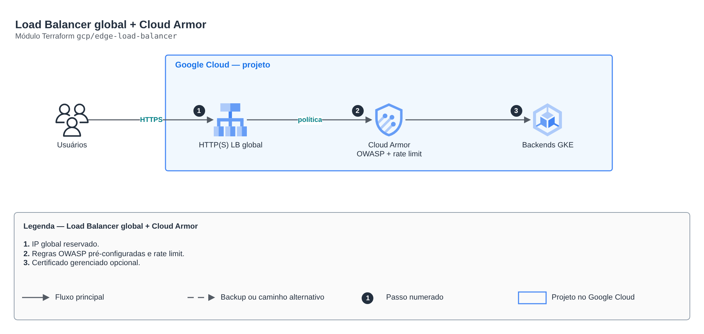

# Load Balancer global + Cloud Armor

> `gcp/edge-load-balancer` · categoria **borda** · origem: Estudos de caso de arquitetura (2026)

> Idealizado em outubro de 2026 e publicado agora.


## Arquitetura



Fonte editável: [`diagram.drawio`](diagram.drawio) (abra no draw.io / diagrams.net).

1. IP global reservado.
2. Regras OWASP pré-configuradas e rate limit.
3. Certificado gerenciado opcional.

## Uso

```hcl
module "edge_load_balancer" {
  source = "git::https://github.com/raphaelfcs/automacao_terraform.git//gcp/edge-load-balancer?ref=v1.0.0"

  project_id = "demo-plataforma-dev"
  waf_rules  = { "sqli-v33-stable" = 1000, "xss-v33-stable" = 1001 }
  rate_limit = 60
}
```

## Exemplos

| Exemplo | Arquivos |
|---|---|
| [`basico`](examples/basico) | `main.tf`, `locals.tf`, `backend.tf` |

Cada exemplo tem seu próprio backend (state isolado por módulo e exemplo). Ambientes diferentes usam apenas outro `backend.tf`/`*.tfvars`, sem duplicar código.

## Entradas

| Nome | Tipo | Padrão | Obrigatória | Descrição |
|---|---|---|---|---|
| `project_id` | `string` | - | **sim** |  |
| `policy_name` | `string` | `"armor-lab"` | não | Nome da política do Cloud Armor (referenciado no GCPBackendPolicy). |
| `ip_name` | `string` | `"ip-lab"` | não | Nome do IP global (referenciado no Gateway). |
| `waf_rules` | `map(number)` | - | **sim** | Regras WAF pré-configuradas (OWASP) com a prioridade de cada uma. |
| `waf_preview` | `bool` | `false` | não | true = só registra no log, sem bloquear (bom para calibrar). |
| `rate_limit` | `number` | `60` | não | Requisições por minuto por IP antes do banimento temporário. |
| `allowed_country` | `string` | `""` | não | Código do país permitido (ex.: BR). Vazio = sem regra geográfica. |
| `enable_https` | `bool` | `false` | não | Cria certificado gerenciado para <IP>.nip.io. |

## Saídas

| Nome | Descrição |
|---|---|
| `ip_address` |  |
| `policy_name` |  |
| `https_domain` |  |

## Arquivos

- `locals.tf`: valores derivados
- `main.tf`: recursos principais
- `outputs.tf`: saídas
- `variables.tf`: entradas e validações
- `versions.tf`: versões do Terraform e providers
- `examples/`: composições prontas para uso
- `tests/`: `terraform test` com providers simulados

## Well-Architected

- Segurança: origem privada, WAF e TLS moderno na borda.
- Performance: cache na borda e compressão.

## Testes

```bash
cd gcp/edge-load-balancer
terraform init -backend=false
terraform test
```
