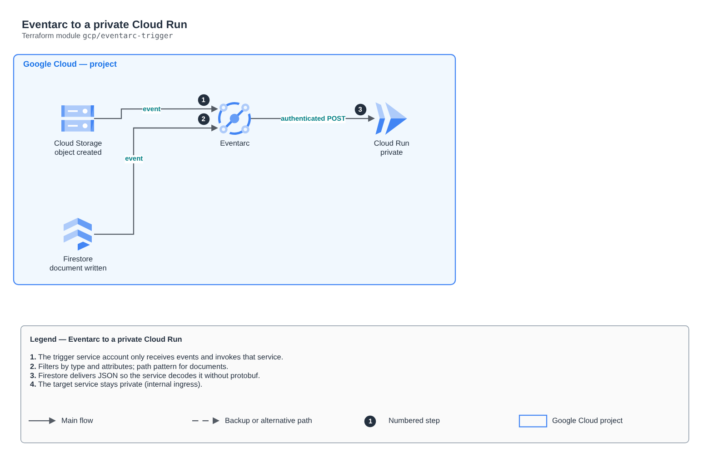

# Eventarc to a private Cloud Run

[Português](README.md) · **English**

> `gcp/eventarc-trigger` · category **integracao** · origin: Health records platform (2026)

> Designed in November 2026 and published now.

Eventarc triggers delivering events (Cloud Storage, Firestore, Pub/Sub...) to a private Cloud Run service. Creates the trigger service account with the minimum (receive events and invoke that service) and, if asked, the permission the Cloud Storage agent needs to publish.

## Architecture



Editable source: [`diagram.drawio`](diagram.drawio) (open it in draw.io / diagrams.net), with Portuguese and English pages.

1. The trigger service account only receives events and invokes that service.
2. Filters by type and attributes; path pattern for documents.
3. Firestore delivers JSON so the service decodes it without protobuf.
4. The target service stays private (internal ingress).

## Usage

```hcl
module "eventarc_trigger" {
  source = "git::https://github.com/raphaelfcs/automacao_terraform.git//gcp/eventarc-trigger?ref=v1.0.0"

  project_id              = local.project_id
  cloud_run_service       = "demo-dev-eventos"
  service_account_id      = "demo-dev-eventarc"
  grant_storage_publisher = true
  triggers = {
    objeto-criado = { filters = { type = "google.cloud.storage.object.v1.finalized", bucket = "demo-dev-documentos" }, path = "/eventos/gcs" }
  }
  labels = local.labels
}
```

## Examples

| Example | Files |
|---|---|
| [`storage-e-firestore`](examples/storage-e-firestore) | `main.tf`, `locals.tf`, `backend.tf` |

Each example has its own backend (state isolated per module and example). Different environments only use another `backend.tf`/`*.tfvars`, without duplicating code.

## Inputs

| Name | Type | Default | Required | Description |
|---|---|---|---|---|
| `project_id` | `string` | - | **yes** | GCP project. |
| `region` | `string` | `"southamerica-east1"` | no | Trigger region (the same as the source bucket/database and the service). |
| `cloud_run_service` | `string` | - | **yes** | Target Cloud Run service name. |
| `service_account_id` | `string` | - | **yes** | ID of the triggers service account. |
| `triggers` | `map(...)` | - | **yes** | Triggers: name -> { filters (attribute = value, including "type"), path_patterns (attribute = pattern, e.g. document = "itens/{id}"), path on the service, content_type }. |
| `grant_storage_publisher` | `bool` | `false` | no | Grants the Cloud Storage agent the Pub/Sub publisher role (required for bucket triggers). |
| `labels` | `map(string)` | `{}` | no | Labels applied. |

## Outputs

| Name | Description |
|---|---|
| `trigger_ids` | Trigger IDs. |
| `service_account_email` | Service account of the triggers. |

## Files

- `main.tf`: main resources
- `outputs.tf`: outputs
- `variables.tf`: inputs and validations
- `versions.tf`: Terraform and provider versions
- `examples/`: ready-to-use compositions
- `tests/`: `terraform test` with mocked providers

## Well-Architected

- Reliability: dead-letter queues (DLQ), retries and event archiving.
- Security: resource policies restricted by source and message encryption.

## Tests

```bash
cd gcp/eventarc-trigger
terraform init -backend=false
terraform test
```
