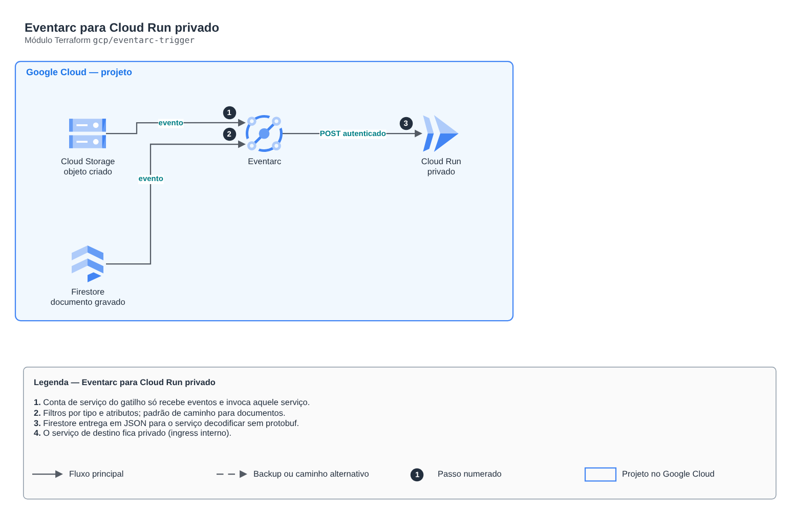

# Eventarc para Cloud Run privado

**Português** · [English](README.en.md)

> `gcp/eventarc-trigger` · categoria **integracao** · origem: Plataforma de documentos de saúde (2026)

> Idealizado em novembro de 2026 e publicado agora.

Gatilhos do Eventarc entregando eventos (Cloud Storage, Firestore, Pub/Sub...) a um serviço Cloud Run privado. Cria a conta de serviço do gatilho com o mínimo (receber eventos e invocar aquele serviço) e, se pedido, a permissão que o agente do Cloud Storage precisa para publicar.

## Arquitetura



Fonte editável: [`diagram.drawio`](diagram.drawio) (abra no draw.io / diagrams.net), com páginas em português e inglês.

1. Conta de serviço do gatilho só recebe eventos e invoca aquele serviço.
2. Filtros por tipo e atributos; padrão de caminho para documentos.
3. Firestore entrega em JSON para o serviço decodificar sem protobuf.
4. O serviço de destino fica privado (ingress interno).

## Uso

```hcl
module "eventarc_trigger" {
  source = "git::https://github.com/raphaelfcs/automacao_terraform.git//gcp/eventarc-trigger?ref=v1.0.0"

  project_id              = local.project_id
  cloud_run_service       = "demo-dev-eventos"
  service_account_id      = "demo-dev-eventarc"
  grant_storage_publisher = true
  triggers = {
    objeto-criado = { filters = { type = "google.cloud.storage.object.v1.finalized", bucket = "demo-dev-documentos" }, path = "/eventos/gcs" }
  }
  labels = local.labels
}
```

## Exemplos

| Exemplo | Arquivos |
|---|---|
| [`storage-e-firestore`](examples/storage-e-firestore) | `main.tf`, `locals.tf`, `backend.tf` |

Cada exemplo tem seu próprio backend (state isolado por módulo e exemplo). Ambientes diferentes usam apenas outro `backend.tf`/`*.tfvars`, sem duplicar código.

## Entradas

| Nome | Tipo | Padrão | Obrigatória | Descrição |
|---|---|---|---|---|
| `project_id` | `string` | - | **sim** | Projeto do GCP. |
| `region` | `string` | `"southamerica-east1"` | não | Região dos gatilhos (a mesma do bucket/banco de origem e do serviço). |
| `cloud_run_service` | `string` | - | **sim** | Nome do serviço Cloud Run de destino. |
| `service_account_id` | `string` | - | **sim** | ID da conta de serviço dos gatilhos. |
| `triggers` | `map(...)` | - | **sim** | Gatilhos: nome -> { filters (atributo = valor, inclui "type"), path_patterns (atributo = padrão, ex.: document = "itens/{id}"), path no serviço, content_type }. |
| `grant_storage_publisher` | `bool` | `false` | não | Dá ao agente do Cloud Storage o papel de publicar no Pub/Sub (necessário para gatilhos de bucket). |
| `labels` | `map(string)` | `{}` | não | Labels aplicados. |

## Saídas

| Nome | Descrição |
|---|---|
| `trigger_ids` | IDs dos gatilhos. |
| `service_account_email` | Conta de serviço dos gatilhos. |

## Arquivos

- `main.tf`: recursos principais
- `outputs.tf`: saídas
- `variables.tf`: entradas e validações
- `versions.tf`: versões do Terraform e providers
- `examples/`: composições prontas para uso
- `tests/`: `terraform test` com providers simulados

## Well-Architected

- Confiabilidade: filas de mensagens mortas (DLQ), retentativas e arquivamento de eventos.
- Segurança: políticas de recurso restritas por origem e cifragem das mensagens.

## Testes

```bash
cd gcp/eventarc-trigger
terraform init -backend=false
terraform test
```
