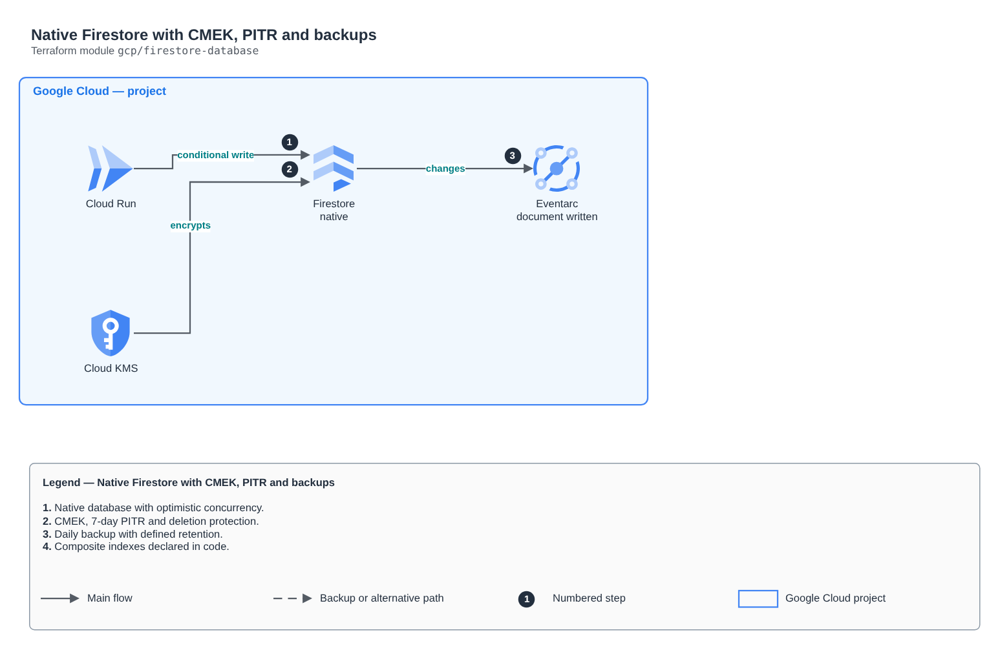

# Native Firestore with CMEK, PITR and backups

[Português](README.md) · **English**

> `gcp/firestore-database` · category **dados** · origin: Health records platform (2026)

> Designed in November 2026 and published now.

Native mode Firestore with CMEK, point-in-time recovery (7 days), deletion protection, scheduled backups and declared composite indexes. Optimistic concurrency: it fits conditional writes (updateTime precondition), with no long transactions locking documents.

## Architecture



Editable source: [`diagram.drawio`](diagram.drawio) (open it in draw.io / diagrams.net), with Portuguese and English pages.

1. Native database with optimistic concurrency.
2. CMEK, 7-day PITR and deletion protection.
3. Daily backup with defined retention.
4. Composite indexes declared in code.

## Usage

```hcl
module "firestore_database" {
  source = "git::https://github.com/raphaelfcs/automacao_terraform.git//gcp/firestore-database?ref=v1.0.0"

  project_id = local.project_id
  kms_key_id = "projects/demo-plataforma-dev/locations/southamerica-east1/keyRings/demo-dev/cryptoKeys/dados"
  composite_indexes = {
    tenant = { collection = "itens", fields = [{ path = "pk" }, { path = "sk" }] }
  }
}
```

## Examples

| Example | Files |
|---|---|
| [`itens`](examples/itens) | `main.tf`, `locals.tf`, `backend.tf` |

Each example has its own backend (state isolated per module and example). Different environments only use another `backend.tf`/`*.tfvars`, without duplicating code.

## Inputs

| Name | Type | Default | Required | Description |
|---|---|---|---|---|
| `project_id` | `string` | - | **yes** | GCP project. |
| `database_name` | `string` | `"(default)"` | no | Database name. "(default)" uses the Firestore daily free quota. |
| `location` | `string` | `"southamerica-east1"` | no | Database region (cannot change after creation). |
| `kms_key_id` | `string` | `null` | no | Cloud KMS key (CMEK), in the same region. The Firestore service agent needs permission on it. |
| `point_in_time_recovery` | `bool` | `true` | no | Read any point in time from the last 7 days. |
| `delete_protection` | `bool` | `true` | no | Prevents deleting the database (and abandons instead of deleting on destroy). |
| `daily_backup_retention_days` | `number` | `14` | no | Daily backup kept for N days (max 98). null = no scheduled backup. |
| `composite_indexes` | `map(...)` | `{}` | no | Composite indexes: name -> { collection, fields = [{ path, order }] }. |

## Outputs

| Name | Description |
|---|---|
| `name` | Database name. |
| `id` | Database ID (projects/.../databases/...). |

## Files

- `main.tf`: main resources
- `outputs.tf`: outputs
- `variables.tf`: inputs and validations
- `versions.tf`: Terraform and provider versions
- `examples/`: ready-to-use compositions
- `tests/`: `terraform test` with mocked providers

## Well-Architected

- Reliability: automatic backups, configurable Multi-AZ/high availability and deletion protection.
- Security: private-only access, mandatory TLS and data encrypted at rest with KMS/CMK.

## Tests

```bash
cd gcp/firestore-database
terraform init -backend=false
terraform test
```
