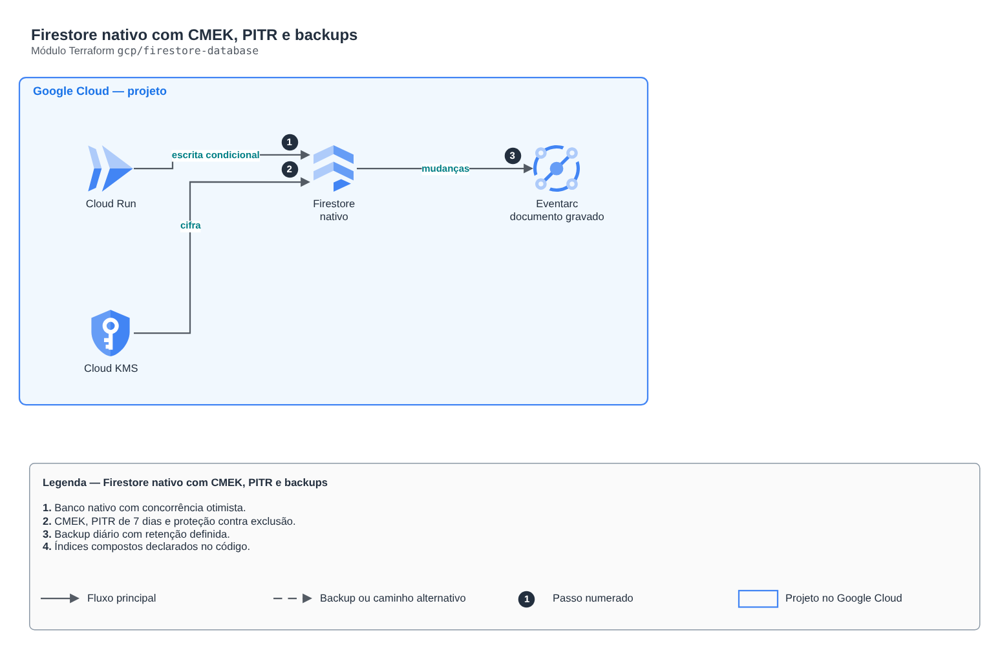

# Firestore nativo com CMEK, PITR e backups

**Português** · [English](README.en.md)

> `gcp/firestore-database` · categoria **dados** · origem: Plataforma de documentos de saúde (2026)

> Idealizado em novembro de 2026 e publicado agora.

Firestore em modo nativo com CMEK, recuperação point-in-time (7 dias), proteção contra exclusão, backups agendados e índices compostos declarados. Concorrência otimista: combina com escritas condicionais (precondição de updateTime), sem transações longas travando documentos.

## Arquitetura



Fonte editável: [`diagram.drawio`](diagram.drawio) (abra no draw.io / diagrams.net), com páginas em português e inglês.

1. Banco nativo com concorrência otimista.
2. CMEK, PITR de 7 dias e proteção contra exclusão.
3. Backup diário com retenção definida.
4. Índices compostos declarados no código.

## Uso

```hcl
module "firestore_database" {
  source = "git::https://github.com/raphaelfcs/automacao_terraform.git//gcp/firestore-database?ref=v1.0.0"

  project_id = local.project_id
  kms_key_id = "projects/demo-plataforma-dev/locations/southamerica-east1/keyRings/demo-dev/cryptoKeys/dados"
  composite_indexes = {
    tenant = { collection = "itens", fields = [{ path = "pk" }, { path = "sk" }] }
  }
}
```

## Exemplos

| Exemplo | Arquivos |
|---|---|
| [`itens`](examples/itens) | `main.tf`, `locals.tf`, `backend.tf` |

Cada exemplo tem seu próprio backend (state isolado por módulo e exemplo). Ambientes diferentes usam apenas outro `backend.tf`/`*.tfvars`, sem duplicar código.

## Entradas

| Nome | Tipo | Padrão | Obrigatória | Descrição |
|---|---|---|---|---|
| `project_id` | `string` | - | **sim** | Projeto do GCP. |
| `database_name` | `string` | `"(default)"` | não | Nome do banco. "(default)" usa a cota gratuita diária do Firestore. |
| `location` | `string` | `"southamerica-east1"` | não | Região do banco (não muda depois de criado). |
| `kms_key_id` | `string` | `null` | não | Chave do Cloud KMS (CMEK), na mesma região. O agente de serviço do Firestore precisa de permissão nela. |
| `point_in_time_recovery` | `bool` | `true` | não | Leitura de qualquer instante dos últimos 7 dias. |
| `delete_protection` | `bool` | `true` | não | Impede excluir o banco (e abandona em vez de apagar no destroy). |
| `daily_backup_retention_days` | `number` | `14` | não | Backup diário retido por N dias (máximo 98). null = sem backup agendado. |
| `composite_indexes` | `map(...)` | `{}` | não | Índices compostos: nome -> { collection, fields = [{ path, order }] }. |

## Saídas

| Nome | Descrição |
|---|---|
| `name` | Nome do banco. |
| `id` | ID do banco (projects/.../databases/...). |

## Arquivos

- `main.tf`: recursos principais
- `outputs.tf`: saídas
- `variables.tf`: entradas e validações
- `versions.tf`: versões do Terraform e providers
- `examples/`: composições prontas para uso
- `tests/`: `terraform test` com providers simulados

## Well-Architected

- Confiabilidade: backups automáticos, Multi-AZ/alta disponibilidade configuráveis e proteção contra exclusão.
- Segurança: acesso somente privado, TLS obrigatório e dados cifrados em repouso com KMS/CMK.

## Testes

```bash
cd gcp/firestore-database
terraform init -backend=false
terraform test
```
