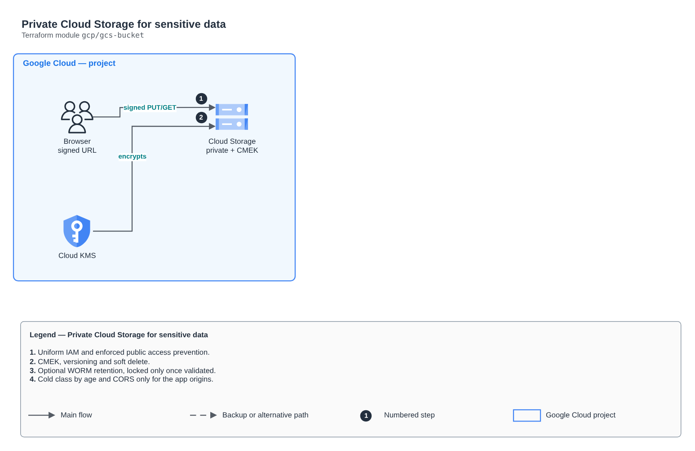

# Private Cloud Storage for sensitive data

[Português](README.md) · **English**

> `gcp/gcs-bucket` · category **armazenamento** · origin: Health records platform (2026)

> Designed in November 2026 and published now.

Private Cloud Storage bucket for sensitive data: uniform IAM access, enforced public access prevention, CMEK, versioning, soft delete, optional retention (WORM, with lock), storage class change by age and CORS only for the app origins (signed URLs in the browser).

## Architecture



Editable source: [`diagram.drawio`](diagram.drawio) (open it in draw.io / diagrams.net), with Portuguese and English pages.

1. Uniform IAM and enforced public access prevention.
2. CMEK, versioning and soft delete.
3. Optional WORM retention, locked only once validated.
4. Cold class by age and CORS only for the app origins.

## Usage

```hcl
module "gcs_bucket" {
  source = "git::https://github.com/raphaelfcs/automacao_terraform.git//gcp/gcs-bucket?ref=v1.0.0"

  project_id      = local.project_id
  name            = "demo-dev-documentos"
  kms_key_id      = "projects/demo-plataforma-dev/locations/southamerica-east1/keyRings/demo-dev/cryptoKeys/dados"
  cold_after_days = 30
  cors_origins    = ["https://app.example.com"]
  labels          = local.labels
}
```

## Examples

| Example | Files |
|---|---|
| [`documentos`](examples/documentos) | `main.tf`, `locals.tf`, `backend.tf` |

Each example has its own backend (state isolated per module and example). Different environments only use another `backend.tf`/`*.tfvars`, without duplicating code.

## Inputs

| Name | Type | Default | Required | Description |
|---|---|---|---|---|
| `project_id` | `string` | - | **yes** | GCP project. |
| `name` | `string` | - | **yes** | Global bucket name. |
| `location` | `string` | `"southamerica-east1"` | no | Bucket region. |
| `kms_key_id` | `string` | `null` | no | Cloud KMS key (CMEK). The Storage service agent needs permission on it. |
| `versioning` | `bool` | `true` | no | Keeps previous object versions. |
| `noncurrent_delete_days` | `number` | `30` | no | Deletes old versions after N days. null = keep them. |
| `soft_delete_days` | `number` | `7` | no | Recovery window for deleted objects (0 to 90 days). |
| `retention_days` | `number` | `null` | no | Minimum retention of each object (WORM). null = no retention. |
| `lock_retention` | `bool` | `false` | no | Locks the retention forever (irreversible). Use it only in production, after validating the period. |
| `cold_after_days` | `number` | `null` | no | Moves objects to a cold class after N days. null = do not move. |
| `cold_storage_class` | `string` | `"NEARLINE"` | no | Cold class: NEARLINE (monthly access), COLDLINE or ARCHIVE. |
| `cors_origins` | `list(string)` | `[]` | no | App https origins that upload/download with a signed URL. Empty = no CORS. |
| `iam_bindings` | `list(...)` | `[]` | no | Bucket permissions: list of { role, member }. |
| `force_destroy` | `bool` | `false` | no | Allows destroying with objects inside (disposable environments only). |
| `labels` | `map(string)` | `{}` | no | Labels applied. |

## Outputs

| Name | Description |
|---|---|
| `name` | Bucket name. |
| `url` | Bucket gs:// URL. |

## Files

- `main.tf`: main resources
- `outputs.tf`: outputs
- `variables.tf`: inputs and validations
- `versions.tf`: Terraform and provider versions
- `examples/`: ready-to-use compositions
- `tests/`: `terraform test` with mocked providers

## Well-Architected

- Security: public access blocked, encryption and identity-based authentication.
- Reliability: versioning and reversible deletion.

## Tests

```bash
cd gcp/gcs-bucket
terraform init -backend=false
terraform test
```
