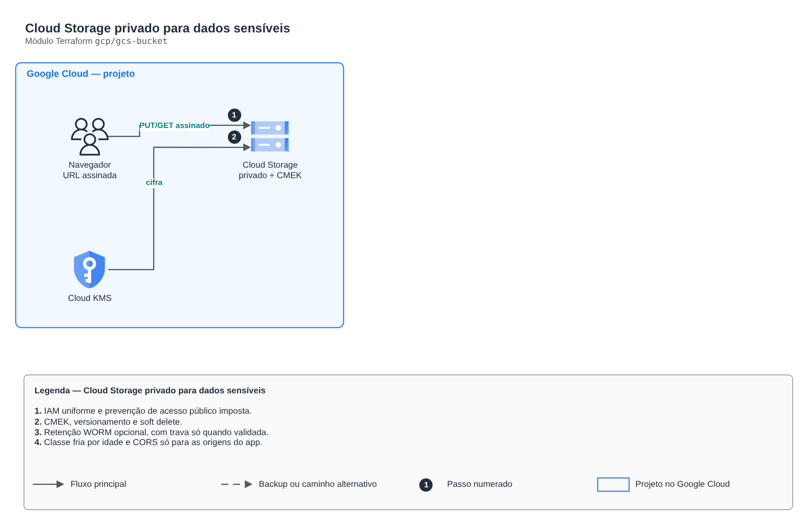

# Cloud Storage privado para dados sensíveis

**Português** · [English](README.en.md)

> `gcp/gcs-bucket` · categoria **armazenamento** · origem: Plataforma de documentos de saúde (2026)

> Idealizado em novembro de 2026 e publicado agora.

Bucket privado do Cloud Storage para dados sensíveis: acesso uniforme por IAM, prevenção de acesso público imposta, CMEK, versionamento, soft delete, retenção opcional (WORM, com trava), mudança de classe por idade e CORS só para as origens do app (URL assinada no navegador).

## Arquitetura



Fonte editável: [`diagram.drawio`](diagram.drawio) (abra no draw.io / diagrams.net), com páginas em português e inglês.

1. IAM uniforme e prevenção de acesso público imposta.
2. CMEK, versionamento e soft delete.
3. Retenção WORM opcional, com trava só quando validada.
4. Classe fria por idade e CORS só para as origens do app.

## Uso

```hcl
module "gcs_bucket" {
  source = "git::https://github.com/raphaelfcs/automacao_terraform.git//gcp/gcs-bucket?ref=v1.0.0"

  project_id      = local.project_id
  name            = "demo-dev-documentos"
  kms_key_id      = "projects/demo-plataforma-dev/locations/southamerica-east1/keyRings/demo-dev/cryptoKeys/dados"
  cold_after_days = 30
  cors_origins    = ["https://app.example.com"]
  labels          = local.labels
}
```

## Exemplos

| Exemplo | Arquivos |
|---|---|
| [`documentos`](examples/documentos) | `main.tf`, `locals.tf`, `backend.tf` |

Cada exemplo tem seu próprio backend (state isolado por módulo e exemplo). Ambientes diferentes usam apenas outro `backend.tf`/`*.tfvars`, sem duplicar código.

## Entradas

| Nome | Tipo | Padrão | Obrigatória | Descrição |
|---|---|---|---|---|
| `project_id` | `string` | - | **sim** | Projeto do GCP. |
| `name` | `string` | - | **sim** | Nome global do bucket. |
| `location` | `string` | `"southamerica-east1"` | não | Região do bucket. |
| `kms_key_id` | `string` | `null` | não | Chave do Cloud KMS (CMEK). O agente de serviço do Storage precisa de permissão nela. |
| `versioning` | `bool` | `true` | não | Mantém versões anteriores dos objetos. |
| `noncurrent_delete_days` | `number` | `30` | não | Apaga versões antigas depois de N dias. null = mantém. |
| `soft_delete_days` | `number` | `7` | não | Janela de recuperação de objetos apagados (0 a 90 dias). |
| `retention_days` | `number` | `null` | não | Retenção mínima de cada objeto (WORM). null = sem retenção. |
| `lock_retention` | `bool` | `false` | não | Trava a retenção para sempre (irreversível). Use só em produção, depois de validar o prazo. |
| `cold_after_days` | `number` | `null` | não | Move objetos para classe fria depois de N dias. null = não move. |
| `cold_storage_class` | `string` | `"NEARLINE"` | não | Classe fria: NEARLINE (acesso mensal), COLDLINE ou ARCHIVE. |
| `cors_origins` | `list(string)` | `[]` | não | Origens https do app que enviam/baixam com URL assinada. Vazio = sem CORS. |
| `iam_bindings` | `list(...)` | `[]` | não | Permissões no bucket: lista de { role, member }. |
| `force_destroy` | `bool` | `false` | não | Permite destruir com objetos dentro (só para ambientes descartáveis). |
| `labels` | `map(string)` | `{}` | não | Labels aplicados. |

## Saídas

| Nome | Descrição |
|---|---|
| `name` | Nome do bucket. |
| `url` | URL gs:// do bucket. |

## Arquivos

- `main.tf`: recursos principais
- `outputs.tf`: saídas
- `variables.tf`: entradas e validações
- `versions.tf`: versões do Terraform e providers
- `examples/`: composições prontas para uso
- `tests/`: `terraform test` com providers simulados

## Well-Architected

- Segurança: acesso público bloqueado, criptografia e autenticação por identidade.
- Confiabilidade: versionamento e exclusão reversível.

## Testes

```bash
cd gcp/gcs-bucket
terraform init -backend=false
terraform test
```
