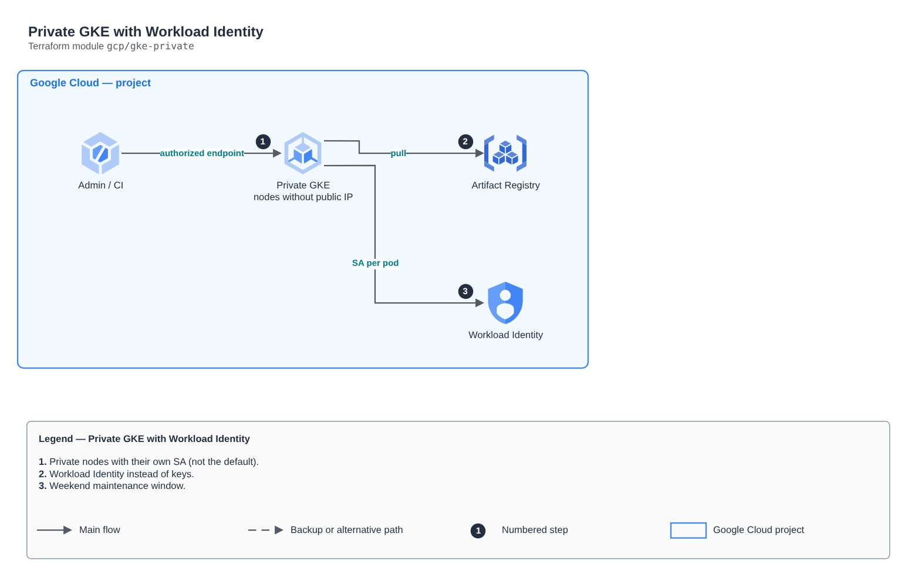

# Private GKE with Workload Identity

[Português](README.md) · **English**

> `gcp/gke-private` · category **containers** · origin: Architecture case studies (2026)

> Designed in October 2026 and published now.

Private regional GKE Autopilot: nodes without public IP, dedicated service account, Workload Identity, authorized endpoint and maintenance window.

## Architecture



Editable source: [`diagram.drawio`](diagram.drawio) (open it in draw.io / diagrams.net), with Portuguese and English pages.

1. Private nodes with their own SA (not the default).
2. Workload Identity instead of keys.
3. Weekend maintenance window.

## Usage

```hcl
module "gke_private" {
  source = "git::https://github.com/raphaelfcs/automacao_terraform.git//gcp/gke-private?ref=v1.0.0"

  project_id          = "demo-plataforma-dev"
  region              = local.region
  network_self_link   = "projects/demo-plataforma-dev/global/networks/vpc-demo"
  subnet_self_link    = "projects/demo-plataforma-dev/regions/southamerica-east1/subnetworks/sn-gke-sp"
  pods_range_name     = "pods"
  services_range_name = "services"
  maintenance_window  = { start = "2026-01-01T05:00:00Z", end = "2026-01-01T09:00:00Z", recurrence = "FREQ=WEEKLY;BYDAY=SA,SU" }
  labels              = local.labels
}
```

## Examples

| Example | Files |
|---|---|
| [`basico`](examples/basico) | `main.tf`, `locals.tf`, `backend.tf` |

Each example has its own backend (state isolated per module and example). Different environments only use another `backend.tf`/`*.tfvars`, without duplicating code.

## Inputs

| Name | Type | Default | Required | Description |
|---|---|---|---|---|
| `project_id` | `string` | - | **yes** |  |
| `region` | `string` | - | **yes** |  |
| `cluster_name` | `string` | `"gke-lab"` | no |  |
| `network_self_link` | `string` | - | **yes** |  |
| `subnet_self_link` | `string` | - | **yes** |  |
| `pods_range_name` | `string` | - | **yes** |  |
| `services_range_name` | `string` | - | **yes** |  |
| `release_channel` | `string` | `"REGULAR"` | no | RAPID, REGULAR or STABLE. |
| `authorized_networks` | `list(...)` | `[]` | no | Networks allowed to call the control plane. Empty list = no restriction (lab only). |
| `maintenance_window` | `object(...)` | - | **yes** | Recurring maintenance window (UTC). |
| `artifact_repo` | `string` | `"lab"` | no |  |
| `deletion_protection` | `bool` | `false` | no |  |
| `labels` | `map(string)` | `{}` | no |  |

## Outputs

| Name | Description |
|---|---|
| `cluster_name` |  |
| `workload_pool` |  |
| `artifact_repo` |  |

## Files

- `iam.tf`: policies, roles and permissions
- `locals.tf`: derived values
- `main.tf`: main resources
- `outputs.tf`: outputs
- `variables.tf`: inputs and validations
- `versions.tf`: Terraform and provider versions
- `examples/`: ready-to-use compositions
- `tests/`: `terraform test` with mocked providers

## Well-Architected

- Security: private endpoint and nodes, workload identity (IRSA/Workload Identity) and encrypted secrets.
- Performance efficiency: automatic node and pod scaling.

## Tests

```bash
cd gcp/gke-private
terraform init -backend=false
terraform test
```
