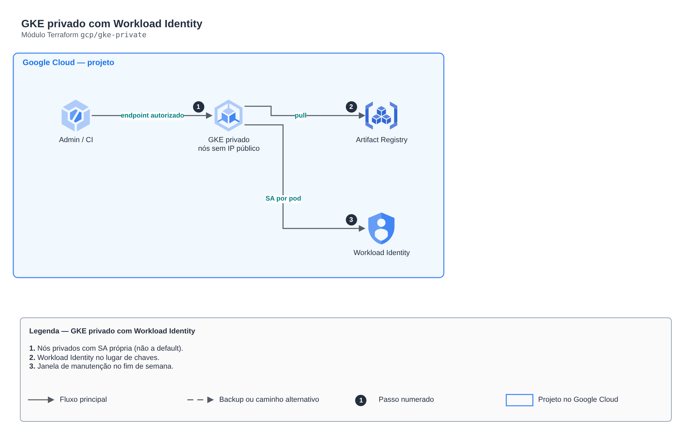

# GKE privado com Workload Identity

> `gcp/gke-private` · categoria **containers** · origem: Estudos de caso de arquitetura (2026)

> Idealizado em outubro de 2026 e publicado agora.


## Arquitetura



Fonte editável: [`diagram.drawio`](diagram.drawio) (abra no draw.io / diagrams.net).

1. Nós privados com SA própria (não a default).
2. Workload Identity no lugar de chaves.
3. Janela de manutenção no fim de semana.

## Uso

```hcl
module "gke_private" {
  source = "git::https://github.com/raphaelfcs/automacao_terraform.git//gcp/gke-private?ref=v1.0.0"

  project_id          = "demo-plataforma-dev"
  region              = local.region
  network_self_link   = "projects/demo-plataforma-dev/global/networks/vpc-demo"
  subnet_self_link    = "projects/demo-plataforma-dev/regions/southamerica-east1/subnetworks/sn-gke-sp"
  pods_range_name     = "pods"
  services_range_name = "services"
  maintenance_window  = { start = "2026-01-01T05:00:00Z", end = "2026-01-01T09:00:00Z", recurrence = "FREQ=WEEKLY;BYDAY=SA,SU" }
  labels              = local.labels
}
```

## Exemplos

| Exemplo | Arquivos |
|---|---|
| [`basico`](examples/basico) | `main.tf`, `locals.tf`, `backend.tf` |

Cada exemplo tem seu próprio backend (state isolado por módulo e exemplo). Ambientes diferentes usam apenas outro `backend.tf`/`*.tfvars`, sem duplicar código.

## Entradas

| Nome | Tipo | Padrão | Obrigatória | Descrição |
|---|---|---|---|---|
| `project_id` | `string` | - | **sim** |  |
| `region` | `string` | - | **sim** |  |
| `cluster_name` | `string` | `"gke-lab"` | não |  |
| `network_self_link` | `string` | - | **sim** |  |
| `subnet_self_link` | `string` | - | **sim** |  |
| `pods_range_name` | `string` | - | **sim** |  |
| `services_range_name` | `string` | - | **sim** |  |
| `release_channel` | `string` | `"REGULAR"` | não | RAPID, REGULAR ou STABLE. |
| `authorized_networks` | `list(...)` | `[]` | não | Redes que podem chamar o plano de controle. Lista vazia = sem restrição (só para laboratório). |
| `maintenance_window` | `object(...)` | - | **sim** | Janela recorrente de manutenção (UTC). |
| `artifact_repo` | `string` | `"lab"` | não |  |
| `deletion_protection` | `bool` | `false` | não |  |
| `labels` | `map(string)` | `{}` | não |  |

## Saídas

| Nome | Descrição |
|---|---|
| `cluster_name` |  |
| `workload_pool` |  |
| `artifact_repo` |  |

## Arquivos

- `iam.tf`: políticas, papéis e permissões
- `locals.tf`: valores derivados
- `main.tf`: recursos principais
- `outputs.tf`: saídas
- `variables.tf`: entradas e validações
- `versions.tf`: versões do Terraform e providers
- `examples/`: composições prontas para uso
- `tests/`: `terraform test` com providers simulados

## Well-Architected

- Segurança: endpoint e nós privados, identidade por workload (IRSA/Workload Identity) e segredos cifrados.
- Eficiência de performance: escalonamento automático de nós e pods.

## Testes

```bash
cd gcp/gke-private
terraform init -backend=false
terraform test
```
