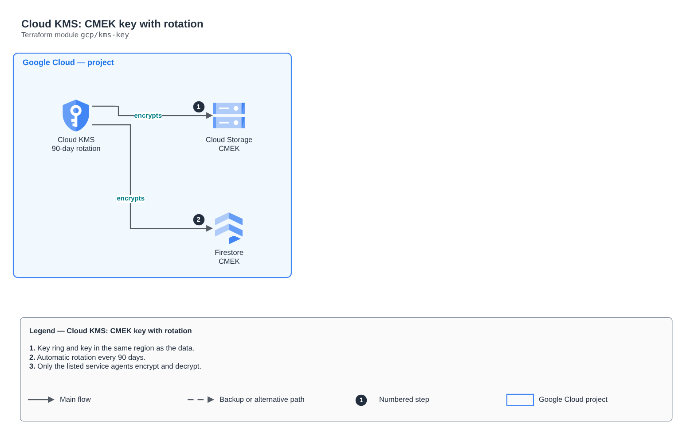

# Cloud KMS: CMEK key with rotation

[Português](README.md) · **English**

> `gcp/kms-key` · category **seguranca** · origin: Health records platform (2026)

> Designed in November 2026 and published now.

Cloud KMS key (CMEK) with automatic rotation and usage granted only to who needs it (Cloud Storage, Firestore service agents etc.). Cloud KMS keys are not really deleted: destroying schedules the destruction of versions, so the name is stable per environment.

## Architecture



Editable source: [`diagram.drawio`](diagram.drawio) (open it in draw.io / diagrams.net), with Portuguese and English pages.

1. Key ring and key in the same region as the data.
2. Automatic rotation every 90 days.
3. Only the listed service agents encrypt and decrypt.

## Usage

```hcl
module "kms_key" {
  source = "git::https://github.com/raphaelfcs/automacao_terraform.git//gcp/kms-key?ref=v1.0.0"

  project_id                  = local.project_id
  key_ring_name               = "demo-dev"
  key_name                    = "dados"
  encrypter_decrypter_members = ["serviceAccount:service-123456789012@gs-project-accounts.iam.gserviceaccount.com"]
  labels                      = local.labels
}
```

## Examples

| Example | Files |
|---|---|
| [`dados`](examples/dados) | `main.tf`, `locals.tf`, `backend.tf` |

Each example has its own backend (state isolated per module and example). Different environments only use another `backend.tf`/`*.tfvars`, without duplicating code.

## Inputs

| Name | Type | Default | Required | Description |
|---|---|---|---|---|
| `project_id` | `string` | - | **yes** | GCP project. |
| `location` | `string` | `"southamerica-east1"` | no | Key region (the same as the data it encrypts). |
| `key_ring_name` | `string` | - | **yes** | Key ring name. |
| `key_name` | `string` | - | **yes** | Key name. |
| `rotation_period` | `string` | `"7776000s"` | no | Automatic rotation (seconds with an s suffix). Default: 90 days. |
| `protection_level` | `string` | `"SOFTWARE"` | no | SOFTWARE or HSM (HSM costs more per key version and per operation). |
| `encrypter_decrypter_members` | `list(string)` | `[]` | no | Members that encrypt/decrypt with the key (e.g. serviceAccount:service-123@gs-project-accounts.iam.gserviceaccount.com). |
| `labels` | `map(string)` | `{}` | no | Labels applied. |

## Outputs

| Name | Description |
|---|---|
| `key_id` | Full key ID (projects/.../cryptoKeys/...), used as CMEK. |
| `key_ring_id` | Key ring ID. |

## Files

- `main.tf`: main resources
- `outputs.tf`: outputs
- `variables.tf`: inputs and validations
- `versions.tf`: Terraform and provider versions
- `examples/`: ready-to-use compositions
- `tests/`: `terraform test` with mocked providers

## Well-Architected

- Security: least privilege in policies, customer-managed key encryption and an audit trail.
- Operational excellence: everything declared in code, reviewed in PRs and tested with `terraform test`.

## Tests

```bash
cd gcp/kms-key
terraform init -backend=false
terraform test
```
