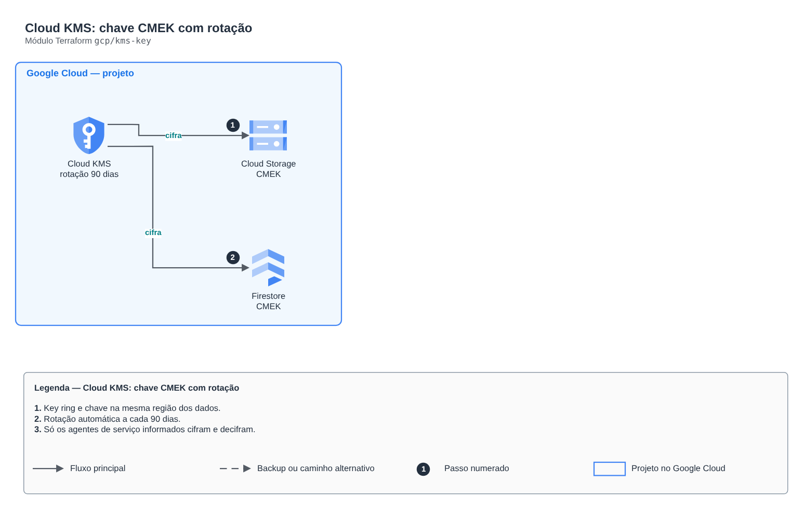

# Cloud KMS: chave CMEK com rotação

**Português** · [English](README.en.md)

> `gcp/kms-key` · categoria **seguranca** · origem: Plataforma de documentos de saúde (2026)

> Idealizado em novembro de 2026 e publicado agora.

Chave do Cloud KMS (CMEK) com rotação automática e permissão de uso só para quem precisa (agentes de serviço do Cloud Storage, Firestore etc.). Chaves do Cloud KMS não são apagadas de verdade: destruir agenda a destruição das versões, por isso o nome é estável por ambiente.

## Arquitetura



Fonte editável: [`diagram.drawio`](diagram.drawio) (abra no draw.io / diagrams.net), com páginas em português e inglês.

1. Key ring e chave na mesma região dos dados.
2. Rotação automática a cada 90 dias.
3. Só os agentes de serviço informados cifram e decifram.

## Uso

```hcl
module "kms_key" {
  source = "git::https://github.com/raphaelfcs/automacao_terraform.git//gcp/kms-key?ref=v1.0.0"

  project_id                  = local.project_id
  key_ring_name               = "demo-dev"
  key_name                    = "dados"
  encrypter_decrypter_members = ["serviceAccount:service-123456789012@gs-project-accounts.iam.gserviceaccount.com"]
  labels                      = local.labels
}
```

## Exemplos

| Exemplo | Arquivos |
|---|---|
| [`dados`](examples/dados) | `main.tf`, `locals.tf`, `backend.tf` |

Cada exemplo tem seu próprio backend (state isolado por módulo e exemplo). Ambientes diferentes usam apenas outro `backend.tf`/`*.tfvars`, sem duplicar código.

## Entradas

| Nome | Tipo | Padrão | Obrigatória | Descrição |
|---|---|---|---|---|
| `project_id` | `string` | - | **sim** | Projeto do GCP. |
| `location` | `string` | `"southamerica-east1"` | não | Região da chave (a mesma dos dados que ela cifra). |
| `key_ring_name` | `string` | - | **sim** | Nome do key ring. |
| `key_name` | `string` | - | **sim** | Nome da chave. |
| `rotation_period` | `string` | `"7776000s"` | não | Rotação automática (segundos com sufixo s). Padrão: 90 dias. |
| `protection_level` | `string` | `"SOFTWARE"` | não | SOFTWARE ou HSM (HSM custa mais por versão de chave e por operação). |
| `encrypter_decrypter_members` | `list(string)` | `[]` | não | Membros que cifram/decifram com a chave (ex.: serviceAccount:service-123@gs-project-accounts.iam.gserviceaccount.com). |
| `labels` | `map(string)` | `{}` | não | Labels aplicados. |

## Saídas

| Nome | Descrição |
|---|---|
| `key_id` | ID completo da chave (projects/.../cryptoKeys/...), usado como CMEK. |
| `key_ring_id` | ID do key ring. |

## Arquivos

- `main.tf`: recursos principais
- `outputs.tf`: saídas
- `variables.tf`: entradas e validações
- `versions.tf`: versões do Terraform e providers
- `examples/`: composições prontas para uso
- `tests/`: `terraform test` com providers simulados

## Well-Architected

- Segurança: privilégio mínimo nas políticas, criptografia com chave gerenciada pelo cliente e trilha de auditoria.
- Excelência operacional: tudo declarado em código, revisado em PR e testado com `terraform test`.

## Testes

```bash
cd gcp/kms-key
terraform init -backend=false
terraform test
```
