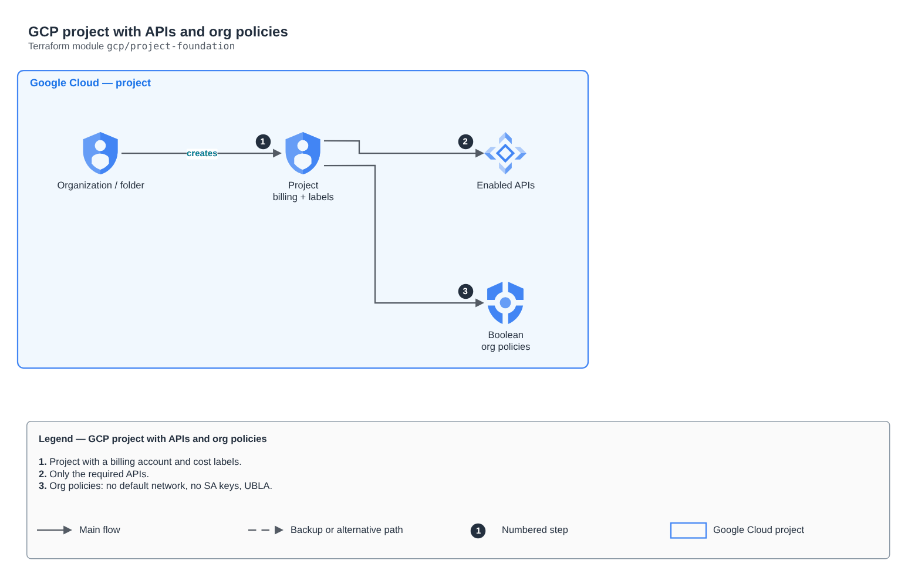

# GCP project with APIs and org policies

[Português](README.md) · **English**

> `gcp/project-foundation` · category **governanca** · origin: Architecture case studies (2026)

> Designed in October 2026 and published now.

Google Cloud project with a billing account, cost labels, only the required APIs and boolean Org Policies applied at the folder.

## Architecture



Editable source: [`diagram.drawio`](diagram.drawio) (open it in draw.io / diagrams.net), with Portuguese and English pages.

1. Project with a billing account and cost labels.
2. Only the required APIs.
3. Org policies: no default network, no SA keys, UBLA.

## Usage

```hcl
module "project_foundation" {
  source = "git::https://github.com/raphaelfcs/automacao_terraform.git//gcp/project-foundation?ref=v1.0.0"

  project_id       = "demo-plataforma-dev"
  project_name     = "Demo Plataforma"
  billing_account  = "000000-000000-000000"
  apis             = ["compute.googleapis.com", "container.googleapis.com", "sqladmin.googleapis.com"]
  boolean_policies = ["compute.skipDefaultNetworkCreation", "iam.disableServiceAccountKeyCreation", "storage.uniformBucketLevelAccess"]
  labels           = local.labels
}
```

## Examples

| Example | Files |
|---|---|
| [`basico`](examples/basico) | `main.tf`, `locals.tf`, `backend.tf` |

Each example has its own backend (state isolated per module and example). Different environments only use another `backend.tf`/`*.tfvars`, without duplicating code.

## Inputs

| Name | Type | Default | Required | Description |
|---|---|---|---|---|
| `project_id` | `string` | - | **yes** | Lab project ID (globally unique). |
| `project_name` | `string` | - | **yes** | Project display name. |
| `billing_account` | `string` | - | **yes** | Billing account ID (XXXXXX-XXXXXX-XXXXXX). |
| `org_id` | `string` | `""` | no | Numeric organization ID. Empty = account without organization (no folder and no Org Policies). |
| `folder_name` | `string` | `"fldr-lab"` | no | Folder created in the organization. |
| `apis` | `list(string)` | - | **yes** | APIs enabled in the project. |
| `labels` | `map(string)` | `{}` | no | Labels applied to the project (the basis for FinOps). |
| `boolean_policies` | `list(string)` | `[]` | no | Boolean Org Policies applied to the folder (organization only). |

## Outputs

| Name | Description |
|---|---|
| `project_id` |  |
| `project_number` |  |
| `folder` |  |

## Files

- `locals.tf`: derived values
- `main.tf`: main resources
- `outputs.tf`: outputs
- `variables.tf`: inputs and validations
- `versions.tf`: Terraform and provider versions
- `examples/`: ready-to-use compositions
- `tests/`: `terraform test` with mocked providers

## Well-Architected

- Security: preventive guardrails at the organization (SCP/org policies) instead of manual fixes.
- Operational excellence: standards applied when the account/project is created, not afterwards.

## Tests

```bash
cd gcp/project-foundation
terraform init -backend=false
terraform test
```
