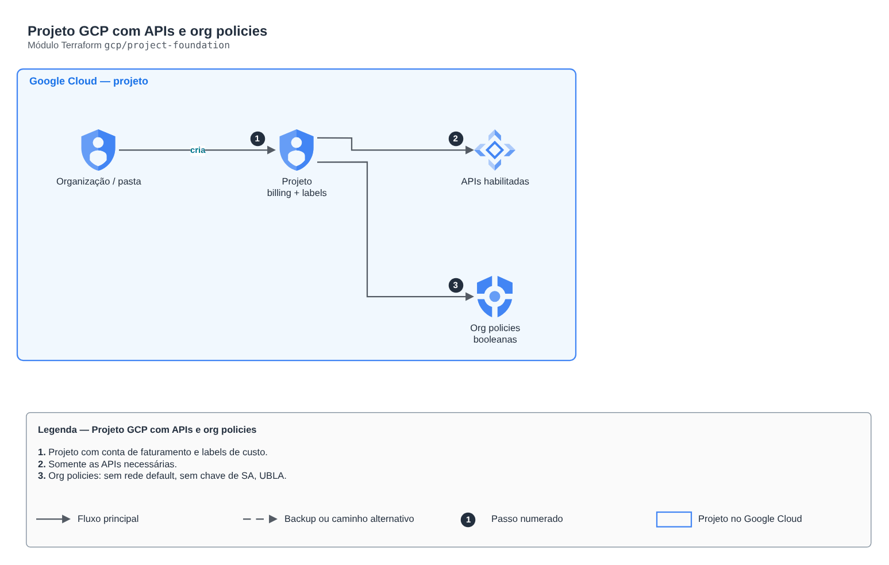

# Projeto GCP com APIs e org policies

**Português** · [English](README.en.md)

> `gcp/project-foundation` · categoria **governanca** · origem: Estudos de caso de arquitetura (2026)

> Idealizado em outubro de 2026 e publicado agora.

Projeto no Google Cloud com conta de faturamento, labels de custo, somente as APIs necessárias e Org Policies booleanas aplicadas na pasta.

## Arquitetura



Fonte editável: [`diagram.drawio`](diagram.drawio) (abra no draw.io / diagrams.net), com páginas em português e inglês.

1. Projeto com conta de faturamento e labels de custo.
2. Somente as APIs necessárias.
3. Org policies: sem rede default, sem chave de SA, UBLA.

## Uso

```hcl
module "project_foundation" {
  source = "git::https://github.com/raphaelfcs/automacao_terraform.git//gcp/project-foundation?ref=v1.0.0"

  project_id       = "demo-plataforma-dev"
  project_name     = "Demo Plataforma"
  billing_account  = "000000-000000-000000"
  apis             = ["compute.googleapis.com", "container.googleapis.com", "sqladmin.googleapis.com"]
  boolean_policies = ["compute.skipDefaultNetworkCreation", "iam.disableServiceAccountKeyCreation", "storage.uniformBucketLevelAccess"]
  labels           = local.labels
}
```

## Exemplos

| Exemplo | Arquivos |
|---|---|
| [`basico`](examples/basico) | `main.tf`, `locals.tf`, `backend.tf` |

Cada exemplo tem seu próprio backend (state isolado por módulo e exemplo). Ambientes diferentes usam apenas outro `backend.tf`/`*.tfvars`, sem duplicar código.

## Entradas

| Nome | Tipo | Padrão | Obrigatória | Descrição |
|---|---|---|---|---|
| `project_id` | `string` | - | **sim** | ID do projeto do laboratório (único no mundo). |
| `project_name` | `string` | - | **sim** | Nome exibido do projeto. |
| `billing_account` | `string` | - | **sim** | ID da conta de faturamento (XXXXXX-XXXXXX-XXXXXX). |
| `org_id` | `string` | `""` | não | ID numérico da organização. Vazio = conta sem organização (sem pasta e sem Org Policies). |
| `folder_name` | `string` | `"fldr-lab"` | não | Nome da pasta criada na organização. |
| `apis` | `list(string)` | - | **sim** | APIs habilitadas no projeto. |
| `labels` | `map(string)` | `{}` | não | Labels aplicadas ao projeto (base para FinOps). |
| `boolean_policies` | `list(string)` | `[]` | não | Org Policies booleanas aplicadas na pasta (só com organização). |

## Saídas

| Nome | Descrição |
|---|---|
| `project_id` |  |
| `project_number` |  |
| `folder` |  |

## Arquivos

- `locals.tf`: valores derivados
- `main.tf`: recursos principais
- `outputs.tf`: saídas
- `variables.tf`: entradas e validações
- `versions.tf`: versões do Terraform e providers
- `examples/`: composições prontas para uso
- `tests/`: `terraform test` com providers simulados

## Well-Architected

- Segurança: guardrails preventivos na organização (SCP/org policies) em vez de correções manuais.
- Excelência operacional: padrões aplicados na criação da conta/projeto, não depois.

## Testes

```bash
cd gcp/project-foundation
terraform init -backend=false
terraform test
```
