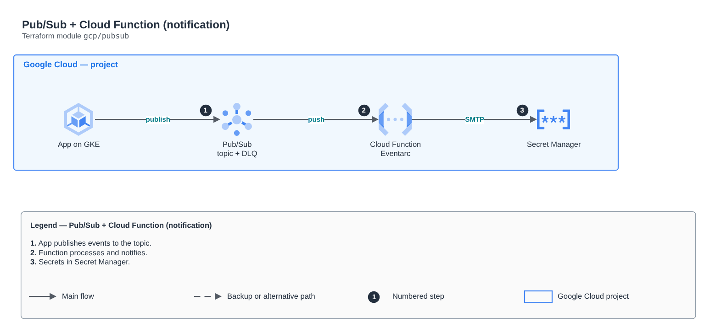

# Pub/Sub + Cloud Function (notification)

[Português](README.md) · **English**

> `gcp/pubsub` · category **integracao** · origin: Architecture case studies (2026)

> Designed in October 2026 and published now.

Pub/Sub with topic and DLQ and a Cloud Run function triggered by Eventarc that reads secrets from Secret Manager and sends notifications.

## Architecture



Editable source: [`diagram.drawio`](diagram.drawio) (open it in draw.io / diagrams.net), with Portuguese and English pages.

1. App publishes events to the topic.
2. Function processes and notifies.
3. Secrets in Secret Manager.

## Usage

```hcl
module "pubsub" {
  source = "git::https://github.com/raphaelfcs/automacao_terraform.git//gcp/pubsub?ref=v1.0.0"

  project_id          = "demo-plataforma-dev"
  project_number      = "123456789012"
  region              = local.region
  db_secret_id        = "projects/demo-plataforma-dev/secrets/db-password"
  function_source_dir = "${path.module}/../../src"
  smtp_user           = "notificacoes@example.com"
  smtp_password       = var.smtp_password
  mail_to             = "time@example.com"
  labels              = local.labels
}
```

## Examples

| Example | Files |
|---|---|
| [`basico`](examples/basico) | `main.tf`, `locals.tf`, `backend.tf` |

Each example has its own backend (state isolated per module and example). Different environments only use another `backend.tf`/`*.tfvars`, without duplicating code.

## Inputs

| Name | Type | Default | Required | Description |
|---|---|---|---|---|
| `project_id` | `string` | - | **yes** |  |
| `project_number` | `string` | - | **yes** |  |
| `region` | `string` | - | **yes** |  |
| `topic_name` | `string` | `"orders-created"` | no |  |
| `k8s_namespace` | `string` | `"lab"` | no | Namespace of the app that publishes to the topic. |
| `k8s_service_account` | `string` | `"orders-api"` | no | Kubernetes service account that publishes to the topic (Workload Identity). |
| `db_secret_id` | `string` | - | **yes** | Secret with the database password, read by the API through Workload Identity. |
| `function_name` | `string` | `"notify-order"` | no |  |
| `function_source_dir` | `string` | - | **yes** | Folder with the function code (main.py + requirements.txt). |
| `smtp_user` | `string` | - | **yes** | Gmail account that sends the e-mail. |
| `smtp_password` | `string` | - | **yes** | Gmail app password (kept in Secret Manager). |
| `mail_to` | `string` | - | **yes** | Confirmation recipient. |
| `labels` | `map(string)` | `{}` | no |  |

## Outputs

| Name | Description |
|---|---|
| `topic` |  |
| `function` |  |

## Files

- `iam.tf`: policies, roles and permissions
- `locals.tf`: derived values
- `main.tf`: main resources
- `outputs.tf`: outputs
- `variables.tf`: inputs and validations
- `versions.tf`: Terraform and provider versions
- `src/`: supporting files (code, templates or policies)
- `examples/`: ready-to-use compositions
- `tests/`: `terraform test` with mocked providers

## Well-Architected

- Reliability: dead-letter queues (DLQ), retries and event archiving.
- Security: resource policies restricted by source and message encryption.

## Tests

```bash
cd gcp/pubsub
terraform init -backend=false
terraform test
```
