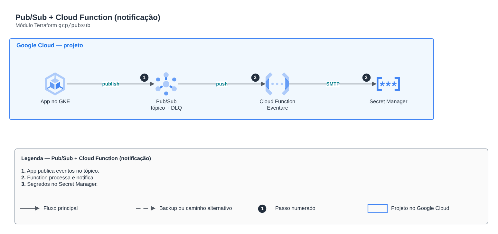

# Pub/Sub + Cloud Function (notificação)

**Português** · [English](README.en.md)

> `gcp/pubsub` · categoria **integracao** · origem: Estudos de caso de arquitetura (2026)

> Idealizado em outubro de 2026 e publicado agora.

Pub/Sub com tópico e DLQ e uma Cloud Run function acionada por Eventarc que lê segredos no Secret Manager e envia notificações.

## Arquitetura



Fonte editável: [`diagram.drawio`](diagram.drawio) (abra no draw.io / diagrams.net), com páginas em português e inglês.

1. App publica eventos no tópico.
2. Function processa e notifica.
3. Segredos no Secret Manager.

## Uso

```hcl
module "pubsub" {
  source = "git::https://github.com/raphaelfcs/automacao_terraform.git//gcp/pubsub?ref=v1.0.0"

  project_id          = "demo-plataforma-dev"
  project_number      = "123456789012"
  region              = local.region
  db_secret_id        = "projects/demo-plataforma-dev/secrets/db-password"
  function_source_dir = "${path.module}/../../src"
  smtp_user           = "notificacoes@example.com"
  smtp_password       = var.smtp_password
  mail_to             = "time@example.com"
  labels              = local.labels
}
```

## Exemplos

| Exemplo | Arquivos |
|---|---|
| [`basico`](examples/basico) | `main.tf`, `locals.tf`, `backend.tf` |

Cada exemplo tem seu próprio backend (state isolado por módulo e exemplo). Ambientes diferentes usam apenas outro `backend.tf`/`*.tfvars`, sem duplicar código.

## Entradas

| Nome | Tipo | Padrão | Obrigatória | Descrição |
|---|---|---|---|---|
| `project_id` | `string` | - | **sim** |  |
| `project_number` | `string` | - | **sim** |  |
| `region` | `string` | - | **sim** |  |
| `topic_name` | `string` | `"orders-created"` | não |  |
| `k8s_namespace` | `string` | `"lab"` | não | Namespace da aplicação que publica no tópico. |
| `k8s_service_account` | `string` | `"orders-api"` | não | Conta de serviço do Kubernetes que publica no tópico (Workload Identity). |
| `db_secret_id` | `string` | - | **sim** | Secret com a senha do banco, lido pela API via Workload Identity. |
| `function_name` | `string` | `"notify-order"` | não |  |
| `function_source_dir` | `string` | - | **sim** | Pasta com o código da função (main.py + requirements.txt). |
| `smtp_user` | `string` | - | **sim** | Conta Gmail que envia o e-mail. |
| `smtp_password` | `string` | - | **sim** | Senha de app do Gmail (fica no Secret Manager). |
| `mail_to` | `string` | - | **sim** | Destinatário da confirmação. |
| `labels` | `map(string)` | `{}` | não |  |

## Saídas

| Nome | Descrição |
|---|---|
| `topic` |  |
| `function` |  |

## Arquivos

- `iam.tf`: políticas, papéis e permissões
- `locals.tf`: valores derivados
- `main.tf`: recursos principais
- `outputs.tf`: saídas
- `variables.tf`: entradas e validações
- `versions.tf`: versões do Terraform e providers
- `src/`: arquivos auxiliares (código, templates ou políticas)
- `examples/`: composições prontas para uso
- `tests/`: `terraform test` com providers simulados

## Well-Architected

- Confiabilidade: filas de mensagens mortas (DLQ), retentativas e arquivamento de eventos.
- Segurança: políticas de recurso restritas por origem e cifragem das mensagens.

## Testes

```bash
cd gcp/pubsub
terraform init -backend=false
terraform test
```
