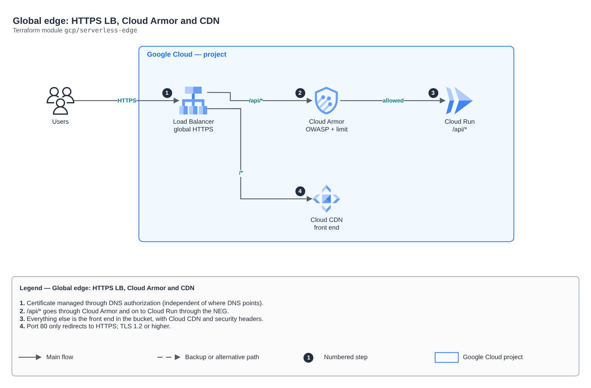

# Global edge: HTTPS LB, Cloud Armor and CDN

[Português](README.md) · **English**

> `gcp/serverless-edge` · category **borda** · origin: Health records platform (2026)

> Designed in November 2026 and published now.

Google Cloud global edge for a serverless app: external HTTPS Load Balancer (EXTERNAL_MANAGED) with a certificate managed through DNS authorization (works even with DNS pointing to another cloud, as in active-active), Cloud Armor on the API (preconfigured OWASP rules and per-IP limit), /api/* to Cloud Run through the serverless NEG and the rest to the front-end bucket with Cloud CDN.

## Architecture



Editable source: [`diagram.drawio`](diagram.drawio) (open it in draw.io / diagrams.net), with Portuguese and English pages.

1. Certificate managed through DNS authorization (independent of where DNS points).
2. /api/* goes through Cloud Armor and on to Cloud Run through the NEG.
3. Everything else is the front end in the bucket, with Cloud CDN and security headers.
4. Port 80 only redirects to HTTPS; TLS 1.2 or higher.

## Usage

```hcl
module "serverless_edge" {
  source = "git::https://github.com/raphaelfcs/automacao_terraform.git//gcp/serverless-edge?ref=v1.0.0"

  project_id        = local.project_id
  name              = "demo-dev"
  domain            = "app.example.com"
  serverless_neg_id = "projects/demo-plataforma-dev/regions/southamerica-east1/networkEndpointGroups/demo-dev-api-neg"
  web_bucket_name   = "demo-dev-web"
  allowed_countries = ["BR"]
}
```

## Examples

| Example | Files |
|---|---|
| [`app`](examples/app) | `main.tf`, `locals.tf`, `backend.tf` |

Each example has its own backend (state isolated per module and example). Different environments only use another `backend.tf`/`*.tfvars`, without duplicating code.

## Inputs

| Name | Type | Default | Required | Description |
|---|---|---|---|---|
| `project_id` | `string` | - | **yes** | GCP project. |
| `name` | `string` | - | **yes** | Prefix of the edge resources. |
| `domain` | `string` | - | **yes** | Published name (e.g. app.example.com). The certificate is issued through DNS authorization. |
| `serverless_neg_id` | `string` | - | **yes** | Serverless NEG of the API Cloud Run service (neg_id output of the cloud-run-service module). |
| `web_bucket_name` | `string` | - | **yes** | Bucket with the front-end build (objects readable by the Load Balancer). |
| `waf_rule_ids` | `list(string)` | `["sqli-v33-stable", "xss-v33-stable",...` | no | Cloud Armor preconfigured WAF rules (each one is billed as a rule). |
| `waf_sensitivity` | `number` | `1` | no | OWASP rule sensitivity (1 = fewer false positives, 4 = strictest). |
| `waf_preview` | `bool` | `false` | no | WAF rules only log, without blocking (first week in production). |
| `rate_limit_per_minute` | `number` | `300` | no | Requests per IP per minute before a 5-minute ban. |
| `allowed_countries` | `list(string)` | `[]` | no | ISO codes of countries allowed on the API (e.g. ["BR"]). Empty = no restriction. |
| `content_security_policy` | `string` | `"default-src 'self'; frame-ancestors ...` | no | CSP sent with the front end. It must allow the login domain and the upload buckets. |
| `log_sample_rate` | `number` | `1` | no | Fraction of API requests recorded in the LB log (0 to 1). |

## Outputs

| Name | Description |
|---|---|
| `ip_address` | Global Load Balancer IP (A record in DNS). |
| `dns_authorization_record` | CNAME record that authorizes the certificate: { name, type, data }. |
| `security_policy_id` | Cloud Armor policy. |

## Files

- `locals.tf`: derived values
- `main.tf`: main resources
- `outputs.tf`: outputs
- `variables.tf`: inputs and validations
- `versions.tf`: Terraform and provider versions
- `examples/`: ready-to-use compositions
- `tests/`: `terraform test` with mocked providers

## Well-Architected

- Security: private origin, WAF and modern TLS at the edge.
- Performance: edge caching and compression.

## Tests

```bash
cd gcp/serverless-edge
terraform init -backend=false
terraform test
```
