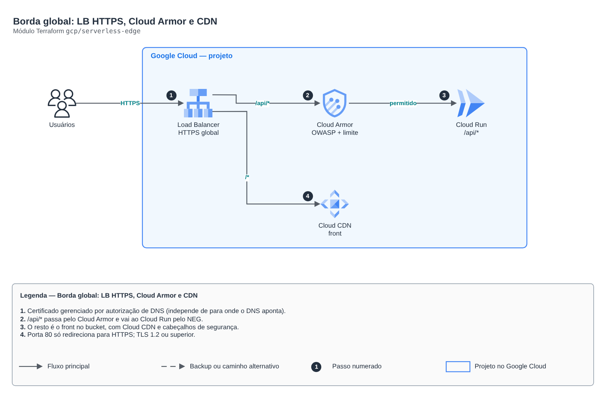

# Borda global: LB HTTPS, Cloud Armor e CDN

**Português** · [English](README.en.md)

> `gcp/serverless-edge` · categoria **borda** · origem: Plataforma de documentos de saúde (2026)

> Idealizado em novembro de 2026 e publicado agora.

Borda global do Google Cloud para app serverless: Load Balancer HTTPS externo (EXTERNAL_MANAGED) com certificado gerenciado por autorização de DNS (funciona mesmo com o DNS apontando para outra nuvem, como num ativo-ativo), Cloud Armor na API (regras OWASP pré-configuradas e limite por IP), /api/* no Cloud Run pelo NEG serverless e o resto no bucket do front com Cloud CDN.

## Arquitetura



Fonte editável: [`diagram.drawio`](diagram.drawio) (abra no draw.io / diagrams.net), com páginas em português e inglês.

1. Certificado gerenciado por autorização de DNS (independe de para onde o DNS aponta).
2. /api/* passa pelo Cloud Armor e vai ao Cloud Run pelo NEG.
3. O resto é o front no bucket, com Cloud CDN e cabeçalhos de segurança.
4. Porta 80 só redireciona para HTTPS; TLS 1.2 ou superior.

## Uso

```hcl
module "serverless_edge" {
  source = "git::https://github.com/raphaelfcs/automacao_terraform.git//gcp/serverless-edge?ref=v1.0.0"

  project_id        = local.project_id
  name              = "demo-dev"
  domain            = "app.example.com"
  serverless_neg_id = "projects/demo-plataforma-dev/regions/southamerica-east1/networkEndpointGroups/demo-dev-api-neg"
  web_bucket_name   = "demo-dev-web"
  allowed_countries = ["BR"]
}
```

## Exemplos

| Exemplo | Arquivos |
|---|---|
| [`app`](examples/app) | `main.tf`, `locals.tf`, `backend.tf` |

Cada exemplo tem seu próprio backend (state isolado por módulo e exemplo). Ambientes diferentes usam apenas outro `backend.tf`/`*.tfvars`, sem duplicar código.

## Entradas

| Nome | Tipo | Padrão | Obrigatória | Descrição |
|---|---|---|---|---|
| `project_id` | `string` | - | **sim** | Projeto do GCP. |
| `name` | `string` | - | **sim** | Prefixo dos recursos da borda. |
| `domain` | `string` | - | **sim** | Nome publicado (ex.: app.example.com). O certificado sai por autorização de DNS. |
| `serverless_neg_id` | `string` | - | **sim** | NEG serverless do Cloud Run da API (saída neg_id do módulo cloud-run-service). |
| `web_bucket_name` | `string` | - | **sim** | Bucket com o build do front (objetos legíveis pelo Load Balancer). |
| `waf_rule_ids` | `list(string)` | `["sqli-v33-stable", "xss-v33-stable",...` | não | Regras WAF pré-configuradas do Cloud Armor (cada uma cobra como regra). |
| `waf_sensitivity` | `number` | `1` | não | Sensibilidade das regras OWASP (1 = menos falso positivo, 4 = mais rígido). |
| `waf_preview` | `bool` | `false` | não | Regras WAF só registram, sem bloquear (primeira semana em produção). |
| `rate_limit_per_minute` | `number` | `300` | não | Requisições por IP por minuto antes do banimento de 5 minutos. |
| `allowed_countries` | `list(string)` | `[]` | não | Códigos ISO de países permitidos na API (ex.: ["BR"]). Vazio = sem restrição. |
| `content_security_policy` | `string` | `"default-src 'self'; frame-ancestors ...` | não | CSP enviada com o front. Precisa permitir o domínio do login e os buckets de upload. |
| `log_sample_rate` | `number` | `1` | não | Fração das requisições da API registradas no log do LB (0 a 1). |

## Saídas

| Nome | Descrição |
|---|---|
| `ip_address` | IP global do Load Balancer (registro A no DNS). |
| `dns_authorization_record` | Registro CNAME que autoriza o certificado: { name, type, data }. |
| `security_policy_id` | Política do Cloud Armor. |

## Arquivos

- `locals.tf`: valores derivados
- `main.tf`: recursos principais
- `outputs.tf`: saídas
- `variables.tf`: entradas e validações
- `versions.tf`: versões do Terraform e providers
- `examples/`: composições prontas para uso
- `tests/`: `terraform test` com providers simulados

## Well-Architected

- Segurança: origem privada, WAF e TLS moderno na borda.
- Performance: cache na borda e compressão.

## Testes

```bash
cd gcp/serverless-edge
terraform init -backend=false
terraform test
```
