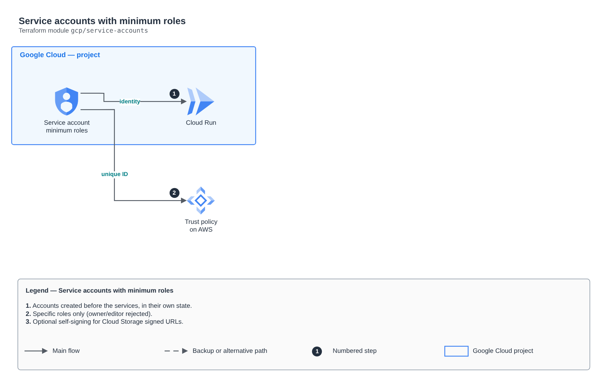

# Service accounts with minimum roles

[Português](README.md) · **English**

> `gcp/service-accounts` · category **seguranca** · origin: Health records platform (2026)

> Designed in November 2026 and published now.

Service accounts created outside the compute modules, so another state can reference them before the service exists (e.g. an AWS trust policy that needs the unique ID). Each account gets only the listed project roles and, optionally, permission to sign with its own identity.

## Architecture



Editable source: [`diagram.drawio`](diagram.drawio) (open it in draw.io / diagrams.net), with Portuguese and English pages.

1. Accounts created before the services, in their own state.
2. Specific roles only (owner/editor rejected).
3. Optional self-signing for Cloud Storage signed URLs.

## Usage

```hcl
module "service_accounts" {
  source = "git::https://github.com/raphaelfcs/automacao_terraform.git//gcp/service-accounts?ref=v1.0.0"

  project_id = local.project_id
  accounts = {
    demo-dev-api = { display_name = "API", project_roles = ["roles/datastore.user"], self_sign = true }
  }
}
```

## Examples

| Example | Files |
|---|---|
| [`api-e-eventos`](examples/api-e-eventos) | `main.tf`, `locals.tf`, `backend.tf` |

Each example has its own backend (state isolated per module and example). Different environments only use another `backend.tf`/`*.tfvars`, without duplicating code.

## Inputs

| Name | Type | Default | Required | Description |
|---|---|---|---|---|
| `project_id` | `string` | - | **yes** | GCP project. |
| `accounts` | `map(...)` | - | **yes** | Accounts: account_id -> { display_name, project_roles, self_sign }. |

## Outputs

| Name | Description |
|---|---|
| `emails` | Emails per account_id. |
| `unique_ids` | Unique IDs per account_id (AWS trust policy). |

## Files

- `locals.tf`: derived values
- `main.tf`: main resources
- `outputs.tf`: outputs
- `variables.tf`: inputs and validations
- `versions.tf`: Terraform and provider versions
- `examples/`: ready-to-use compositions
- `tests/`: `terraform test` with mocked providers

## Well-Architected

- Security: least privilege in policies, customer-managed key encryption and an audit trail.
- Operational excellence: everything declared in code, reviewed in PRs and tested with `terraform test`.

## Tests

```bash
cd gcp/service-accounts
terraform init -backend=false
terraform test
```
