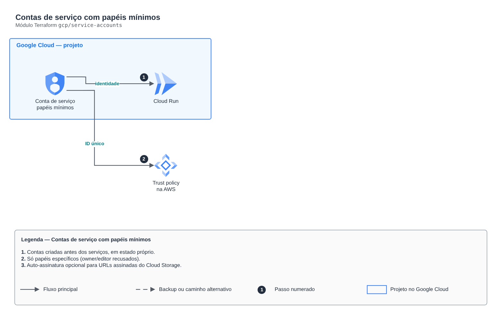

# Contas de serviço com papéis mínimos

**Português** · [English](README.en.md)

> `gcp/service-accounts` · categoria **seguranca** · origem: Plataforma de documentos de saúde (2026)

> Idealizado em novembro de 2026 e publicado agora.

Contas de serviço criadas fora dos módulos de computação, para outro estado poder referenciá-las antes de o serviço existir (ex.: trust policy da AWS que precisa do ID único). Cada conta recebe só os papéis de projeto listados e, opcionalmente, permissão de assinar com a própria identidade.

## Arquitetura



Fonte editável: [`diagram.drawio`](diagram.drawio) (abra no draw.io / diagrams.net), com páginas em português e inglês.

1. Contas criadas antes dos serviços, em estado próprio.
2. Só papéis específicos (owner/editor recusados).
3. Auto-assinatura opcional para URLs assinadas do Cloud Storage.

## Uso

```hcl
module "service_accounts" {
  source = "git::https://github.com/raphaelfcs/automacao_terraform.git//gcp/service-accounts?ref=v1.0.0"

  project_id = local.project_id
  accounts = {
    demo-dev-api = { display_name = "API", project_roles = ["roles/datastore.user"], self_sign = true }
  }
}
```

## Exemplos

| Exemplo | Arquivos |
|---|---|
| [`api-e-eventos`](examples/api-e-eventos) | `main.tf`, `locals.tf`, `backend.tf` |

Cada exemplo tem seu próprio backend (state isolado por módulo e exemplo). Ambientes diferentes usam apenas outro `backend.tf`/`*.tfvars`, sem duplicar código.

## Entradas

| Nome | Tipo | Padrão | Obrigatória | Descrição |
|---|---|---|---|---|
| `project_id` | `string` | - | **sim** | Projeto do GCP. |
| `accounts` | `map(...)` | - | **sim** | Contas: account_id -> { display_name, project_roles, self_sign }. |

## Saídas

| Nome | Descrição |
|---|---|
| `emails` | E-mails por account_id. |
| `unique_ids` | IDs únicos por account_id (trust policy da AWS). |

## Arquivos

- `locals.tf`: valores derivados
- `main.tf`: recursos principais
- `outputs.tf`: saídas
- `variables.tf`: entradas e validações
- `versions.tf`: versões do Terraform e providers
- `examples/`: composições prontas para uso
- `tests/`: `terraform test` com providers simulados

## Well-Architected

- Segurança: privilégio mínimo nas políticas, criptografia com chave gerenciada pelo cliente e trilha de auditoria.
- Excelência operacional: tudo declarado em código, revisado em PR e testado com `terraform test`.

## Testes

```bash
cd gcp/service-accounts
terraform init -backend=false
terraform test
```
